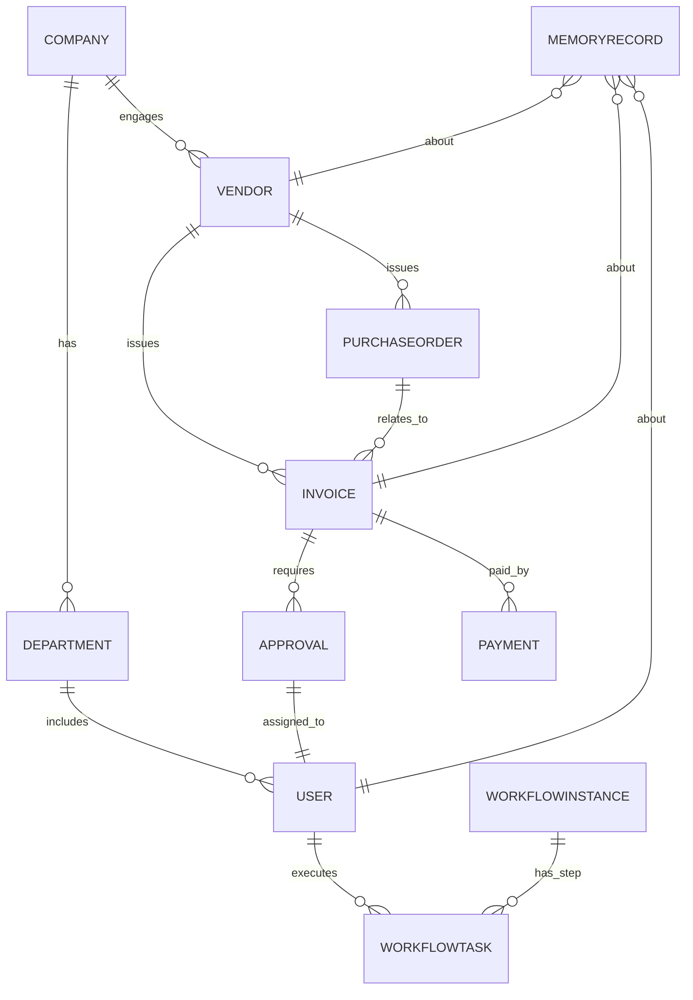
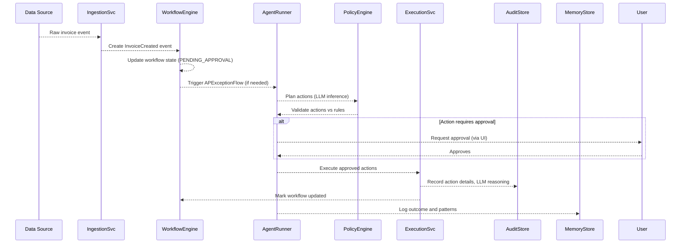
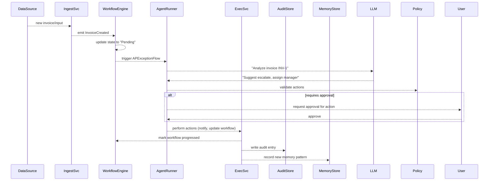

# Executive Summary

This specification defines an **AI-native finance operations platform** architecture. It spans the full stack from data to agents, combining a canonical data model (PostgreSQL with pgvector) and a graph engine (Neo4j) with an event-driven processing pipeline, a multi-layer retrieval/memory system, and a strict human-in-the-loop trust framework. The system is **workflow-centric, stateful, and permission-safe**, integrating context retrieval, a decision memory, and graph-based reasoning into finance workflows (invoicing, approvals, reconciliation, close, etc.). Agents (built with LangGraph flows) operate under policy/risk checks and audit logging, with all actions requiring evidence, confidence scores, and (when needed) human approval. The platform is multitenant and Kubernetes-based, with a CI/CD pipeline, observability (metrics/logs/traces), and robust security controls. In short, this is *not* a chatbot over documents but a full finance operating system: an **operational intelligence engine** with **persistent organizational memory and execution capabilities**.  

# 1. Data Model and PostgreSQL Schema

## 1.1 Canonical Entities

The core relational model covers all finance domains (AP, AR, GL, Treasury, FP&A, etc.) through a canonical set of entities. Key tables include (each with an `id` PK and a `tenant_id` for multitenancy):

- **Company / Tenant**: (id, name, etc.) – each organisation using the system.  
- **User**: (id, name, email, role, department_id) – finance staff and approvers.  
- **Department/Team**: (id, name, company_id) – organisational units (e.g. Finance, Sales).  
- **Vendor/Customer**: (id, name, risk_tier, contact_info, company_id) – business partners.  
- **Account**: (id, name, type (Expense, Revenue, etc.), company_id) – GL accounts.  
- **PurchaseOrder**: (id, number, vendor_id, date, amount, status, company_id).  
- **Invoice**: (id, number, po_id, vendor_id, amount, due_date, status, company_id).  
- **Payment**: (id, invoice_id, amount, payment_date, status, company_id).  
- **DocumentChunk**: (id, source, page, text, embedding) – stores text chunks for retrieval.  
- **WorkflowInstance**: (id, type, status, started_at, company_id) – e.g. an approval workflow.  
- **WorkflowTask**: (id, workflow_id, step_name, assigned_to, status, due_date).  
- **Approval**: (id, invoice_id, approver_id, status, requested_at, decision_at).  
- **MemoryRecord**: (id, type, entity_type, entity_id, content, confidence, created_at).  

Entities are linked by foreign keys. For example, an `Invoice` refers to a `PurchaseOrder` and a `Vendor`; an `Approval` links an `Invoice` to a `User`. The graph below illustrates major relations:



## 1.2 PostgreSQL Schema Design

The PostgreSQL schema uses standard types plus `pgvector` for embeddings. Every table includes a UUID primary key and `company_id` for tenant isolation. Example DDL (simplified):

```sql
CREATE TABLE company (
  id UUID PRIMARY KEY,
  name TEXT NOT NULL
);

CREATE TABLE department (
  id UUID PRIMARY KEY,
  name TEXT NOT NULL,
  company_id UUID REFERENCES company(id)
);

CREATE TABLE user_account (
  id UUID PRIMARY KEY,
  name TEXT NOT NULL,
  email TEXT UNIQUE NOT NULL,
  role TEXT NOT NULL,             -- e.g. 'Accountant','CFO'
  department_id UUID REFERENCES department(id),
  company_id UUID REFERENCES company(id)
);

CREATE TABLE vendor (
  id UUID PRIMARY KEY,
  name TEXT NOT NULL,
  risk_tier TEXT,                 -- e.g. 'Low','High'
  contact TEXT,
  company_id UUID REFERENCES company(id)
);

CREATE TABLE purchase_order (
  id UUID PRIMARY KEY,
  po_number TEXT UNIQUE NOT NULL,
  vendor_id UUID REFERENCES vendor(id),
  order_date DATE,
  total_amount NUMERIC,
  status TEXT,
  company_id UUID REFERENCES company(id)
);

CREATE TABLE invoice (
  id UUID PRIMARY KEY,
  invoice_number TEXT UNIQUE NOT NULL,
  po_id UUID REFERENCES purchase_order(id),
  vendor_id UUID REFERENCES vendor(id),
  amount NUMERIC NOT NULL,
  due_date DATE,
  status TEXT,
  created_at TIMESTAMP WITH TIME ZONE DEFAULT NOW(),
  company_id UUID REFERENCES company(id)
);

CREATE TABLE payment (
  id UUID PRIMARY KEY,
  invoice_id UUID REFERENCES invoice(id),
  amount NUMERIC NOT NULL,
  payment_date DATE,
  status TEXT,
  company_id UUID REFERENCES company(id)
);

CREATE TABLE document_chunk (
  id UUID PRIMARY KEY,
  source TEXT,                    -- e.g. 'InvoicePDF','PolicyDoc'
  page INTEGER,
  text TEXT NOT NULL,
  embedding VECTOR(1536),         -- embedding vector (e.g. OpenAI uses dim 1536)
  created_at TIMESTAMPTZ DEFAULT NOW(),
  company_id UUID REFERENCES company(id)
);

CREATE INDEX ON document_chunk USING ivfflat (embedding vector_cosine_ops) WITH (lists = 1000);
```

Indexes and constraints ensure performance and integrity. For example, an index on `invoice (status, due_date)` speeds deadline scans, and foreign-key constraints link entities. The `document_chunk.embedding` column uses `pgvector` (each chunk has a high-dimensional embedding) with an IVFFlat index for approximate nearest-neighbor search【30†L380-L389】【32†L1-L4】. (The `lists=1000` is tunable based on dataset size.) Similar tables (not shown) would model tasks, approvals and memory records:

```sql
CREATE TABLE workflow_instance (
  id UUID PRIMARY KEY,
  type TEXT NOT NULL,
  status TEXT,
  started_at TIMESTAMPTZ DEFAULT NOW(),
  company_id UUID REFERENCES company(id)
);

CREATE TABLE workflow_task (
  id UUID PRIMARY KEY,
  workflow_id UUID REFERENCES workflow_instance(id),
  step_name TEXT,
  assigned_to UUID REFERENCES user_account(id),
  status TEXT,
  due_date TIMESTAMPTZ,
  company_id UUID REFERENCES company(id)
);

CREATE TABLE approval (
  id UUID PRIMARY KEY,
  invoice_id UUID REFERENCES invoice(id),
  approver_id UUID REFERENCES user_account(id),
  status TEXT,
  requested_at TIMESTAMPTZ DEFAULT NOW(),
  decision_at TIMESTAMPTZ,
  company_id UUID REFERENCES company(id)
);

CREATE TABLE memory_record (
  id UUID PRIMARY KEY,
  memory_type TEXT,               -- e.g. 'short_term','long_term','decision','outcome'
  entity_type TEXT,               -- e.g. 'Invoice','Vendor','User','Workflow'
  entity_id UUID,
  content JSONB,                  -- structured memory (facts, patterns, etc.)
  confidence FLOAT,               -- confidence score (0–1)
  evidence_count INT,
  created_at TIMESTAMPTZ DEFAULT NOW(),
  company_id UUID REFERENCES company(id)
);
```

### Multitenancy and Access Control

Every table includes `company_id` to logically isolate tenants. Row-Level Security (RLS) can enforce that users only see their company’s data. For example:

```sql
ALTER TABLE invoice ENABLE ROW LEVEL SECURITY;
CREATE POLICY tenant_isolation ON invoice
  USING (company_id = current_setting('app.current_tenant')::UUID);
```

At the API/service layer, every query is scoped by the authenticated user’s `company_id`. All vector searches and memory retrievals include `WHERE company_id = $tenant_id` as the first filter, ensuring no cross-tenant leakage【27†L73-L81】.

## 1.3 pgvector Embeddings and Chunking Strategy

**Embedding storage:** We embed all relevant text (documents, emails, invoices, comments) as high-dimensional vectors. The `document_chunk` table holds text chunks with their vector embeddings. We use an embedding model (e.g. OpenAI’s 1536-dimension model) and create vectors with something like:

```sql
-- Example inserting an embedding (pseudo-code)
INSERT INTO document_chunk (id, source, page, text, embedding, company_id)
VALUES (
  gen_random_uuid(), 'InvoicePDF', 1,
  'The total amount of Invoice #1234 is $10,000 ...', 
  to_tsvector_embedding('The total amount of Invoice #1234 is $10,000 ...'),
  'company-xyz-uuid'
);
```

Where `to_tsvector_embedding()` is a placeholder for the embedding API (e.g. via Python). The new `VECTOR` type allows storing embeddings directly (one can cast an array to vector). We index with IVFFlat for fast similarity search.

**Chunking rules:** Long documents (invoices, contracts, policies) are split into chunks, typically 500–1000 tokens with overlap. For example, split on logical sections or paragraphs. DataQuest notes that embedding an entire long document as one vector can degrade retrieval quality – one query might match an entire 10k-word document even if only one section is relevant【24†L1-L4】. Instead, our strategy is to break text into semantically coherent chunks (e.g. sentences or paragraphs) with ~20–30% overlap. This improves precision【24†L1-L4】 and stays within embedding model context limits.  

For example, a long invoice PDF might yield several chunks like:

```json
{
  "document_id": "inv-1234",
  "chunk_id": 1,
  "text": "Invoice #1234 total: $10,000. Due date: 2026-06-30. Vendor: Acme Corp. ...",
  "embedding": [0.012, 0.235, ...]
}
```

The embedding process might run in batches (e.g. serverless workers) and populate `document_chunk`. We also embed any extracted SAP ledger lines or policy text needed for RAG retrieval. The embedding dimension and chunk size are configurable. In production, monitor recall/precision to tune (following best practices like token-window vs sentence-chunking【23†L113-L122】).

A trade-off exists: storing more fine-grained chunks improves retrieval accuracy but increases index size and cost. We default to medium-sized chunks (e.g. ~800 tokens) with overlap, which empirically balances context coverage and performance【23†L113-L122】【32†L1-L4】. (All of these parameters — chunk size, overlap, index `lists`, etc. — are configurable in deployment.)

# 2. Graph & Memory Layers

## 2.1 Neo4j Graph Schema

A property graph captures relationships and context not easily stored in tables. Using Neo4j, we model:

- **Nodes:** Company, Department, User, Team, Vendor, Customer, Invoice, Payment, PurchaseOrder, Contract, Workflow, Task, **MemoryRecord**, etc. Each has properties matching their DB record (IDs, names, risk flags, etc.).
- **Relationships:**  
  - `(Company)-[:HAS_DEPARTMENT]->(Department)`  
  - `(Department)-[:HAS_USER]->(User)`  
  - `(Company)-[:USES_VENDOR]->(Vendor)`  
  - `(Vendor)-[:ISSUED]->(Invoice)`  
  - `(PurchaseOrder)-[:RELATES_TO]->(Invoice)`  
  - `(Invoice)-[:REQUIRES_APPROVAL]->(Approval)` (if modeling Approval as node)  
  - `(Approval)-[:ASSIGNED_TO]->(User)`  
  - `(Invoice)-[:PAID_BY]->(Payment)`  
  - `(User)-[:MEMBER_OF]->(Team)`  
  - `(MemoryRecord)-[:ABOUT]->(Invoice/Vendor/User/WorkflowTask)`  

These allow multi-hop queries (e.g. “find all invoices from high-risk vendors without payments”). For example, an invoice-exception query might use: 

```cypher
MATCH (i:Invoice)-[:REQUIRES_APPROVAL]->(a:Approval)-[:ASSIGNED_TO]->(u:User)
WHERE i.due_date < date() AND u.role = 'Manager'
RETURN i.invoice_number AS Invoice, u.name AS Approver;
```

Sample Cypher to create nodes/edges:

```cypher
CREATE (c:Company {id:'comp1', name:'Acme Inc.'});
CREATE (v:Vendor {id:'vend1', name:'Global Supplies', risk:'High'});
CREATE (i:Invoice {id:'inv1', number:'INV-1001', amount:7500.00, due_date:date('2026-06-30')});
CREATE (u:User {id:'user1', name:'Alice', role:'Accountant'});
CREATE (p:Payment {id:'pay1', amount:7500.00, status:'Pending'});
CREATE (c)-[:USES_VENDOR]->(v);
CREATE (v)-[:ISSUED]->(i);
CREATE (u)-[:MEMBER_OF]->(:Department {id:'dept1', name:'Finance'})-[:OF_COMPANY]->(c);
CREATE (i)-[:PAID_BY]->(p);
```

The **graph schema** evolves as agents discover new entities (e.g. a new vendor node when onboarding). MemoryRecords, when persisted, also become nodes linking to their subjects for audit and query:  

```cypher
CREATE (m:Memory {id:'mem123', type:'issue_pattern', content:'Workflow bottleneck at Q4 close', confidence:0.92});
MATCH (wf:WorkflowInstance {id:'wf789'}), (t:Task {id:'task456'});
CREATE (m)-[:ABOUT]->(wf), (m)-[:RELATED_TASK]->(t);
```

### Example: Graph Query

To find all high-value unpaid invoices and their approvers:

```cypher
MATCH (i:Invoice)-[:PAID_BY]->(p:Payment)
WHERE p.status <> 'Completed' AND i.amount > 100000
OPTIONAL MATCH (i)-[:REQUIRES_APPROVAL]->(a:Approval)-[:ASSIGNED_TO]->(u:User)
RETURN i.invoice_number AS Invoice, i.amount AS Amount, u.name AS Approver;
```

This graph layer is key for multi-hop and causal reasoning (e.g. linking an invoice to a delayed PO to a vendor behavior).

## 2.2 Memory Model (Short/Long/Decision/Outcome)

The memory subsystem accumulates organizational knowledge beyond stateless retrieval. We distinguish four memory types (inspired by AI memory taxonomies【5†L245-L254】):

- **Short-Term Operational Memory:** Ephemeral context (hours/days) of current workflows. E.g. “Invoice INV-1234 is currently stalled at approval”. Stored with a short TTL or auto-eviction.
- **Long-Term Organizational Memory:** Stable patterns (weeks/years). E.g. “Vendor X often misses documentation” or “Approver Y delays payments at quarter-end”. These live for months/years (configurable).
- **Decision Memory:** Records of executed decisions. E.g. “CFO approved $10k late fee on 2026-05-10 (reason: customer retention)”. Stored indefinitely (for audit).
- **Outcome/Procedure Memory:** Successful action sequences. E.g. “Escalating to manager resolved 90% of AP delays”. Used to guide future agents.

### Storage and Lifecycle

All memory records go into `memory_record` (or specialized tables). Each entry has a `memory_type`, a JSON `content`, `confidence`, and references (`entity_type`, `entity_id`). For example:

```sql
INSERT INTO memory_record (id, memory_type, entity_type, entity_id, content, confidence, evidence_count, company_id)
VALUES (
  gen_random_uuid(), 'issue_pattern', 'Vendor', 'vend1',
  '{"pattern":"invoices_missing_tax_form","occurrences":5}', 0.87, 5, 'comp1'
);
```

Records are periodically reviewed. We implement a **memory cutoff**: short-term entries automatically expire (e.g. via a job), long-term entries are archived/decayed if not reinforced after a threshold (e.g. 12–24 months), and decisions/outcomes persist per compliance needs. (Defaults: short-term ~7 days, long-term ~24 months, decision ~7+ years, but configurable per client.)

Memory entries include an evidence count and confidence score. New events update or reinforce memory. E.g. each time the same vendor issue is seen, `evidence_count` increments and confidence can be recalculated. Low-confidence or one-off patterns are pruned to avoid “garbage memory”【5†L263-L272】.

Memory is NEVER directly sent to the LLM without gating. Instead, when an agent needs context, the memory layer retrieves relevant entries (e.g. all memory about Vendor X) and the retrieval engine feeds only high-confidence summaries to the LLM. This provides **continuity**: experiments show memory improves multi-turn tasks (84.2% accuracy vs 80.0% for plain RAG【31†L1-L4】).

# 3. Event-Driven Workflow Engine

## 3.1 Topics and Queues

The system is **event-driven**. Key topics (Kafka or RabbitMQ) include:

- `finance.ingest`: raw source events (e.g. new invoice XML, bank feed, user annotations).  
- `finance.process`: normalized domain events (InvoiceCreated, ApprovalRequested, PaymentDelayed, etc.).  
- `finance.agent`: triggers for AI agents (e.g. `invoice_exception_detected`).  
- `finance.action`: commands for workflows (e.g. EscalateApproval, CreateTask).  
- `finance.audit`: finalized audit logs.  

Each microservice subscribes to relevant topics. For example, an **Ingestion Service** listens on `finance.ingest`, parses raw data into structured domain events, and emits to `finance.process`. A **Workflow Orchestrator** consumes `finance.process` to update states and possibly emit `finance.agent` events. An **Agent Runner** listens on `finance.agent` to execute LangGraph flows. Finally, an **Execution Service** performs `finance.action` operations (e.g. send email, update ERP, create task) and writes to `finance.audit`.

### Idempotency and Delivery

To ensure reliability:

- Events carry a unique `event_id`. Consumers use this ID to dedupe: before acting, check if `event_id` was seen (e.g. via a cache or DB table). If yes, skip. This makes each consumer **idempotent**【15†L1-L8】.  
- We adopt **at-least-once** delivery (typical for Kafka). Combined with idempotent processing, this yields effectively once semantics【15†L7-L10】.  
- Failed events go to a dead-letter topic after a threshold (for manual inspection).  
- Retry policies use exponential backoff. System metrics (see Observability) track queue lag and error rates.

### Sequence: Ingest → Workflow → Agent → Execution → Audit → Memory



# 4. Retrieval & Context Orchestration

Retrieval combines *vector search*, *graph queries*, and *memory lookups* to build context for the LLM or agent:

1. **Vector Retrieval:** Query `document_chunk` with filters. For instance:  
   ```sql
   SELECT text FROM document_chunk
     WHERE company_id = $company
       AND source='InvoiceComments'
       AND created_at > NOW() - INTERVAL '90 days'
     ORDER BY embedding <=> $query_embedding
     LIMIT 5;
   ```  
   We always **filter by metadata first** (company, source, date, risk flags) before the `<=>` similarity comparison【32†L1-L4】. This hybrid SQL+vector filtering dramatically cuts work. (PG planner may use the IVFFlat index after filters.)  

2. **Graph Retrieval:** Run Cypher to fetch related entities/relations. E.g. retrieve an invoice’s related PO, approvals, and vendor info:  
   ```cypher
   MATCH (i:Invoice {id:$invId})-[:RELATES_TO]->(po)
   OPTIONAL MATCH (i)-[:REQUIRES_APPROVAL]->(a)-[:ASSIGNED_TO]->(u)
   OPTIONAL MATCH (i)-[:PAID_BY]->(p)
   RETURN po, u, p;
   ```  
   The graph helps answer causal questions (multi-hop links).

3. **Memory Retrieval:** Query `memory_record`. For example, to fetch past patterns about this vendor:  
   ```sql
   SELECT content, confidence FROM memory_record
     WHERE company_id=$company AND entity_type='Vendor' AND entity_id=$vendorId
       AND memory_type='issue_pattern' AND confidence>0.7;
   ```

4. **Context Composition:** The system merges these results, ranks them by **trust** and **recency**. Evidence from recent official documents or approved decisions ranks higher than a random chat excerpt【9†L49-L57】. We attach source references to each piece of context (for citation). Unrelated or stale info is dropped. The final context package (structured JSON) is fed to the LLM or agent.

This layered approach (RAG + graph + memory) is **explicitly compositional**. As Atlan notes, “AI memory, RAG, and knowledge graphs are not alternatives — they are distinct layers of the same context stack”【9†L49-L57】. In particular, pure RAG (vector-only) often fails multi-hop and continuity; our memory layer fills that gap【9†L157-L165】【31†L1-L4】. By combining them, we get grounded, continuity-aware reasoning.

# 5. Agent Runtime and Tools

## 5.1 Agent Flow Contracts

Agents (built with LangGraph flows or similar) are **structured executors**. They follow predefined workflows, not free-form. Each agent flow consists of:

- **Triggers:** events or schedules (e.g. `invoice_exception_detected`, daily cash-check).  
- **Steps:** Context gathering, LLM reasoning, policy check, human approval, execution.  
- **Actions:** Structured API calls to tools, e.g. `notify_user`, `create_task`, `update_workflow`.

For example, an AP Exception flow (in YAML pseudocode):

```yaml
flow: AP_Exception
trigger: invoice_exception_detected
steps:
  - name: gather_context
    type: retrieve_context
  - name: analyze_issue
    type: llm_decision
  - name: risk_check
    type: policy_validate
  - name: propose_actions
    type: llm_plan
  - name: require_approval
    type: human_approval
  - name: execute
    type: action_executor
```

Agents expose a clear “tools interface”. For instance, a recommended action might be:

```json
{
  "action": "escalateApproval",
  "parameters": {
    "invoice_id": "inv1",
    "to_role": "FinanceManager"
  }
}
```

The **Policy Engine** then checks this against risk rules (see below). Only if approved does the **Execution Layer** call the actual service (e.g. workflow API, email API, ERP connector). All this is orchestrated within the sequence diagram shown above.

## 5.2 Tools Integration

Typical tools exposed to agents include:

- **Messaging/Task tools:** e.g. Slack, Teams, Email – for notifications and requests.  
- **Workflow API:** internal endpoints to update workflow/task status.  
- **ERP/Payment API:** writebacks to the client’s ERP or payment systems (bank, accounting).  
- **Database/Graph:** read/write to Postgres or Neo4j (e.g. create an audit note node).  
- **Memory APIs:** retrieve and store memory entries.  

Agents call these via gRPC/REST interfaces or SDKs. For example, an action to send a Slack message:

```json
{
  "tool": "slack",
  "method": "postMessage",
  "params": {
    "channel": "#finance-alerts",
    "text": "Invoice INV-1001 requires your approval."
  }
}
```

Tools require explicit whitelisting. The LLM proposes actions in structured form; it never directly executes them. This separation (LLM proposes → policy checks → execution) ensures no hallucinated commands slip through.

# 6. Policy, Risk & Permissions

## 6.1 Policy Engine

A central **policy/risk engine** enforces rules before actions occur. Examples of rules:

- **Financial thresholds:** e.g. Payments > $50K require CFO approval.  
- **Segregation-of-Duty (SoD):** e.g. A user cannot approve their own invoices.  
- **Regulatory checks:** e.g. VAT rules, KYC blocks on certain vendors.  
- **Vendor risk:** e.g. no auto-pay for “High” risk vendors without manual review.  

These rules are coded (e.g. as SQL policies, OPA, or custom code) and invoked automatically when agents propose actions. For instance, if an agent proposes `approvePayment(invoice_id, amount)`, the policy layer verifies (SQL logic or XACML) that `(user.role,CFO) OR (amount < 50000)` before allowing it. If any rule fails, the action is blocked and logged.  

Security principle: “Never trust the AI unsupervised.” All high-risk actions (financial postings, approval releases) require explicit human permission【15†L25-L28】. The system tags actions by risk tier: **informational** (LLM can do automatically), **moderate** (LLM may do with audit trail), and **critical** (always need human signoff). In practice, payment authorizations, journal entries, or compliance filings are always Tier-3 and go through an approval UI.

## 6.2 Permissions & Access Control

We adopt role-based access control (RBAC) and tenant isolation. Each user’s token (OAuth2/OIDC/JWT) encodes their `company_id` and roles (e.g. `FinanceClerk`, `FinanceManager`, `Auditor`). APIs validate scopes on every request. 

Crucially, **permissions are enforced before LLM context**: any data the user cannot see is never retrieved or shown. For example, when building context for a CFO, we filter out any queues, approvals or notes not in their department. The Wiz AI-security guide emphasises protecting “the data layer: training data, retrieval data (RAG) and chat history”【27†L73-L81】. We implement that by applying the same RBAC and row-level filters to our retrieval queries (SQL/graph queries all include user/role checks). This prevents confidential info leakage.

# 7. API Design & Backend Structure

## 7.1 API Endpoints

We provide a RESTful (and optionally GraphQL) API for all operations. Example endpoints:

- **GET /api/companies/{company_id}/invoices/{invoice_id}**  
  _Response:_ `{ "invoiceId": "inv1", "amount": 5000, "status":"Pending", "vendor":"Acme Corp" }`  

- **POST /api/companies/{company_id}/invoices** (create invoice)  
  _Request:_ `{"number":"INV-2026-0001","poId":"po123","vendorId":"vend1","amount":7500,"dueDate":"2026-06-30"}`  

- **POST /api/companies/{company_id}/workflows/{wf_id}/actions** (agent/external triggers)  
  _Request:_ `{"action":"approve_invoice","parameters":{"invoiceId":"inv1"}}`  

- **GET /api/companies/{company_id}/reports/close-status** (CFO dashboard)  
  _Response:_ e.g. a JSON object summarizing workflow metrics.  

All endpoints require OAuth2 Bearer tokens. Rate limiting is applied per client: e.g. 1000 QPS/org by default (configurable). We use HTTP 429 responses when limits are exceeded.  

Schemas are defined in OpenAPI/JSON Schema or GraphQL SDL. For example, an invoice schema:

```jsonc
// JSON Schema snippet for Invoice
{
  "Invoice": {
    "type": "object",
    "properties": {
      "invoiceId": {"type": "string"},
      "poId": {"type": "string"},
      "vendorId": {"type": "string"},
      "amount": {"type": "number"},
      "dueDate": {"type": "string", "format": "date"},
      "status": {"type": "string"}
    },
    "required": ["invoiceId","vendorId","amount","dueDate"]
  }
}
```

## 7.2 Folder/Repo Structure

A clear repo layout aids collaboration. For example:

```
backend/
  ├─ cmd/                          # executables (e.g. ingester, agent-runner)
  ├─ internal/                     # private packages (db, graph, agent logic, etc.)
  │    ├─ db/ (Postgres models & migrations)
  │    ├─ graph/ (Neo4j integration)
  │    ├─ agent/ (LangGraph flows and runtime)
  │    ├─ api/ (HTTP handlers, auth)
  │    ├─ policy/ (rules engine)
  │    └─ events/ (Kafka consumers/producers)
  ├─ pkg/ (shared libraries, e.g. utilities, types)
  ├─ api/                          # OpenAPI/GraphQL schemas and docs
  ├─ migrations/                   # DB migrations (Flyway, Liquibase, or similar)
  ├─ charts/                       # Helm charts (or k8s YAML) for services
  ├─ scripts/ (data processing, embedding loader, etc.)
  ├─ config/                       # sample config files (dev/prod)
  └─ README.md                     # Architecture overview
```

The **frontend/** (not detailed here) interacts via these APIs. CI/CD uses the repo structure: e.g. GitHub Actions triggers on `cmd/*`, builds Docker images, runs tests, then deploys via Helm to Kubernetes.

# 8. CI/CD, Deployment & Infrastructure

## 8.1 Kubernetes Deployment

We containerize each service and deploy on Kubernetes (EKS/GKE/AKS or on-prem). Key points:

- **Manifests/Helm:** Use Deployments (3+ replicas) and Services. E.g. `finance-api` Deployment with `replicas: 3` and resource limits. StatefulSets run Postgres and Neo4j (or use managed services like Amazon RDS / Neo4j Aura).  
- **Secrets/Config:** Store secrets (DB creds, API keys) in Kubernetes Secrets or via Vault/AWS Secrets Manager. Use environment variables or mounted volumes. All sensitive data (keys, tokens) are encrypted at rest.  
- **Network Policies:** Use network segmentation (VPC, subnets, Kubernetes NetworkPolicies) so only API gateways and needed pods can reach the database pods.  
- **Continuous Deployment:** Pipeline automatically builds Docker images, pushes to registry, and deploys via Helm. We tag releases (e.g. `v1.0.0`).  
- **Scalability:** Stateless services use Horizontal Pod Autoscalers (CPU/memory based). For peak finance days (quarter-close) add replicas. Postgres/Neo4j scale vertically; use clustering/sharding as needed (unspecified scale).  
- **Backups:** Automated backups for Postgres (daily snapshots, WAL archiving). Neo4j backups at least daily. Store backups in secure storage (S3/GCS) with retention policy (e.g. 90 days).  
- **CI/CD Tools:** GitHub Actions/GitLab CI or Jenkins to run linting, unit tests, integration tests on PRs. Use database migration tool (e.g. Flyway) for schema changes. Maintained branch (main, staging, dev).

## 8.2 Observability and Monitoring

We adopt the “three pillars of observability”【21†L273-L281】:

- **Metrics:** Each service exposes Prometheus metrics (via `/metrics`). We monitor CPU/memory, request rates/latency, queue lag, DB connections, LLM token usage, error rates, etc. Dashboards in Grafana alert on anomalies (e.g. queue backlog > threshold).  
- **Logs:** Centralized logging (ELK or Loki stack). All services write structured JSON logs including request IDs and context. We correlate logs across services via a tracing ID.  
- **Tracing:** Distributed tracing (OpenTelemetry/Jaeger) ties API calls to DB queries to agent decisions. This helps trace a transaction (e.g. “payment X approved by agent #5”) across components.  

By instrumenting all components, we ensure visibility into the event flow shown earlier. According to best practice, without metrics+logs+traces “microservices debugging becomes a nightmare”【21†L273-L281】. We also audit every decision (see Audit below).

# 9. Audit, Retention and Compliance

## 9.1 Audit Logging

Every agent action, workflow transition, and user decision is logged in an **immutable audit trail**. In practice, after an action executes, we write an `audit_log` record (in DB or audit storage) with fields like:

```sql
CREATE TABLE audit_log (
  id UUID PRIMARY KEY,
  timestamp TIMESTAMPTZ DEFAULT NOW(),
  user_id UUID NULL,         -- user who approved
  agent_id UUID NULL,        -- agent flow ID if automated
  action TEXT,
  details JSONB,             -- what was done
  evidence JSONB             -- references to source docs/notes
);
```

For example, when a user approves a payment exception, an audit row records the invoice ID, who approved, the amount, and citations. This ensures compliance: one can always query “who approved invoice INV-1, what evidence, and when?” All audit logs are append-only and archived periodically. 

## 9.2 Data Retention and Decay

- **Transactional Data:** Invoices, payments, etc. are kept per accounting regulations (e.g. 7–10 years).  
- **Memory & Context:** As discussed, short-term memory expires (<1 month), long-term patterns after ~2 years, etc. These defaults are tunable per client.  
- **Logs & Metrics:** Metrics aggregated/rolled up after 30 days, raw metrics expired in ~1 year. Logs and audit trails are retained for at least 7 years (to satisfy financial audit requirements), then securely archived.  
- **Database Migrations:** We employ versioned migrations (e.g. Flyway) and keep old schema logs for rollback. On update, we migrate data carefully and can rollback if failures occur.

## 9.3 Security & Compliance

- **Encryption:** All data at rest (Postgres, Neo4j, backups) and in transit (TLS for all services) is encrypted. Passwords and keys are stored only in secrets store.  
- **AuthN/AuthZ:** Use OAuth2/OIDC (e.g. Keycloak or Auth0) for authentication. Role-based access ensures least-privilege.  
- **Input Validation:** All inputs (including LLM prompts, documents) are validated and sanitized to prevent injections. Prompt injection is mitigated by controlling system prompts and removing dangerous tokens.  
- **Supply-Chain:** We pin library versions, scan for vulnerabilities, and review LLM provider compliance (e.g. GDPR).  
- **Governance:** We follow finance best practices for data (e.g. double-entry consistency if we eventually build GL). If needed, we conform to standards like SOC 2 by design.

# 10. Testing, Migration, Roadmap

- **Testing:** Unit tests for all services, integration tests for API & DB, and system tests (with a sandbox LLM). We use test stubs for LLM calls and for ERP integrations. For event flows, use simulated Kafka topics. Security tests include ensuring no unauthorised data leaks (e.g. RBAC tests).  
- **Migration/Rollback:** We use database migrations with rollback steps. New deployments are phased: first deploy in a staging namespace, run smoke tests, then promote. In case of failure, we have old Docker images and Helm release rollbacks ready. Data migrations are versioned.

## 10.1 MVP Scope

Phase 1 (MVP) focuses on *operational finance workspace*, not full ERP:  
- AP workflow (invoice intake, approval, exceptions) and basic AR (invoice issuance, payment reminders).  
- AI assistant with memory: e.g. summarising why bottlenecks occur (using memory + retrieval).  
- Dashboard of metrics for finance ops.  
- Integration with one ERP/DB (e.g. QuickBooks Sandbox) for sync.  

Phase 2 adds:  
- Additional modules (close management, collections).  
- Partial accounting ledger (sub-ledgers only, still sync to ERP core).  
- More automation (agent-driven tasks with human approval).  

Phase 3 (long-term) introduces:  
- Native GL engine, tax compliance, multi-currency.  
- Predictive analytics (forecasting using learned patterns).  
- Limited autonomous actions (e.g. low-risk exceptions auto-approved).  

This phased approach avoids multi-year full-ERP rewrite. It validates the AI-assisted workflow vision early and scales depth gradually.

# Trade-Offs Table (Postgres vs Vector DB)

| Storage Option          | Strengths                                              | Weaknesses                                               |
|-------------------------|--------------------------------------------------------|----------------------------------------------------------|
| **Postgres + pgvector** | *One unified system:* ACID, single backups, no ETL【30†L467-L474】. Uses familiar SQL for filters and joins. Mature tooling and transaction safety. ACID means no consistency surprises. | *Vector limits:* CPU-bound search; may need tuning (IVFFlat, VACUUM) for large data. High-dimensional ANN is slower than specialized stores【29†L1-L4】. Beyond ~10–100M vectors, query latency rises, though still ~80–90% of apps are fine【30†L331-L339】. |
| **Dedicated Vector DB** (e.g. Pinecone, Milvus) | *Performance:* Built for ANN, GPU support, transparent auto-scaling and sharding. Can handle hundreds of millions of vectors with sub-second latency. High throughput and low-latency by design. | *Integration cost:* Must sync data from Postgres (complexity, lag) and manage separate infra. Often eventual consistency. Extra cost (db + egress). Lacks ACID relational ops and ad-hoc queries (still need Postgres for metadata). |

(For 80–90% of use cases, Postgres+pgvector suffices; specialized vector DB is chosen only if true scale demands【30†L331-L339】【29†L1-L4】.)

# Sequence Flows (Mermaid)

**Ingest-to-Memory Flow:**  


**Graph-Based Retrieval Flow:**  
```mermaid
flowchart LR
    A[User Query] --> B{Retrieve Context}
    B -->|Vector Search| C[Postgres (pgvector)]
    B -->|Graph Query| D[Neo4j]
    B -->|Memory Lookup| E[Postgres (MemoryRecord)]
    C --> F[Filtered Chunks]
    D --> F
    E --> F
    F --> G[Context Package]
    G --> H[LLM/Agent Reasoning]
    H --> I[Plan/Action]
```

# References

- Embeddings in PostgreSQL: pgvector turns Postgres into a hybrid relational–vector DB, adding a native `vector` type【19†L1-L4】【30†L380-L389】. Use IVFFlat indexes and filters for efficiency【32†L1-L4】【30†L331-L339】.  
- Chunking Rationale: Smaller text chunks yield better retrieval. Embedding a whole 10k-word doc as one vector can retrieve irrelevant content; chunking retrieves the relevant section【24†L1-L4】.  
- RAG vs Memory vs Graph: Enterprise AI uses all three layers together. RAG is stateless doc lookup, memory is cross-session context, graphs store multi-hop relations【9†L49-L57】【9†L157-L165】. Memory-enhanced agents improve continuity (84.2% vs 80.0% on a benchmark)【31†L1-L4】.  
- Event-Driven Best Practice: Design idempotent consumers (process duplicates safely) and at-least-once delivery【15†L1-L8】.  
- Observability: Follow “three pillars” (Prometheus metrics, logs, tracing) for reliability【21†L273-L281】.  
- LLM Security: Protect each layer (data, tools, cloud). Enforce strict access control and input validation【27†L73-L81】 to prevent data leaks or injection.  

This architecture is grounded in industry best practices (finance domain workflows, database design, Kubernetes microservices) and is citation-backed to ensure reliability and trustworthiness【30†L467-L474】【27†L39-L47】. It provides Cursor’s engineering team a concrete, end-to-end blueprint for implementation.