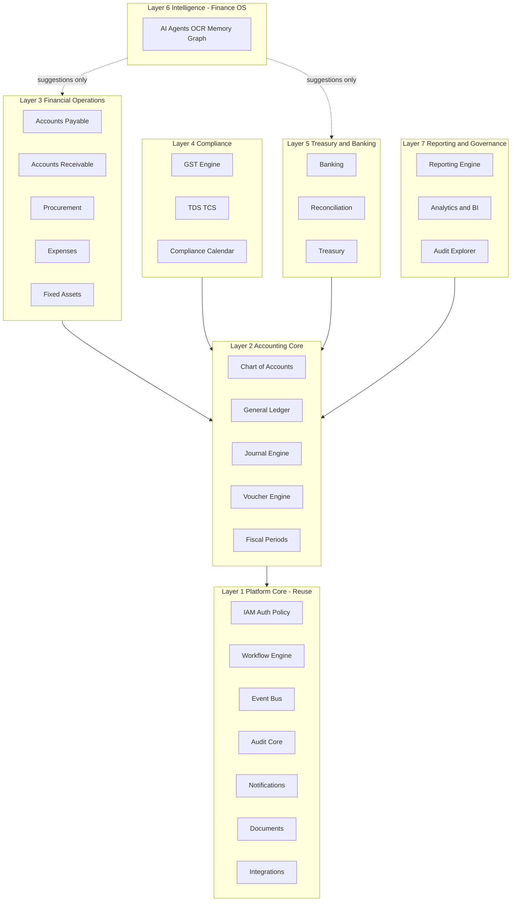
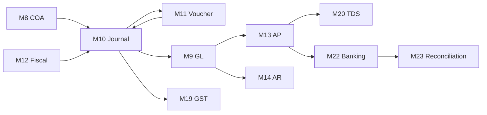

# AI-Native Finance ERP — Master Module Map & Engineering Blueprint

**Status:** Active blueprint — modules implemented per explicit instruction  
**Version:** 1.1  
**Last updated:** 2026-05-23  

**Related documents:**
- Platform architecture: [`../Readme_Architecture.md`](../Readme_Architecture.md)
- Existing backend (Finance OS): [`BACKEND_ARCHITECTURE.md`](BACKEND_ARCHITECTURE.md)
- UI integration guide: [`../backend_documentation.md`](../backend_documentation.md)
- API contracts (v1): [`pkg/contracts/api_contracts.md`](pkg/contracts/api_contracts.md)

---

## Document Purpose

This file is the **single master blueprint** for building ERP inside the existing Finance OS backend monorepo. It defines:

| Use | Description |
|-----|-------------|
| **Engineering blueprint** | Domain boundaries, dependencies, accounting rules |
| **Implementation order** | Phased delivery (Phase 1 → 5) |
| **Service ownership** | What is new ERP vs what is reused from Finance OS |
| **Event boundaries** | ERP facts vs Finance OS intelligence events |
| **Workflow ownership** | Which workflows are ERP-scoped vs shared engine |
| **Extension template** | Per-module sections will be added later (APIs, payloads, UI contracts) |

**How we will work going forward:**

1. You specify **which module** to implement and any extra detail.
2. We extend **this document** (or a linked `ERP_MODULES/<module>.md`) with that module’s API payloads, responses, DB tables, events, workflows, and UI notes.
3. Only then do we write migrations, services, routes, and tests.

**Do not build randomly.** ERP complexity comes from hidden dependencies, finance law, posting chains, compliance, and workflow interactions. This map exists to prevent inconsistent accounting logic, duplicated workflows, broken posting chains, and architecture chaos.

---

## Critical Integration Model

### ERP is NOT a standalone backend

ERP is a **new bounded domain** inside the existing modular monolith at `backend/apps/api/`.

```
backend/apps/api/app/
  api/routes/erp/           ← NEW: /api/v1/erp/*
  schemas/erp/              ← NEW: Pydantic models per subdomain
  services/erp/             ← NEW: deterministic financial truth logic
  services/repositories/    ← EXTEND: Erp*Repository classes (or services/erp/repositories/)
backend/migrations/         ← NEW: 009+ erp_*.sql with RLS
pkg/contracts/              ← EXTEND: ERP event types in contracts
internal/erp/               ← NEW (optional): domain boundary READMEs
```

### What we REUSE (do not duplicate)

| Capability | Existing location | ERP usage |
|------------|-------------------|-----------|
| Auth / JWT / OIDC | `auth.py`, `jwt_auth.py`, `oidc_service.py`, `middleware.py` | All `/api/v1/erp/*` routes |
| Request context | `deps.py`, `request_context.py` | `org_id`, `user_id`, `roles` |
| Policy / ABAC | `policy_service.py`, `object_context.py` | Every mutation, approvals |
| Workflows | `workflows.py`, `workflows_repo`, idempotency | AP/payment/journal/GST/recon approvals |
| Event bus | `event_bus.py`, `event_queue.py`, `event_topology.py` | ERP emits facts; OS emits intelligence |
| Audit | `audit_repo`, `audit.py` | Every financial mutation |
| AI / agents | `langgraph_runner.py`, `agents.py` | Recommend only — **never post ledgers** |
| Retrieval / memory / graph | `retrieval_*`, `memory_*`, `neo4j_service.py` | Intelligence layer |
| Observability | `otel.py`, `metrics.py`, `trace_span`, `logger.py` | All ERP operations |
| Rate limiting | `middleware.py`, `rate_limiter.py` | Same as v1 API |
| RLS / tenancy | `db.py`, `set_rls_org()`, migrations `006_*` | All `erp.*` tables with `org_id` |

### What we DO NOT do

- Create a separate ERP app or duplicate auth/queues/workflows/audit
- Bypass policy engine or tenant isolation
- Let AI directly mutate accounting truth (ledgers, posted journals)
- Maintain separate accounting truth outside the journal engine (vouchers → journals only)

### The two-layer rule (non-negotiable)

```text
Finance OS / AI  =  intelligence layer  (recommend, classify, enrich, predict, prioritize)
ERP              =  financial truth layer  (deterministic, audit-safe, double-entry)
```

| AI MAY | AI MAY NEVER |
|--------|----------------|
| Recommend accounts / approvals | Silently mutate ledgers |
| OCR / classify invoices | Bypass approvals |
| Suggest reconciliation matches | Bypass audit trails |
| Fraud / duplicate scoring | Bypass posting validations |
| Prioritize AP queue | Auto-post without policy + workflow |

ERP **may consume** intelligence events (e.g. `invoice.ai.reviewed`, `reconciliation.match.suggested`) but **posts financial truth** only after server-side validation, policy, and workflow approval.

---

## Seven Platform Layers (Overview)

```text
Layer 1 — Platform Core           (shared; largely EXISTS in Finance OS)
Layer 2 — Accounting Core       (financial truth — ERP foundation)
Layer 3 — Financial Operations    (AP, AR, procurement, expenses, assets)
Layer 4 — Compliance & Taxation   (GST, TDS/TCS, compliance calendar)
Layer 5 — Treasury & Banking      (banking, reconciliation, treasury)
Layer 6 — Intelligence & Automation (AI — EXISTS; ERP consumes, does not duplicate)
Layer 7 — Reporting & Governance  (reports, BI, audit explorer, consolidation)
```



---

# LAYER 1 — PLATFORM CORE

Shared infrastructure. **Most modules already exist** in Finance OS; ERP extends usage, not reimplementation.

---

## Module 1 — Identity & Access Management (IAM)

| Attribute | Value |
|-----------|--------|
| **Status** | **IMPLEMENTED (v1)** — see [`ERP_MODULES/M01_iam.md`](ERP_MODULES/M01_iam.md) |
| **Extends** | `auth.py`, `jwt_auth.py`, `policy_service.py`, `middleware.py` (not rewritten) |
| **Code** | `apps/api/app/modules/core/iam/` |
| **Migration** | `migrations/009_core_iam.sql` → PostgreSQL `core.*` schema |
| **API prefix** | `/api/v1/auth/*`, `/users/*`, `/roles/*`, `/permissions/*`, `/organizations/*`, `/sessions/*` |

### Purpose
User authentication and authorization for all ERP routes.

### Features (platform-wide; ERP consumes)

**Authentication:** email/password (dev), SSO/OIDC, session JWT, MFA (future)  
**Authorization:** RBAC, ABAC, field-level permissions, approval permissions, maker-checker  
**Org structure:** companies (`org_id`), branches, departments, cost centers (ERP tables extend)  
**User management:** invites, deactivation, role assignment (future admin module)

### Laws / concepts
- Separation of duties (SoD)
- Least privilege
- Maker-checker compliance

### Implementation (done v1)
- [x] `core.*` schema + RLS
- [x] Organizations, companies, branches
- [x] Users, roles, permissions, sessions
- [x] Argon2id + JWT + refresh rotation
- [x] RBAC + ABAC (`policy_context`) + maker-checker
- [x] IAM routes + backward-compatible `/auth/password/login`

### Per-module extension (v2)
- [ ] MFA/TOTP APIs
- [ ] User invites
- [ ] API key routes
- [ ] Field-level ACL middleware
- [ ] UI permission map document

---

## Module 2 — Workflow Engine

| Attribute | Value |
|-----------|--------|
| **Status** | **Built (v2)** — full orchestration, migrations `012` + `013` |
| **ERP ownership** | ERP workflow *types* and entity references only; execution in `workflow.*` |
| **API prefix** | `/api/v1/workflows/*`, `/approvals/*`, `/tasks/*`, `/escalations/*` |
| **UI guide** | [`ERP_MODULES/M02_workflow.md`](ERP_MODULES/M02_workflow.md) |

### Purpose
Enterprise operational orchestration — approvals, SLAs, escalations, tasks — separate from ERP financial truth.

### Implemented
- `workflow.*` schema (definitions, instances, steps, approvals, escalations, tasks)
- Deterministic FSM + transition validation
- Approval engine with IAM maker-checker + `evaluate_access`
- Business-hours SLA + breach escalation
- Event bus: `workflow.*`, `approval.*`, `sla.breached`
- Legacy bridge: `public.workflows` via `legacy_workflow_id`
- Workers: SLA / escalation / retry / timeout hooks

### ERP workflow types (seeded definitions)
- `AP_INVOICE_APPROVAL`, `PAYMENT_APPROVAL`, `JOURNAL_APPROVAL` (+ extend per org)

### Per-module extension (later)
- [ ] ERP fact events → auto-start workflows (Module 3)
- [ ] Org holiday calendar for SLA
- [ ] Realtime push wiring in UI gateway

---

## Module 3 — Event Bus

| Attribute | Value |
|-----------|--------|
| **Status** | **Implemented (v1)** — `modules/platform/events/`, migration `015`, Redis Streams |
| **ERP ownership** | Publish via `erp_events.py` helpers; consumers on `workflow.execution` |
| **Contract** | [`pkg/contracts/event_envelope.json`](pkg/contracts/event_envelope.json), [`ERP_MODULES/M03_event_bus.md`](ERP_MODULES/M03_event_bus.md) |

### Purpose
Async communication between ERP (facts) and Finance OS (intelligence).

### ERP fact events (examples)
```text
erp.invoice.created
erp.invoice.approved
erp.journal.posted
erp.journal.reversed
erp.payment.completed
erp.reconciliation.pending
erp.gst.return.generated
erp.voucher.created
erp.period.closed
```

### Finance OS intelligence events (ERP consumes; no auto-post)
```text
invoice.ai.reviewed
payment.risk.detected
reconciliation.match.suggested
erp.account.suggested
```

### Per-module extension (later)
- [ ] Full event catalog with payloads
- [ ] Topic → queue mapping
- [ ] Consumer ownership matrix

---

## Module 5 — Notification & Communication Engine

| Attribute | Value |
|-----------|--------|
| **Status** | **Implemented** — `modules/platform/notifications/`, migration `018` |
| **Email** | Resend free tier + SMTP/console fallback |

---

## Module 4 — Audit & Compliance Core

| Attribute | Value |
|-----------|--------|
| **Status** | **Implemented** — `modules/platform/governance/`, migration `016` |
| **ERP ownership** | ERP-specific `event_type` values and `object_ref` conventions on write paths |

### Purpose
Immutable enterprise auditability for every ERP mutation.

### Requirements for every ERP write
- `audit_repo.create_log()` with actor, object_ref, payload_jsonb
- Actor tracking (`user` vs `agent` vs `system`)
- Before/after state in payload where applicable

### Laws / standards
- Companies Act retention
- SOX-like controls
- GST audit trails

### Per-module extension (later)
- [ ] `object_ref` naming convention (`erp:journal:{id}`, etc.)
- [ ] Retention policies

---

## Module 5 — Notification Engine

| Attribute | Value |
|-----------|--------|
| **Status** | **Partial reuse** — `integration_service` (Slack, email) |
| **ERP ownership** | ERP templates and triggers |

### Channels
Email, Slack (existing webhooks); WhatsApp/SMS/push (future)

### ERP triggers
Workflow reminders, approval pending, GST due dates, reconciliation exceptions

### Per-module extension (later)
- [ ] Template catalog
- [ ] Event → notification mapping

---

## Module 6 — Document Management System

| Attribute | Value |
|-----------|--------|
| **Status** | **Partial reuse** — `documents_repo`, `document_chunks`, ingestion |
| **ERP ownership** | AP invoice attachments, voucher attachments |

### Features
PDF storage, invoice attachments, OCR (via ingestion), versioning, digital signatures (future)

### Per-module extension (later)
- [ ] Link `erp.ap_invoice_documents` → `documents` table
- [ ] OCR pipeline integration

---

## Module 7 — Integration Platform

| Attribute | Value |
|-----------|--------|
| **Status** | **Reuse** — `connectors.py`, `ingestion.py`, `sources.py` |
| **ERP ownership** | Bank, GSTN, payment gateway connectors |

### Integrations (target)
Banks (ICICI, HDFC, Axis), GSTN, Razorpay/RazorpayX, Tally/Zoho export, SAP (future)

### Per-module extension (later)
- [ ] Connector health dashboard
- [ ] Webhook ingress for bank/GSTN

---

# LAYER 2 — ACCOUNTING CORE

**Financial truth layer — MOST IMPORTANT.** Nothing in Layer 3+ works without Layer 2.

---

## Module 8 — Chart of Accounts (COA)

| Attribute | Value |
|-----------|--------|
| **Status** | **New ERP domain** |
| **API prefix** | `/api/v1/erp/ledger/*` (COA subset) |
| **DB tables** | `erp.chart_of_accounts`, `erp.ledger_accounts`, `erp.account_groups` |
| **Phase** | 1 |

### Purpose
Financial account hierarchy per tenant (and optionally per branch).

### Features
- Account groups, categories, parent-child tree
- Account types: Asset, Liability, Equity, Revenue, Expense
- Multi-company / branch COA mapping
- Active/inactive accounts (soft delete)

### Accounting rules
```text
Assets = Liabilities + Equity
```
Accrual basis; double-entry foundation.

### Dependencies
- None (foundation)
- Required by: GL, Journal, Voucher, all operational modules

### Per-module extension (later)
- [ ] DB migration DDL
- [ ] API list/create/update COA
- [ ] UI tree component contract
- [ ] Events: `erp.coa.account.created`

---

## Module 9 — General Ledger (GL)

| Attribute | Value |
|-----------|--------|
| **Status** | **New ERP domain** |
| **API prefix** | `/api/v1/erp/ledger/*` |
| **DB tables** | Ledger balances (derived or materialized), links to `erp.journal_lines` |
| **Phase** | 1 |

### Purpose
Primary accounting truth: balances by account and period.

### Features
- Ledger balances by account/period
- Trial balance
- Fiscal period integration
- Closing entries (via journal engine)

### Rules
- Immutable posting history (only via posted journals)
- Balanced entries only
- Fiscal lock enforcement (Module 12)

### Dependencies
- Module 8 (COA), Module 10 (Journal), Module 12 (Fiscal)

### Per-module extension (later)
- [ ] Trial balance API
- [ ] Balance snapshot strategy (materialized vs on-read)

---

## Module 10 — Journal Engine

| Attribute | Value |
|-----------|--------|
| **Status** | **New ERP domain — HEART OF ERP** |
| **API prefix** | `/api/v1/erp/journals/*` |
| **DB tables** | `erp.journals`, `erp.journal_lines`, `erp.journal_attachments`, `erp.posting_batches` |
| **Phase** | 1 |

### Purpose
Strict double-entry accounting engine. **Single source of accounting truth.**

### Core equation
```text
∑ Debits = ∑ Credits   (every journal, every post)
```

### Features
- Draft / posted / reversed journals
- Reversals, accruals, recurring journals
- Approval workflow integration
- Posting locks (fiscal period)
- Idempotent posting (`idempotency_key`)
- Atomic transactions (Postgres)
- Concurrency control (optimistic locking)

### States
```text
draft → pending_approval → approved → posted
                              ↓
                         cancelled
posted → reversed (via reversal journal)
```

### Dependencies
- Module 8 (COA), Module 12 (Fiscal)
- Required by: Voucher (11), GL (9), all posting from AP/AR/GST/etc.

### Per-module extension (later)
- [ ] Posting service API
- [ ] Reversal API
- [ ] Events: `erp.journal.posted`, `erp.journal.reversed`
- [ ] Concurrency / locking spec

---

## Module 11 — Voucher Engine

| Attribute | Value |
|-----------|--------|
| **Status** | **New ERP domain** |
| **API prefix** | `/api/v1/erp/vouchers/*` |
| **DB tables** | `erp.vouchers`, `erp.voucher_lines`, `erp.voucher_sequences` |
| **Phase** | 1 |

### Purpose
User-friendly accounting entry layer that **always generates journals** (never separate truth).

### Voucher types
Sales, Purchase, Payment, Receipt, Contra, Journal, Debit Note, Credit Note

### Critical rule
```text
Voucher → validate → approve (workflow) → generate Journal → post Journal
```
Never maintain parallel ledger balances on vouchers alone.

### Dependencies
- Module 10 (Journal Engine), Module 8 (COA)

### Per-module extension (later)
- [ ] Per-type validators
- [ ] Number sequences per voucher type
- [ ] UI forms per voucher type

---

## Module 12 — Fiscal Period Management

| Attribute | Value |
|-----------|--------|
| **Status** | **Built** — see [M12_fiscal.md](./ERP_MODULES/M12_fiscal.md) |
| **API prefix** | `/api/v1/erp/ledger/*` (+ `/erp/fiscal-periods` aliases) |
| **DB tables** | `erp.fiscal_years`, `erp.fiscal_periods`, `erp.period_close_checklists`, `erp.period_reopen_requests`, `erp.year_end_runs` |
| **Migration** | `039_erp_fiscal_engine.sql` |
| **Phase** | 1 |

### Purpose
Control when posting is allowed.

### Features
- Fiscal years and periods (India Apr–Mar default)
- Soft lock / hard lock / closed
- Period close checklist + PERIOD_CLOSE workflow
- Reopen with PERIOD_REOPEN workflow + maker-checker + audit
- Year-end close, retained earnings carry-forward
- Canonical posting gate (`posting_validation_service`)

### Dependencies
- Module 10 (Journal posting checks)
- Module 2 (Workflow), Module 4 (Audit), Module 3 (Events)

### Per-module extension (later)
- [x] Close checklist workflow
- [x] Events: `erp.period.closed`, `erp.period.reopened`, `erp.year_end.completed`
- [ ] UI period calendar
- [x] Multi-entity consolidation hooks (M35)

---

# LAYER 3 — FINANCIAL OPERATIONS

Operational modules. All post through Layer 2 only.

---

## Module 13 — Accounts Payable (AP)

| Attribute | Value |
|-----------|--------|
| **Status** | **New ERP domain** (may link to existing `invoices` for OS intelligence) |
| **API prefix** | `/api/v1/erp/ap/*` |
| **DB tables** | `erp.vendors`, `erp.vendor_contacts`, `erp.vendor_bank_accounts`, `erp.ap_invoices`, `erp.ap_invoice_lines`, `erp.ap_invoice_documents` |
| **Phase** | 2 (after Phase 1 foundation) |

### Purpose
Vendor bills, approvals, payments, TDS on payables.

### Subdomains
| Area | Features |
|------|----------|
| Vendors | GSTIN, PAN, bank accounts, payment terms |
| Invoices | Upload, OCR (via OS), matching, approval, scheduling |
| Payments | NEFT/RTGS/UPI, bulk payments |
| TDS | Deduction, certificates (links Module 20) |

### Key calculations
```text
TDS Amount = Invoice Amount × TDS Rate
```
GST ITC rules apply (Module 19).

### Laws
Income Tax Act (TDS sections), GST Act (ITC)

### AI (Finance OS only)
Duplicate detection, fraud scoring, smart approvals, OCR, vendor risk — **recommendations only**

### Workflows
AP approval, payment approval (Module 2)

### Dependencies
- Layer 2 complete; Module 20 (TDS); Module 19 (GST); Module 22 (Banking) for payments

### Per-module extension (later)
- [ ] Full invoice lifecycle API
- [x] 3-way match (with Module 15)
- [ ] Payment batch API

---

## Module 14 — Accounts Receivable (AR)

| Attribute | Value |
|-----------|--------|
| **Status** | **New ERP domain** |
| **API prefix** | `/api/v1/erp/ar/*` |
| **DB tables** | `erp.customers`, `erp.ar_invoices`, `erp.ar_invoice_lines` |
| **Phase** | 3 |

### Purpose
Customer invoicing, collections, credit control.

### Features
Invoicing, reminders, disputes, credit limits, aging

### Aging buckets
```text
0-30 | 31-60 | 61-90 | 90+
```

### AI (Finance OS)
Collection prediction, payment behavior, customer risk

### Dependencies
- Layer 2; Module 19 (GST on sales)

---

## Module 15 — Procurement

| Attribute | Value |
|-----------|--------|
| **Status** | **Built** — see [M15_procurement.md](./ERP_MODULES/M15_procurement.md) |
| **API prefix** | `/api/v1/erp/procurement/*` |
| **DB tables** | `erp.purchase_requisitions`, `erp.purchase_orders`, `erp.goods_receipts`, `erp.procurement_matches`, `erp.procurement_policies`, `erp.budget_envelopes` |
| **Migration** | `040_erp_procurement_engine.sql` |
| **Phase** | 2+ |

### Purpose
PR → PO → GRN → Invoice matching (enterprise spend control).

### Critical logic
**3-way match:** PO ↔ GRN ↔ AP Invoice (canonical in M15; consumed by M13 AP)

### Dependencies
- Module 13 (AP vendor master + invoices)
- Module 2 (Workflow), Module 4 (Audit), Module 3 (Events)

---

## Module 16 — Expense Management

| Attribute | Value |
|-----------|--------|
| **Status** | **Implemented** |
| **API prefix** | `/api/v1/erp/expenses/*` |
| **DB tables** | `erp.expense_claims`, `expense_claim_items`, `expense_receipts`, `expense_policies`, `employee_advances`, `corporate_card_transactions` |
| **Phase** | 2+ |
| **Docs** | [M16_expense.md](ERP_MODULES/M16_expense.md) |

### Features
Reimbursements, travel claims, receipt OCR (M6), policy validation, workflow approvals, treasury payout

### AI
Expense classifier, duplicate detection, fraud scoring stub, spend analyzer

### Dependencies
- M6 Documents (`receipt_ocr`), M2 Workflows, M10 Journals, M12 Fiscal, M24 Treasury

---

## Module 17 — Fixed Assets

| Attribute | Value |
|-----------|--------|
| **Status** | **Implemented** |
| **API prefix** | `/api/v1/erp/assets/*` |
| **DB tables** | `erp.asset_categories`, `erp.assets`, `erp.asset_depreciation`, `erp.asset_transfers`, `erp.asset_impairments`, `erp.asset_disposals`, `erp.asset_capitalization_candidates` |
| **Phase** | 2+ |
| **Docs** | [M17_assets.md](ERP_MODULES/M17_assets.md) |

### Features
Capitalization, straight-line depreciation, transfer, impairment, disposal, asset register

### Straight-line depreciation
```text
Depreciation = (Cost - Salvage Value) / Useful Life
```

### Standards
Companies Act, IND-AS / IFRS readiness

### Dependencies
- M8 COA, M10 Journals, M12 Fiscal, M13 AP, M15 Procurement, M16 Expenses

---

## Module 18 — Inventory (Finance-Centric)

| Attribute | Value |
|-----------|--------|
| **Status** | **Built** — see [M18_inventory.md](./ERP_MODULES/M18_inventory.md) |
| **Phase** | 5 — Enterprise |

### Valuation
FIFO, weighted average → stock journals via Module 10; GRNI two-phase with M15/M13

---

# LAYER 4 — COMPLIANCE & TAXATION

Critical for India market.

---

## Module 19 — GST Engine

| Attribute | Value |
|-----------|--------|
| **Status** | **Done** — implemented as [M14 Tax](./ERP_MODULES/M14_tax.md) (`erp/tax`) |
| **API prefix** | `/api/v1/gst/*` |
| **DB tables** | `erp.gst_registrations`, `erp.gst_transactions`, `erp.gst_returns`, `erp.itc_ledger`, `erp.e_invoices`, `erp.eway_bills` |
| **Phase** | 4 — Compliance |

### Purpose
Cross-cutting GST compliance engine: calculation, ledger, ITC, returns (GSTR-1/3B/9), e-invoice, e-way, GSTR-2B reconciliation. Consumed by AP, AR, journals, and reporting — not a standalone silo.

### Features
CGST/SGST/IGST, ITC, reverse charge, e-invoice/IRN, e-way bill, GSTR-1, GSTR-3B, GSTR-9, GSTR-2B reconciliation

### Calculation
```text
GST Amount = Taxable Value × GST Rate
```

### Laws
GST Act, e-invoicing thresholds, ITC rules

### Dependencies
- AP/AR invoices; COA (GST ledgers via `gst_account_mappings`); Journal for tax postings

### Implementation note
Module numbering: master map **M19** = implementation doc **M14** (`modules/erp/tax/`). Government APIs use M7 connectors (`stub_gst` default; production when `GSTN_*` / `IRP_*` / `EWAY_*` env configured).

---

## Module 20 — TDS/TCS Engine

| Attribute | Value |
|-----------|--------|
| **Status** | **Done** (~98%) |
| **API prefix** | `/api/v1/tds/*` |
| **DB tables** | `erp.tds_sections`, `erp.tds_rules`, `erp.tds_transactions`, `erp.tds_challans`, `erp.tds_returns`, `erp.tcs_transactions` |
| **Phase** | 2 |
| **Doc** | [M14_tax.md](M14_tax.md) |

### Features
Section mapping (194C, 194J, 206C, etc.), challans, Form 16A/26Q readiness

### Dependencies
- Module 13 (AP payments)

---

## Module 21 — Compliance Calendar

| Attribute | Value |
|-----------|--------|
| **Status** | **Done** (~95%) |
| **API prefix** | `/api/v1/erp/compliance/*` (aliases: `/api/v1/compliance/*`) |
| **Package** | `modules/erp/compliance/` |
| **Migration** | `046_erp_compliance_engine.sql` |
| **Phase** | 2+ |

### Features
Rule-driven obligations, reminders, escalations, penalties (stub), dashboard, filing readiness, GST/TDS/fiscal integration. See [M21_compliance.md](ERP_MODULES/M21_compliance.md).

---

# LAYER 5 — TREASURY & BANKING

---

## Module 22 — Banking Engine

| Attribute | Value |
|-----------|--------|
| **Status** | **Done** (~95%) |
| **API prefix** | `/api/v1/erp/banking/*` (alias: `/api/v1/banking/*`) |
| **Package** | `modules/erp/banking/` |
| **DB tables** | `erp.bank_accounts`, `erp.bank_transactions`, `erp.bank_beneficiaries`, `erp.payment_requests` |
| **Phase** | 2 |

### Features
Bank accounts, statement import (CSV/Excel/MT940), payment execution, receipts, beneficiaries. See [M22_banking.md](ERP_MODULES/M22_banking.md).

### Integrations
ICICI, HDFC, Axis, RazorpayX via M7 (stub until credentials)

### Dependencies
M13 AP payments; M14 AR receipts; M10 Journal; M12 Fiscal

---

## Module 23 — Reconciliation Engine

| Attribute | Value |
|-----------|--------|
| **Status** | **New ERP domain** (OS graph/AI assists) |
| **API prefix** | `/api/v1/erp/reconciliation/*` (or under banking) |
| **DB tables** | `erp.bank_reconciliations` |
| **Phase** | 2–3 |

### Purpose
Match bank lines to books.

### Matching
Amount, date proximity, narration, reference; partial matches; fuzzy rules

### AI (Finance OS)
Anomaly detection, confidence scoring, **suggestions only** — human/policy approves match → journal

### Dependencies
- Module 22; Module 10

---

## Module 24 — Treasury Management

| Attribute | Value |
|-----------|--------|
| **Status** | **New ERP domain** |
| **Phase** | 3 |

### Features
Cash position, liquidity, inter-account transfers, forecasting hooks

### Calculation
```text
Net Cash Flow = Cash Inflows - Cash Outflows
```

---

# LAYER 6 — INTELLIGENCE & AUTOMATION

**Largely EXISTS in Finance OS.** ERP integrates; does not rebuild.

---

## Module 25 — AI Invoice Intelligence

| **Reuse** | `ingestion`, `embedding_worker`, `retrieval`, OCR paths |
| **Phase** | 4 |

OCR, extraction, ledger suggestions, duplicate/anomaly detection.

---

## Module 26 — Workflow Intelligence

| **Reuse** | `langgraph_runner`, workflow analytics |
| **Phase** | 4 |

Bottleneck detection, SLA prediction, approval optimization.

---

## Module 27 — Memory System

| **Reuse** | `memory_repo`, `decisions_memory.py` |
| **Phase** | 4 |

Operational patterns, vendor behavior, approval history.

---

## Module 28 — Operational Graph Engine

| **Reuse** | `neo4j_service`, `graph.py`, `graph_extraction_service` |
| **Phase** | 4 |

Dependency tracing, causality (invoice → payment → GST, etc.).

---

## Module 29 — AI Agents

| **Reuse** | `agents.py`, `langgraph_runner` |
| **Phase** | 4 |

AP agent, reconciliation agent, GST agent, close agent, collections agent.

**Agents NEVER:** directly mutate ledgers or bypass approvals.

---

## Module 30 — Forecasting Engine

| **New / extend** | Analytics services |
| **Phase** | 5 |

Cash, collections, expense forecasting (read-only on posted data).

---

# LAYER 7 — REPORTING & GOVERNANCE

---

## Module 31 — Reporting Engine

| Attribute | Value |
|-----------|--------|
| **API prefix** | `/api/v1/erp/reports/*` |
| **Phase** | 2+ (basic trial balance in Phase 1 via GL) |

### Reports
P&L, Balance Sheet, Trial Balance, GST, TDS, AP/AR aging

### Performance
Materialized views, reporting indexes, pagination, async heavy reports via queue

---

## Module 32 — Analytics & BI

Executive financial intelligence — KPIs, trends, insights, executive dashboard, AI copilot.

| Attribute | Value |
|-----------|--------|
| **API prefix** | `/api/v1/finance-os/analytics/*` |
| **Schema** | `finance_analytics` (migration 057) |
| **Golden rule** | Dashboard reads `finance_analytics.*` only; KPI batch via upstream M31/M30/M26/M24/M21 services |

**Phase:** 4–5 — **Done**

See [`ERP_MODULES/M32_analytics.md`](ERP_MODULES/M32_analytics.md).

---

## Module 33 — Audit Explorer

Enterprise trust and explainability — unified timelines, evidence, AI decision trails, approval chains, audit copilot.

| Attribute | Value |
|-----------|--------|
| **API prefix** | `/api/v1/finance-os/audit/*` |
| **Schema** | `finance_audit` (migration 058) |
| **Golden rule** | Explorer reads `finance_audit.*`; canonical audit via M4 `audit_service` (never duplicate) |

**Phase:** 2 — **Done**

See [`ERP_MODULES/M33_audit_explorer.md`](ERP_MODULES/M33_audit_explorer.md).

---

## Module 34 — Policy Engine

| **Reuse** | `policy_service.py` |
| **Phase** | 1 (extend rules per ERP action) |

Threshold policies, maker-checker, SoD — **never duplicate**.

---

## Module 35 — Multi-Entity & Consolidation

Branch accounting, consolidation, eliminations.

**Phase:** 5

---

## Module 36 — API + Webhook Platform

| **Reuse / extend** | `sources`, webhooks, `queue` |
| **Phase** | 3+ |

Webhook subscriptions, API keys, event streams for integrators.

---

# Cross-Cutting Technical Standards

Apply to **every new ERP module** when implemented.

## Architecture rules

1. Modular monolith — `services/erp/<domain>/`, `routes/erp/`, `schemas/erp/`
2. `org_id` on every table and query; `set_rls_org()` on every connection
3. PostgreSQL transactions for posting; rollback on failure
4. Async side effects via event bus (not synchronous coupling)
5. Server-side validation only (never trust frontend)
6. Pagination on all list endpoints
7. Idempotency keys on post/approve/pay operations
8. Reversal support for posted financial documents
9. `trace_span` + `metrics_store` + `audit_repo` on mutations

## Database conventions

| Rule | Detail |
|------|--------|
| PK | UUID (`gen_random_uuid()` or app-generated) |
| Tenancy | `org_id UUID NOT NULL` + RLS policies |
| Audit columns | `created_at`, `updated_at`, `created_by`, `updated_by` where applicable |
| Posted immutability | No UPDATE on posted journal lines; reversal only |
| Soft delete | Only where business allows (`deleted_at`) |
| Indexes | `(org_id, ...)`, reporting composites, FK indexes |

## API conventions

| Rule | Detail |
|------|--------|
| Prefix | `/api/v1/erp/<domain>/...` |
| Auth | Existing Bearer JWT + `build_request_context` |
| Response | `request_id`, `confidence`, `verification_status` (align with v1) |
| Errors | 400 validation, 403 policy, 404 not found, 409 conflict/lock, 422 business rule |

## Event naming convention

```text
erp.<domain>.<action>     # facts from ERP
<intelligence>.<action>   # suggestions from Finance OS (no erp. prefix)
```

## Workflow integration pattern

```text
1. Create ERP document (draft)
2. Start workflow (existing workflows_repo)
3. On approve → policy check → post journal (deterministic)
4. Emit erp.*.posted event
5. Audit log
```

---

# Dependency Graph (Implementation Order)

```text
Phase 1 (Foundation) — MUST be sequential internally:
  M8 COA → M12 Fiscal → M10 Journal → M11 Voucher → M9 GL
  Parallel: M1/M2/M3/M4 reuse only (no new build)

Phase 2 (Operational value):
  M13 AP + M22 Banking + M19 GST + M20 TDS
  M23 Reconciliation (after banking + journals)
  M31 basic reports

Phase 3:
  M14 AR + M24 Treasury + M36 webhooks

Phase 4:
  M25–M29 intelligence (extend OS, wire ERP events)

Phase 5:
  M17 Assets + M30 Forecast + M35 Consolidation + M18 Inventory
```



---

# Phased Implementation Plan (Master)

| Phase | Modules | Outcome |
|-------|---------|---------|
| **1 — Foundation** | Reuse M1–M7 (auth, workflow, events, audit); **Build** M8, M9, M10, M11, M12 | Deterministic accounting core; can post balanced journals |
| **2 — Operational finance** | M13 AP, M22 Banking, M23 Reconciliation, M19 GST, M20 TDS, M21 calendar, M31 basic reports | First customer value (India AP + compliance) |
| **3 — Receivables** | M14 AR, M24 Treasury, M15 Procurement, M36 API platform | Full order-to-cash + treasury |
| **4 — AI power** | M25–M29 (extend Finance OS) | OCR, agents, memory, graph on ERP data |
| **5 — Enterprise** | M17 Assets, M30 Forecast, M35 Consolidation, M18 Inventory, M32 BI | Enterprise scale |

**Do not build Phase 2 before Phase 1 posting engine is correct.**

---

# Per-Module Documentation Template

When you request implementation of a module, we will add a section (or file `ERP_MODULES/M##_<name>.md`) containing:

```markdown
## Module N — <Name> — Implementation Spec

### Status
### Dependencies (must be live)
### Database tables + migration version
### RLS policies
### API endpoints (method, path)
### Request/response schemas (Pydantic)
### Service layer responsibilities
### Repository methods
### Validators / business rules
### Workflow types
### Events emitted / consumed
### Policy rules (action → role)
### Audit object_ref convention
### UI team notes (screens, fields, states)
### Test plan
### Open questions
```

---

# Open Decisions (Resolve at Phase 1 Kickoff)

| # | Decision | Options |
|---|----------|---------|
| 1 | PostgreSQL schema | `erp` schema vs `erp_*` table prefix |
| 2 | Link to existing `invoices` / `workflows` | ERP-native tables only vs sync bridge to OS tables |
| 3 | COA template | India default chart vs per-org empty |
| 4 | Fiscal year | Apr–Mar default for India |
| 5 | Voucher numbering | Per org per type sequences |
| 6 | Posting batch | Real-time post vs batch close for high volume |
| 7 | Multi-currency | Phase 1 scope or defer |
| 8 | Branch dimension | `branch_id` on lines from day 1 or later |

---

# Module Index (Quick Reference)

| ID | Module | Layer | Phase | Build vs Reuse |
|----|--------|-------|-------|----------------|
| M1 | IAM | 1 | 1 | **Built (v1)** |
| M2 | Workflow Engine | 1 | — | **Built (v1)** |
| M3 | Event Bus | 1 | — | Reuse |
| M4 | Audit Core | 1 | — | Reuse |
| M5 | Notifications | 1 | — | Partial reuse |
| M6 | Documents | 1 | — | Partial reuse |
| M7 | Integrations | 1 | — | Reuse/extend |
| M8 | Chart of Accounts | 2 | 1 | **Build** |
| M9 | General Ledger | 2 | 1 | **Build** |
| M10 | Journal Engine | 2 | 1 | **Build** |
| M11 | Voucher Engine | 2 | 1 | **Build** |
| M12 | Fiscal Periods | 2 | 1 | **Built** |
| M13 | Accounts Payable | 3 | 2 | **Build** |
| M14 | Accounts Receivable | 3 | 3 | **Build** |
| M15 | Procurement | 3 | 2+ | **Built** |
| M16 | Expense Management | 3 | 2+ | **Done** |
| M17 | Fixed Assets | 3 | 2+ | **Done** |
| M18 | Inventory | 3 | 2+ | **Done** |
| M19 | GST Engine | 4 | 2 | **Done** (see M14_tax.md) |
| M20 | TDS/TCS Engine | 4 | 2 | **Done** (see M14_tax.md) |
| M21 | Compliance Calendar | 4 | 2+ | **Done** (see M21_compliance.md) |
| M22 | Banking | 5 | 2 | **Done** (see M22_banking.md) |
| M23 | Reconciliation | 5 | 2–3 | **Done** (see M23_reconciliation.md) |
| M24 | Treasury | 5 | 3 | **Done** (see M24_treasury.md) |
| M25 | AI Invoice Intelligence | 6 | 4 | **Done** (see M25_invoice_ai.md) |
| M26 | Workflow Intelligence | 6 | 4 | **Done** (see M26_workflow_intelligence.md) |
| M27 | Memory System | 6 | 4 | **Done** (see M27_memory.md) |
| M28 | Graph Engine | 6 | 4 | **Done** (see M28_graph.md) |
| M29 | AI Agents | 6 | 4 | **Done** (see M29_agents.md) |
| M30 | Forecasting | 6 | 5 | **Done** (see M30_forecasting.md) |
| M31 | Reporting | 7 | 2+ | **Done** |
| M32 | Analytics & BI | 7 | 4–5 | **Done** |
| M33 | Audit Explorer | 7 | 2 | Done |
| M34 | Policy Engine | 7 | 1 | **Done** (see M34_policy_engine.md) |
| M35 | Multi-Entity / Consolidation | 7 | 5 | **Done** (see M35_consolidation.md) |
| M36 | API / Webhooks | 7 | 3+ | **Done** (see M36_api_platform.md) |

---

# Changelog

| Date | Change |
|------|--------|
| 2026-06-20 | M36 API + Webhook Platform — partner gateway, unified webhooks, idempotency, accounting connector stubs |
| 2026-06-20 | M35 Multi-Entity Consolidation — entity hierarchy, intercompany, elimination, consolidated reporting |
| 2026-06-18 | M29 AI Agent Orchestration — finance_os agents, domain planners, confidence, workflow launcher |
| 2026-06-18 | M26 Workflow Intelligence — finance_os snapshots, bottleneck/SLA/optimization, M2 stage events |
| 2026-06-18 | M25 AI Invoice Intelligence — finance_os schema, pipeline, APIs, AP bridge |
| 2026-05-23 | Initial master module map — planning only, no implementation |

---

*This document is the authoritative ERP blueprint. Implementation starts only when you specify a module ID (e.g. "Start M8 COA" or "Start Phase 1").*
