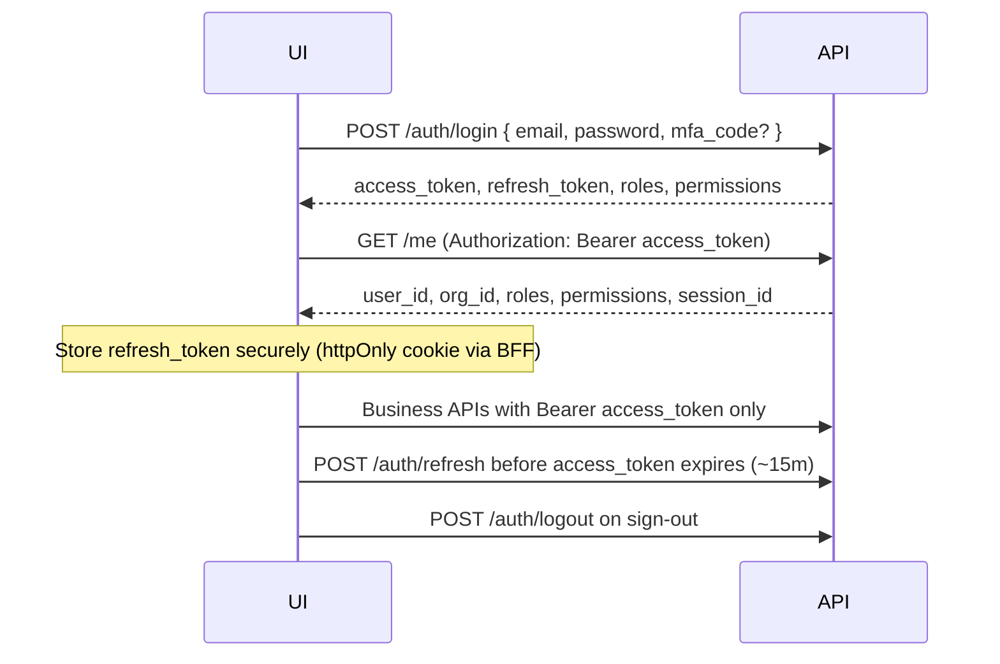

# Module 1 — Identity & Access Management (IAM)

**Audience:** Frontend / BFF / mobile UI teams  
**Base URL:** `http://localhost:8000/api/v1` (dev) — all paths below are relative to `/api/v1`  
**Status:** v3 — code complete (run migrations `009`–`011` after installing pgvector on PostgreSQL 18)

---

## Quick start (UI login flow)



**Dev credentials (after migrations):**

| Field | Value |
|-------|--------|
| Email | `dev@example.com` |
| Password | `dev-password` |
| Org ID | `11111111-1111-4111-8111-111111111111` |
| User ID | `aaaaaaaa-aaaa-4aaa-8aaa-aaaaaaaaaaaa` |

---

## Authentication headers

| Header | When | Value |
|--------|------|--------|
| `Authorization` | **Required** on protected routes | `Bearer <access_token>` or `Bearer cb_<api_key>` |
| `Content-Type` | POST/PATCH bodies | `application/json` |

**Do not send** `x-org-id`, `x-user-id`, or `x-roles` from the browser when using JWT — tenant and user come from the token.

### JWT access token claims (decode client-side for UI gating)

| Claim | Description |
|-------|-------------|
| `sub` | User UUID |
| `org_id` | Tenant UUID |
| `roles` | `string[]` — e.g. `["tenant_admin"]` |
| `permissions` | `string[]` — e.g. `["payment.approve", "user.manage"]` |
| `session_id` | Refresh session UUID |
| `attrs` | ABAC object merged from roles (see below) |
| `jti` | Token ID (revoked on logout) |
| `exp` | Expiry (~900s default) |

**Example `attrs` (ABAC) for UI hints:**

```json
{
  "max_approve_amount": 500000,
  "mfa_required": true,
  "read_only": false,
  "disallowed_actions": ["approve_payment"],
  "allowed_branch_ids": ["branch-uuid-1"],
  "rules": [
    {
      "resource": "payment",
      "action": "approve",
      "condition": { "amount_lte": 500000 }
    }
  ]
}
```

---

## Standard response envelope

Most IAM responses include:

| Field | Type | Purpose |
|-------|------|---------|
| `request_id` | string | Correlate logs / support |
| `confidence` | number | Platform metadata (often `0.99`) |
| `verification_status` | string | Machine-readable outcome code |

**Errors:** FastAPI returns `{ "detail": "<message>" }` with HTTP status:

| Status | Meaning |
|--------|---------|
| `400` | Validation (password, slug, invite) |
| `401` | Invalid credentials, expired/revoked token, MFA required |
| `403` | Missing permission or scope |
| `404` | User, role, session, etc. not found |
| `409` | Idempotent replay or duplicate resource |
| `503` | IAM DB auth disabled or DB unavailable |

---

## Idempotency (mutating IAM admin calls)

Pass `idempotency_key` (UUID recommended) in the JSON body. Duplicate keys within 24h return **409** with `detail: "Idempotent replay: request already processed"`.

**Supported on:** user create, invite, role assign, session revoke, role create, org/company/branch/business-unit create, API key create, permission create, user status PATCH.

---

# API reference

## 1. Auth — IAM database login

### POST `/auth/login` (public)

Primary production login when `IAM_USE_DB_AUTH=true`.

**Request**

```json
{
  "email": "dev@example.com",
  "password": "dev-password",
  "mfa_code": "123456"
}
```

| Field | Required | Notes |
|-------|----------|-------|
| `email` | yes | Lowercased server-side |
| `password` | yes | Min 12 chars, upper, lower, digit for *new* passwords |
| `mfa_code` | no | **Required** when user role has `mfa_required` in policy |

**Response `200` — `LoginResponse`**

```json
{
  "request_id": "login-1716540000",
  "access_token": "eyJhbGciOiJIUzI1NiIs...",
  "refresh_token": "opaque-refresh-token-string",
  "token_type": "bearer",
  "expires_in": 900,
  "user_id": "aaaaaaaa-aaaa-4aaa-8aaa-aaaaaaaaaaaa",
  "org_id": "11111111-1111-4111-8111-111111111111",
  "roles": ["tenant_admin"],
  "permissions": ["invoice.create", "payment.approve", "user.manage"],
  "confidence": 0.99,
  "verification_status": "iam_db_login"
}
```

**UI:** Persist `refresh_token` in httpOnly cookie (BFF). Keep `access_token` in memory. Show MFA field when login returns `401` with detail containing `MFA`.

---

### POST `/auth/refresh` (public)

Rotates refresh token (old session invalidated).

**Request**

```json
{
  "refresh_token": "<opaque from login>",
  "mfa_code": "123456"
}
```

**Response `200` — `RefreshResponse`**

```json
{
  "request_id": "refresh-1716540100",
  "access_token": "eyJ...",
  "refresh_token": "<new opaque>",
  "token_type": "bearer",
  "expires_in": 900,
  "user_id": "aaaaaaaa-aaaa-4aaa-8aaa-aaaaaaaaaaaa",
  "org_id": "11111111-1111-4111-8111-111111111111",
  "confidence": 0.99,
  "verification_status": "iam_session_refreshed"
}
```

---

### POST `/auth/logout` (public, optional Bearer)

Revokes refresh session **and** blacklists access token `jti` when Bearer sent.

**Request**

```json
{
  "refresh_token": "<opaque>"
}
```

**Headers:** `Authorization: Bearer <access_token>` (recommended)

**Response `200`**

```json
{
  "request_id": "logout-1716540200",
  "status": "logged_out",
  "confidence": 0.99,
  "verification_status": "iam_session_revoked"
}
```

---

### POST `/auth/password/login` (legacy dev)

Backward-compatible route; same tokens as IAM login when DB auth enabled. Prefer `/auth/login` for new UI.

---

## 2. Auth — session context (Finance OS)

### GET `/me` (authenticated)

**Response `200`**

```json
{
  "request_id": "<uuid>",
  "user_id": "aaaaaaaa-aaaa-4aaa-8aaa-aaaaaaaaaaaa",
  "org_id": "11111111-1111-4111-8111-111111111111",
  "roles": ["tenant_admin"],
  "permissions": ["payment.approve", "user.manage"],
  "session_id": "session-uuid",
  "confidence": 1.0,
  "verification_status": "verified"
}
```

**UI:** Call after login and on app boot (with valid token). Use `permissions` for menu/button visibility.

---

### GET `/permissions/evaluate` (authenticated)

Pre-check before showing Approve / Post / Pay buttons.

**Query parameters**

| Param | Example | Description |
|-------|---------|-------------|
| `object_type` | `workflow` | Resource type |
| `object_id` | `44444444-4444-4444-8444-444444444441` | Entity UUID |
| `action` | `approve_payment` | Action key |

**Response `200`**

```json
{
  "request_id": "<uuid>",
  "allowed": false,
  "reason": "human_approval_required",
  "checks": ["approval_required"],
  "object_context": {
    "object_type": "workflow",
    "object_id": "44444444-4444-4444-8444-444444444441",
    "owner_user_id": "aaaaaaaa-aaaa-4aaa-8aaa-aaaaaaaaaaaa",
    "amount": 750000
  },
  "confidence": 0.99,
  "verification_status": "object_context_policy_checked"
}
```

**UI mapping**

| `reason` | UI behavior |
|----------|-------------|
| `human_approval_required` | Show “Submit for approval” (not final execute) |
| `maker_checker_denied` | Hide approve; show “Cannot approve own item” |
| `missing_permission` | Hide action |
| `amount_exceeds_role_abac_limit` | Show limit message |
| `fiscal_period_closed` | Block journal post |

---

## 3. OIDC (enterprise SSO)

| Method | Path | Body highlights |
|--------|------|-----------------|
| GET | `/auth/oidc/start?redirect_uri=` | Returns `authorize_url`, `state` |
| POST | `/auth/oidc/callback` | `{ "code", "state", "mfa_code?": "..." }` → tokens |
| POST | `/auth/oidc/refresh` | `{ "refresh_token", "mfa_code?": "..." }` |
| POST | `/auth/oidc/logout` | `{ "refresh_token?", "access_token?" }` |
| POST | `/auth/oidc/revoke` | `{ "access_token" }` |

OIDC callback enriches JWT with IAM `permissions` and `attrs` when DB auth is enabled. MFA gate applies same as password login.

---

## 4. MFA (TOTP)

### POST `/users/me/mfa/enroll` (authenticated)

**Response `200`**

```json
{
  "request_id": "<uuid>",
  "provisioning_uri": "otpauth://totp/...",
  "confidence": 0.99,
  "verification_status": "mfa_enrollment_started"
}
```

**UI:** Render QR from `provisioning_uri` (Google Authenticator, etc.).

---

### POST `/users/me/mfa/confirm?code=123456` (authenticated)

**Response `200`**

```json
{
  "request_id": "<uuid>",
  "status": "mfa_enabled",
  "confidence": 0.99,
  "verification_status": "mfa_enrollment_confirmed"
}
```

---

## 5. Users

**Access:** `tenant_admin` **or** permission `user.manage` (API keys need scope `user.manage`).

### GET `/users?limit=50&offset=0`

**Response `200` — `UserListResponse`**

```json
{
  "request_id": "<uuid>",
  "items": [
    {
      "id": "uuid",
      "org_id": "uuid",
      "email": "user@company.com",
      "display_name": "Jane Doe",
      "status": "active",
      "mfa_enabled": false,
      "phone": "+91..."
    }
  ],
  "total": 1,
  "limit": 50,
  "offset": 0,
  "confidence": 0.99,
  "verification_status": "iam_users_listed"
}
```

`status`: `active` | `suspended` | `deactivated`

---

### GET `/users/{user_id}`

**Response `200` — `UserResponse`** (single user object, no list wrapper)

---

### POST `/users`

**Request**

```json
{
  "email": "new.user@company.com",
  "password": "SecurePass123!",
  "display_name": "New User",
  "role_name": "analyst",
  "phone": null,
  "company_id": null,
  "branch_id": null,
  "idempotency_key": "550e8400-e29b-41d4-a716-446655440000"
}
```

**Response `200`**

```json
{
  "request_id": "<uuid>",
  "user": {
    "id": "uuid",
    "org_id": "uuid",
    "email": "new.user@company.com",
    "display_name": "New User",
    "status": "active"
  },
  "confidence": 0.99,
  "verification_status": "iam_user_created"
}
```

---

### PATCH `/users/{user_id}` (admin)

**Request**

```json
{
  "status": "suspended",
  "idempotency_key": "uuid"
}
```

**Response `200`**

```json
{
  "request_id": "<uuid>",
  "user": { "id": "...", "email": "...", "display_name": "...", "status": "suspended" },
  "verification_status": "iam_user_status_updated"
}
```

**Access:** `tenant_admin` or `org.admin` permission.

---

### POST `/users/{user_id}/roles`

**Request**

```json
{
  "role_name": "ap_executive",
  "company_id": "company-uuid",
  "branch_id": "branch-uuid",
  "idempotency_key": "uuid"
}
```

**Response `200`**

```json
{
  "request_id": "<uuid>",
  "status": "assigned",
  "user_id": "uuid",
  "role_name": "ap_executive",
  "confidence": 0.99,
  "verification_status": "iam_role_assigned"
}
```

---

## 6. Invites

### POST `/users/invites` (authenticated, `user.manage`)

**Request**

```json
{
  "email": "invitee@company.com",
  "role_name": "analyst",
  "company_id": null,
  "branch_id": null,
  "idempotency_key": "uuid"
}
```

**Response `200`**

```json
{
  "request_id": "<uuid>",
  "invite_id": "uuid",
  "email": "invitee@company.com",
  "invite_token": "url-safe-secret-show-once",
  "expires_at": "2026-05-26T12:00:00Z",
  "confidence": 0.99,
  "verification_status": "user_invited"
}
```

**UI:** Build invite link: `https://<app>/accept-invite?token=<invite_token>` (token shown once).

---

### POST `/auth/invite/accept` (public)

**Request**

```json
{
  "invite_token": "<from email link>",
  "password": "SecurePass123!",
  "display_name": "Invited User"
}
```

**Response `200`**

```json
{
  "request_id": "invite-accept",
  "user_id": "uuid",
  "email": "invitee@company.com",
  "org_id": "uuid",
  "confidence": 0.99,
  "verification_status": "invite_accepted"
}
```

**UI:** Redirect to login after success (user must still call `/auth/login` unless you add auto-login).

---

## 7. Roles

### GET `/roles` (authenticated)

**Response `200` — `RoleListResponse`**

```json
{
  "request_id": "<uuid>",
  "items": [
    {
      "id": "uuid",
      "org_id": "uuid",
      "name": "ap_executive",
      "description": "Accounts payable executive",
      "system_role": true,
      "policy_context": {
        "max_approve_amount": 500000,
        "rules": []
      }
    }
  ],
  "confidence": 0.99,
  "verification_status": "iam_roles_listed"
}
```

---

### POST `/roles` (admin)

**Request**

```json
{
  "name": "custom_approver",
  "description": "Custom approval role",
  "policy_context": {
    "max_approve_amount": 250000,
    "mfa_required": false,
    "rules": [
      {
        "resource": "payment",
        "action": "approve",
        "condition": { "amount_lte": 250000 }
      }
    ]
  },
  "idempotency_key": "uuid"
}
```

**Response `200`:** `{ "request_id", "role": { ... }, "verification_status": "iam_role_created" }`

---

### PATCH `/roles/{role_id}` (admin)

**Request:** `{ "description?", "policy_context?": { ... } }`  
**Response:** `{ "request_id", "role": { ... }, "verification_status": "iam_role_updated" }`

---

### POST `/roles/{role_id}/permissions` (admin)

**Request:** `{ "permission_key": "payment.approve" }`  
**Response:** `{ "request_id", "status": "assigned", "verification_status": "iam_role_permission_added" }`

---

### DELETE `/roles/{role_id}/permissions/{permission_key}` (admin)

**Response:** `{ "request_id", "status": "removed", "verification_status": "iam_role_permission_removed" }`

---

## 8. Permissions catalog

### GET `/permissions` (authenticated)

**Response `200` — `PermissionListResponse`**

```json
{
  "request_id": "<uuid>",
  "items": [
    {
      "id": "uuid",
      "resource": "payment",
      "action": "approve",
      "permission_key": "payment.approve",
      "description": "Approve payments"
    }
  ],
  "confidence": 0.99,
  "verification_status": "iam_permissions_listed"
}
```

### POST `/permissions` (admin — `tenant_admin` or `org.admin`)

**Request**

```json
{
  "resource": "vendor",
  "action": "approve",
  "description": "Approve vendor onboarding",
  "idempotency_key": "uuid"
}
```

Server derives `permission_key` = `vendor.approve`.

### PATCH `/permissions/{permission_id}` (admin)

**Request:** `{ "description": "Updated label" }`

---

## 9. Organizations & structure

### GET `/organizations/current`

**Response `200` — `OrganizationResponse`**

```json
{
  "id": "11111111-1111-4111-8111-111111111111",
  "name": "Benchmark Corp",
  "slug": "benchmark-corp",
  "status": "active",
  "country_code": "IN",
  "timezone": "Asia/Kolkata",
  "currency": "INR",
  "plan": "starter"
}
```

---

### POST `/organizations` (provision tenant — `tenant_admin` only)

**Request**

```json
{
  "name": "Acme India Pvt Ltd",
  "slug": "acme-india",
  "country_code": "IN",
  "timezone": "Asia/Kolkata",
  "currency": "INR",
  "plan": "starter",
  "idempotency_key": "uuid"
}
```

Slug rules: lowercase alphanumeric + hyphens (`^[a-z0-9]+(?:-[a-z0-9]+)*$`).

**Response `200`:** `{ "request_id", "organization": { ... }, "verification_status": "iam_org_created" }`

---

### PATCH `/organizations/current` (admin)

**Request:** `{ "name?", "timezone?", "currency?" }`

---

### GET `/organizations/companies`

**Response `200`**

```json
{
  "request_id": "<uuid>",
  "items": [
    {
      "id": "uuid",
      "org_id": "uuid",
      "legal_name": "Acme India Pvt Ltd",
      "gstin": "29AAAAA0000A1Z5",
      "pan": null,
      "base_currency": "INR",
      "financial_year_start": "04-01"
    }
  ],
  "confidence": 0.99,
  "verification_status": "iam_companies_listed"
}
```

---

### POST `/organizations/companies` (admin)

**Request**

```json
{
  "legal_name": "Subsidiary Ltd",
  "base_currency": "INR",
  "financial_year_start": "04-01",
  "gstin": null,
  "idempotency_key": "uuid"
}
```

---

### PATCH `/organizations/companies/{company_id}` (admin)

**Request:** `{ "legal_name?", "gstin?", "status?": "active" }`

---

### GET `/organizations/branches?company_id={uuid}`

**Response `200`**

```json
{
  "request_id": "<uuid>",
  "items": [
    {
      "id": "uuid",
      "company_id": "uuid",
      "org_id": "uuid",
      "branch_code": "BLR-01",
      "branch_name": "Bangalore HQ",
      "state_code": "29",
      "address": {}
    }
  ],
  "verification_status": "iam_branches_listed"
}
```

---

### POST `/organizations/branches` (admin)

**Request**

```json
{
  "company_id": "uuid",
  "branch_code": "MUM-01",
  "branch_name": "Mumbai",
  "state_code": "27",
  "idempotency_key": "uuid"
}
```

---

### PATCH `/organizations/branches/{branch_id}` (admin)

**Request:** `{ "branch_name?", "state_code?" }`

---

### GET `/organizations/business-units`

**Response `200`**

```json
{
  "request_id": "<uuid>",
  "items": [
    {
      "id": "uuid",
      "org_id": "uuid",
      "company_id": "uuid",
      "unit_code": "FIN-OPS",
      "unit_name": "Finance Operations",
      "created_at": "..."
    }
  ],
  "verification_status": "iam_business_units_listed"
}
```

---

### POST `/organizations/business-units` (admin)

**Request:** `{ "unit_code", "unit_name", "company_id?", "idempotency_key?" }`

---

### GET `/organizations/validate-slug/{slug}`

**Response (valid)**

```json
{
  "request_id": "<uuid>",
  "valid": true,
  "verification_status": "slug_valid"
}
```

**Response (invalid)**

```json
{
  "request_id": "<uuid>",
  "valid": false,
  "reason": "Organization slug must be lowercase alphanumeric with hyphens"
}
```

**UI:** Debounced call during org onboarding form.

---

## 10. Sessions

### GET `/sessions` (`session.read` or `tenant_admin`)

**Response `200`**

```json
{
  "request_id": "<uuid>",
  "items": [
    {
      "id": "session-uuid",
      "user_id": "uuid",
      "org_id": "uuid",
      "expires_at": "...",
      "revoked": false,
      "created_at": "...",
      "device_info": { "user_agent": "..." },
      "ip_address": "127.0.0.1"
    }
  ],
  "verification_status": "iam_sessions_listed"
}
```

---

### POST `/sessions/{session_id}/revoke` (`session.revoke`)

**Request (optional body)**

```json
{
  "idempotency_key": "uuid"
}
```

**Response `200`**

```json
{
  "request_id": "<uuid>",
  "status": "revoked",
  "session_id": "uuid",
  "verification_status": "iam_session_revoked"
}
```

**UI:** “Sign out all devices” / revoke individual session rows.

---

## 11. API keys (integrations)

**Access:** `organization.manage` or `tenant_admin`.  
**Usage:** `Authorization: Bearer cb_<secret>` on Finance OS APIs (workflows, invoices, agents, retrieval, sources).

### GET `/api-keys`

**Response `200`**

```json
{
  "request_id": "<uuid>",
  "items": [
    {
      "id": "uuid",
      "name": "ERP sync",
      "scopes": ["payment.read", "workflow.write"],
      "expires_at": null,
      "revoked": false,
      "created_at": "..."
    }
  ],
  "verification_status": "api_keys_listed"
}
```

Note: hashed secret is **never** returned on list.

---

### POST `/api-keys`

**Request**

```json
{
  "name": "ERP sync",
  "scopes": ["payment.read", "invoice.create", "workflow.write"],
  "expires_at": "2027-01-01T00:00:00Z",
  "idempotency_key": "uuid"
}
```

Scopes must be valid `resource.action` keys or `*` / `admin`.

**Response `200`**

```json
{
  "request_id": "<uuid>",
  "api_key": "cb_<SHOW_ONCE_SECRET>",
  "key": {
    "id": "uuid",
    "org_id": "uuid",
    "name": "ERP sync",
    "scopes": ["payment.read", "invoice.create"],
    "expires_at": null,
    "created_at": "..."
  },
  "verification_status": "api_key_created"
}
```

**UI:** Copy `api_key` once; cannot retrieve later.

---

### POST `/api-keys/{key_id}/revoke`

**Response `200`:** `{ "request_id", "status": "revoked", "key_id", "verification_status": "api_key_revoked" }`

---

## 12. Workflow / payment UI integration

### POST `/workflows/{workflow_id}/actions`

**Request**

```json
{
  "action": "approve_payment",
  "parameters": {
    "amount": 750000,
    "vendor_risk": "low",
    "branch_id": "uuid",
    "company_id": "uuid",
    "human_approved": false,
    "approved": false,
    "idempotency_key": "uuid"
  }
}
```

| Parameter | Purpose |
|-----------|---------|
| `human_approved` / `approved` | Set `true` when approver confirms second step |
| `amount` | Drives ABAC / approval limits |
| `idempotency_key` | Workflow-level idempotency (separate from IAM keys) |

**Response — pending approval**

```json
{
  "request_id": "<uuid>",
  "workflow_id": "uuid",
  "accepted": false,
  "requires_human_approval": true,
  "reason": "human_approval_required",
  "confidence": 0.97,
  "verification_status": "policy_blocked_pending_approval"
}
```

**Response — executed**

```json
{
  "request_id": "<uuid>",
  "workflow_id": "uuid",
  "accepted": true,
  "confidence": 0.95,
  "verification_status": "policy_checked"
}
```

**Two-step UI pattern**

1. User clicks “Request approval” → `human_approved: false` → expect `requires_human_approval: true`.
2. Approver (different user) clicks “Approve” → `human_approved: true` → expect `accepted: true`.

Same pattern applies to **POST** `/companies/{company_id}/workflows/{workflow_id}/actions`.

---

## Permission keys for UI gating

Use `permissions` from login / `/me` (or decode JWT). Common keys:

| Permission | Typical UI |
|------------|----------|
| `user.manage` | Users & invites admin |
| `organization.manage` | API keys, org settings |
| `session.read` / `session.revoke` | Security / sessions page |
| `payment.approve` | Approve payment button |
| `journal.post` | Post journal button |
| `invoice.create` | Create invoice |
| `field.bank` / `field.tax` | Show sensitive fields |

**Role-based shortcuts:** `tenant_admin` bypasses most permission checks on admin routes.

---

## Seeded roles (benchmark org)

| Role | Notes |
|------|--------|
| `tenant_admin` | Full access |
| `cfo`, `controller` | Elevated; CFO has MFA |
| `ap_manager`, `ap_executive` | Amount caps in `policy_context` |
| `ap_preparer` | Cannot `approve_payment` |
| `approver` | MFA + ₹5L cap |
| `analyst` | Read-heavy (assign to new users) |

---

## Environment (backend)

```env
IAM_USE_DB_AUTH=true
IAM_ACCESS_TOKEN_TTL_SECONDS=900
IAM_REFRESH_TOKEN_TTL_SECONDS=604800
POSTGRES_DSN=${POSTGRES_DSN}
```

---

## Health checks for UI boot

| Endpoint | Use |
|----------|-----|
| GET `/health` | Liveness |
| GET `/ready` | Checks Postgres, Redis, `iam_core_schema` |

If `iam_core_schema` is `error:missing_core_schema`, run DB migrations before login UI.

---

## Implementation map

| Area | Path |
|------|------|
| IAM routes | `backend/apps/api/app/modules/core/iam/routes/` |
| Auth (OIDC, `/me`, evaluate) | `backend/apps/api/app/api/routes/auth.py` |
| Migrations | `backend/migrations/009_core_iam.sql`, `010_*.sql`, `011_*.sql` |

---

## Changelog

| Version | Notes |
|---------|--------|
| v1 | Initial IAM |
| v2 | MFA, invites, API keys, field ACL, branch scope |
| v3 | Admin CRUD, unified approval gate, API key scopes on Finance routes, idempotency, business units, this UI guide |
