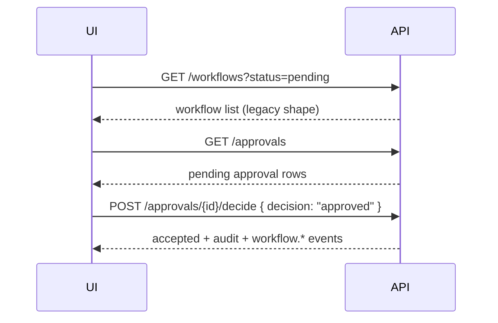

# Module 2 — Workflow Engine

**Audience:** Frontend / BFF / mobile UI teams  
**Base URL:** `http://localhost:8000/api/v1`  
**Status:** v3 — blueprint-complete orchestration (run migrations `012` + `013` + `014` after `009`–`011`)

---

## Architecture principle

| Layer | Owns |
|-------|------|
| **ERP** (`erp.*`) | Financial truth — invoices, journals, balances |
| **Workflow** (`workflow.*`) | Operational execution state — approvals, SLAs, escalations |

ERP modules must **not** hardcode approval flows. They emit facts (e.g. `invoice.created`); the workflow engine starts the correct definition (e.g. `AP_INVOICE_APPROVAL`).

---

## Quick start (approval inbox)



**Auth:** Same as IAM — `Authorization: Bearer <access_token>`.

**Permissions (seeded in migration 012):**

| Permission | Use |
|------------|-----|
| `workflow.read` | List workflows, tasks, escalations |
| `workflow.write` | Actions, transitions, SLA run |
| `approval.read` | View approval queue |
| `approval.decide` | Approve / reject |
| `task.read` | Task inbox |
| `task.assign` | Reassign tasks |

---

## API surface

### Legacy (backward compatible)

| Method | Path | Description |
|--------|------|-------------|
| `GET` | `/workflows` | List workflows (`type`, `status`, `limit`) |
| `POST` | `/workflows/{workflow_id}/actions` | Policy-checked action (existing Finance OS) |
| `GET` | `/workflows/{workflow_id}/timeline` | Step timeline |

Response shape unchanged: `WorkflowItem` with `id`, `workflow_type`, `state`, `owner_user_id`, `started_at`, `closed_at`, `confidence`, `verification_status`.

When migration `012` is applied, list/timeline read from `workflow.*` and map status ↔ legacy `state`.

### Enterprise workflow APIs (new)

| Method | Path | Description |
|--------|------|-------------|
| `POST` | `/workflows/start` | Start instance from definition key |
| `GET` | `/workflows/definitions` | Versioned templates |
| `GET` | `/workflows/{workflow_id}` | Instance + steps |
| `POST` | `/workflows/{workflow_id}/transition` | FSM transition |
| `GET` | `/workflows/metrics/summary` | Counts (total, blocked, pending approval) |
| `GET` | `/approvals` | Pending approval queue |
| `POST` | `/approvals/{approval_id}/decide` | Approve / reject |
| `GET` | `/tasks` | Task inbox (`assigned_to` defaults to current user) |
| `POST` | `/tasks/{task_id}/assign` | Reassign |
| `POST` | `/tasks/{task_id}/complete` | Complete task |
| `GET` | `/escalations` | Escalation list |
| `POST` | `/escalations/{escalation_id}/resolve` | Resolve escalation |
| `POST` | `/escalations/run-sla-check` | SLA breach + reminders + 48h manager escalation |
| `POST` | `/workflows/definitions` | Create new definition version (`workflow.manage`) |
| `PATCH` | `/workflows/definitions/{id}/activate` | Activate definition version |
| `PATCH` | `/workflows/definitions/{id}/deactivate` | Deactivate definition version |
| `GET` | `/workflows/events/stream` | Poll realtime workflow events |
| `GET` | `/workflows/events/stream/sse` | SSE stream for UI |
| `GET` | `/workflows/instances/{workflow_id}/audit` | Workflow-scoped audit trail |
| `POST` | `/workflows/steps/{step_id}/complete` | Resume AI/system step after agent or human completion |

**JWT RBAC:** All enterprise routes enforce IAM permissions (not only API-key scopes). `tenant_admin` bypasses missing grants.

**Multi-level approvals:** Thresholds in `definition_json` build sequential chains (e.g. AP → Finance Manager → CFO). After each `approved` decision, the next level is auto-requested until the chain completes, then steps advance (`executing` → system steps → `completed`).

**Decisions:** `approved`, `rejected`, `delegated` (requires `delegate_to`), `escalated`, `expired` (system/timeout).

**Seeded workflow keys:** `AP_INVOICE_APPROVAL`, `PAYMENT_APPROVAL`, `JOURNAL_APPROVAL`, `GST_FILING`, `BANK_RECONCILIATION`, `VENDOR_ONBOARDING`.

**ERP auto-start:** Publish `erp.invoice.created` or `invoice.created` on the event bus — consumer starts the mapped workflow automatically.

### v3 capabilities (blueprint closure)

| Area | Behavior |
|------|----------|
| **AI wait/resume** | `ai_review` steps enter `waiting_ai`; agent run completes via `workflow_step` trigger or `POST /workflows/steps/{id}/complete` |
| **Dynamic branching** | `definition_json.branches[]` with `when` conditions select alternate step paths |
| **Assignment** | `assignment_strategy`: `load_balance` (default), `round_robin`, `ai_assisted` (uses `suggested_assignee` / `assignment_scores`) |
| **Escalations** | `sla_breach`, `manager_escalation`, `risk_escalation`, `finance_escalation`, `compliance_escalation` + `escalation_policies[]` in definition |
| **Retries / DLQ** | Per-step `retry` policy in definition; exhausted retries recorded in `workflow.step_failures` |
| **Queues** | `workflow.approvals` consumer processes `workflow.advance.requested` after approve |
| **Realtime** | Redis pub/sub when `REDIS_URL` set; in-memory fallback per API process |
| **Metrics** | Workflow latency + approval bottleneck on `/metrics` and `/workflows/metrics/summary` |
| **Scheduled workflows** | `workflow.scheduled_workflows` — cron-driven `BANK_RECONCILIATION` via scheduler |
| **DB constraints** | Migration `014`: immutable approvals trigger, DLQ table, latency samples |

**PostgreSQL integration tests:** set `WORKFLOW_PG_INTEGRATION=1` with migrated DB to run `test_postgres_integration.py`.

---

## AI step completion

### POST `/workflows/steps/{step_id}/complete`

Use after an `ai_review` step (or external system callback).

```json
{
  "result": "completed",
  "output": { "risk_score": 0.12, "summary": "Low risk invoice" }
}
```

`result`: `completed` or `failed`. On success, orchestrator resumes from the next step.

---

## Start workflow

### POST `/workflows/start`

**Request**

```json
{
  "workflow_key": "AP_INVOICE_APPROVAL",
  "entity_type": "invoice",
  "entity_id": "uuid-of-invoice",
  "amount": 250000,
  "metadata": { "vendor_id": "...", "reference": "INV-1001" }
}
```

Either `workflow_key` or `workflow_type` is required.

**Response**

```json
{
  "request_id": "...",
  "workflow_instance_id": "uuid",
  "status": "running",
  "confidence": 0.95,
  "verification_status": "workflow_started"
}
```

Seeded definition keys (benchmark org):

- `AP_INVOICE_APPROVAL`
- `PAYMENT_APPROVAL`
- `JOURNAL_APPROVAL`

---

## Approvals

### GET `/approvals`

```json
{
  "request_id": "...",
  "items": [
    {
      "id": "approval-uuid",
      "workflow_instance_id": "instance-uuid",
      "decision": "pending",
      "level": 1,
      "workflow_type": "AP_INVOICE_APPROVAL",
      "owner_user_id": "creator-uuid",
      "created_at": "2026-05-23T10:00:00Z"
    }
  ],
  "confidence": 0.96,
  "verification_status": "verified"
}
```

### POST `/approvals/{approval_id}/decide`

**Request**

```json
{
  "decision": "approved",
  "reason": "Within policy limit",
  "idempotency_key": "optional-uuid"
}
```

**Decisions:** `approved`, `rejected`, `delegated`, `escalated` (aliases `approve` / `reject` normalized).

**Server-side checks (mandatory):**

- IAM `evaluate_access` for approve/reject actions
- Maker-checker: creator cannot approve own workflow
- Immutable audit via `workflow.transition` + `approval.*` events

**Response**

```json
{
  "request_id": "...",
  "approval_id": "...",
  "decision": "approved",
  "accepted": true,
  "confidence": 0.97,
  "verification_status": "approval_decided"
}
```

**Errors:** `403` policy/maker-checker, `404` not found, `409` idempotent replay.

---

## Workflow lifecycle (FSM)

```text
draft → queued → running → waiting_approval → approved → executing → completed
```

Failure terminals: `failed`, `cancelled`, `timed_out`, `escalated`, `rejected`.

### POST `/workflows/{workflow_id}/transition`

```json
{
  "target_status": "executing",
  "reason": "Payment release",
  "parameters": {}
}
```

Invalid transitions return **409** with FSM detail.

---

## Tasks (unified inbox)

### GET `/tasks?status=open&assigned_to={user_id}`

Use for AP executive / manager work queues. Tasks are created automatically for human approval steps.

### POST `/tasks/{task_id}/assign`

```json
{ "assigned_to": "user-uuid" }
```

---

## Escalations & SLA

SLA due times use **business hours** (Mon–Fri 09:00–18:00 UTC), not raw 24h wall clock.

When a step breaches SLA:

1. `sla.breached` event published
2. Escalation row created (`escalation_type: sla_breach`)
3. Instance status → `escalated`

### POST `/escalations/run-sla-check`

Ops endpoint to scan pending steps and escalate (also callable from scheduler).

---

## Events (reuse Finance OS bus)

Published on `workflow.*` topic → `finance.process` queue:

| Event | When |
|-------|------|
| `workflow.created` | Instance created |
| `workflow.started` | Execution started |
| `workflow.completed` | Terminal success |
| `workflow.failed` | Terminal failure |
| `workflow.escalated` | Escalation recorded |
| `approval.requested` | Approval step opened |
| `approval.completed` | Approved |
| `approval.rejected` | Rejected |
| `sla.breached` | SLA timer exceeded |

Legacy actions still emit `agent.action.executed` for backward compatibility.

---

## ERP integration pattern

```text
ERP: POST invoice → persist erp.invoices
ERP: emit erp.invoice.created (future Module 3)
Workflow: POST /workflows/start { workflow_key: "AP_INVOICE_APPROVAL", entity_type: "invoice", entity_id }
```

Do **not** call `/workflows/{id}/actions` from ERP for standard approvals — use `/approvals/{id}/decide`.

---

## Database (`workflow.*`)

| Table | Purpose |
|-------|---------|
| `workflow_definitions` | Versioned JSON templates |
| `workflow_instances` | Runtime instances (`legacy_workflow_id` links `public.workflows`) |
| `workflow_steps` | Step execution |
| `approvals` | Approval records |
| `escalations` | Escalation tracking |
| `workflow_tasks` | Unified task inbox |

Migration: `backend/migrations/012_workflow_engine.sql`

---

## UI screens (recommended)

1. **Workflow list** — `GET /workflows` (existing component)
2. **Approval inbox** — `GET /approvals`
3. **My tasks** — `GET /tasks`
4. **Workflow detail** — `GET /workflows/{id}` + timeline `GET /workflows/{id}/timeline`
5. **Escalations** — `GET /escalations` (manager view)

Realtime: subscribe to existing WebSocket/SSE channel; filter `workflow.*` and `approval.*` events.

---

## Deployment checklist

1. Install pgvector; run migrations `001`–`012`
2. Assign `workflow.*` / `approval.*` permissions to roles
3. Configure scheduler to call `POST /escalations/run-sla-check` periodically
4. Verify `GET /workflows` returns `verification_status: verified` with engine enabled

---

## Code layout

```text
app/modules/workflows/
  engine/          # FSM, compiler, planner
  repositories/    # workflow.* persistence
  services/        # runtime, approvals, SLA, escalation
  routes/          # /workflows/*, /approvals/*, /tasks/*, /escalations/*
  events/          # workflow_events.py
  workers/         # sla, escalation, retry, timeout hooks
  tests/           # unit tests (FSM, SLA, retry, compiler)
```

Legacy bridge: `app/api/routes/workflows.py` delegates list/timeline to `workflow_service` when schema is ready.
