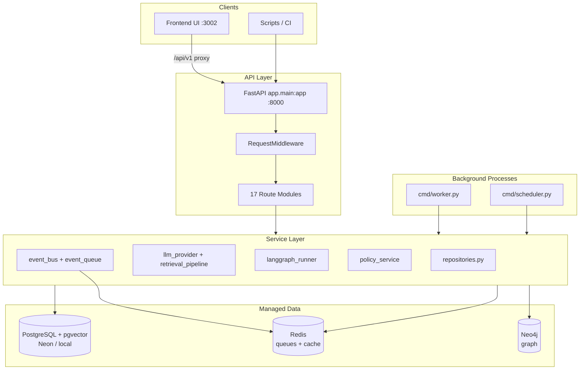

# Company Brain Backend — Complete Architecture Reference

**Repository path:** `backend/`  
**Last updated:** 2026-05-23  
**Purpose:** File-by-file documentation of the entire backend monorepo. Every source file, config, migration, chart, script, and contract is listed with its role.

**Related docs:**
- Platform architecture spec: [`../Readme_Architecture.md`](../Readme_Architecture.md)
- UI integration guide: [`../backend_documentation.md`](../backend_documentation.md)
- **ERP master blueprint (planning):** [`ERP_MASTER_MODULE_MAP.md`](ERP_MASTER_MODULE_MAP.md)
- Monorepo quick start: [`README.md`](README.md)

---

## Table of Contents

1. [Executive Summary](#1-executive-summary)
2. [System Architecture](#2-system-architecture)
3. [Technology Stack](#3-technology-stack)
4. [Complete File Index](#4-complete-file-index)
5. [Root-Level Files](#5-root-level-files)
6. [API Contract Layer (`api/`)](#6-api-contract-layer-api)
7. [Application Layer (`apps/api/`)](#7-application-layer-appsapi)
8. [Process Entrypoints (`cmd/`)](#8-process-entrypoints-cmd)
9. [Configuration (`config/`)](#9-configuration-config)
10. [Evaluation Artifacts (`eval/`)](#10-evaluation-artifacts-eval)
11. [Local Infrastructure (`infra/`)](#11-local-infrastructure-infra)
12. [Domain Boundaries (`internal/`)](#12-domain-boundaries-internal)
13. [Database Migrations (`migrations/`)](#13-database-migrations-migrations)
14. [Shared Contracts (`pkg/`)](#14-shared-contracts-pkg)
15. [Operational Scripts (`scripts/`)](#15-operational-scripts-scripts)
16. [Kubernetes / Helm (`charts/`)](#16-kubernetes--helm-charts)
17. [Cross-Cutting Concerns](#17-cross-cutting-concerns)
18. [Request & Event Flows](#18-request--event-flows)
19. [Environment Variables](#19-environment-variables)
20. [Deployment Topology](#20-deployment-topology)

---

## 1. Executive Summary

The backend is a **Python 3.11 FastAPI** monorepo implementing an AI-native finance operations platform. It provides:

- **REST API** at `/api/v1` (workflows, retrieval/copilot, agents, ingestion, audit, companies, graph, training/eval)
- **PostgreSQL + pgvector** as the system of record (tenant-isolated via RLS)
- **Redis** for queues, idempotency, OIDC state, rate limiting
- **Neo4j** for graph traversal and root-cause queries (optional in dev; Postgres fallback exists)
- **LangGraph-style agent runtime** with policy gates and human approval
- **Event-driven async processing** via Redis queues and background workers
- **Helm charts** for Kubernetes deployment (API + worker + scheduler)

**Implementation note:** `internal/` folders contain **domain boundary READMEs only**. All executable code lives under `apps/api/`.

---

## 2. System Architecture



### Layering Model

| Layer | Location | Responsibility |
|-------|----------|----------------|
| HTTP routes | `apps/api/app/api/routes/` | Request validation, auth deps, response shaping |
| Schemas | `apps/api/app/schemas/` | Pydantic request/response models |
| Services | `apps/api/app/services/` | Business logic, integrations, orchestration |
| Persistence | `repositories.py`, `db.py` | SQL access, RLS, pgvector queries |
| Contracts | `pkg/contracts/`, `api/openapi.yaml` | API and event schemas |
| Ops | `scripts/`, `cmd/`, `charts/` | Migrations, workers, K8s deploy |

---

## 3. Technology Stack

| Component | Technology | Version (pinned) |
|-----------|------------|------------------|
| Language | Python | 3.11 (Dockerfile) |
| Web framework | FastAPI | 0.115.12 |
| ASGI server | Uvicorn | 0.34.2 |
| Validation | Pydantic | 2.12.0 |
| Database driver | psycopg | binary extra |
| Cache/queues | redis-py | 5.2.1 |
| Graph DB | neo4j driver | 5.28.1 |
| LLM | OpenAI SDK | 1.84.0 |
| Auth | PyJWT | 2.10.1 |
| Tracing | OpenTelemetry | API + SDK + OTLP exporter |
| Testing | pytest | 8.3.5 |
| Security audit | pip-audit | (requirements) |

---

## 4. Complete File Index

**Total tracked files:** ~178 (excluding live secrets in `.env`)

```
backend/
├── BACKEND_ARCHITECTURE.md          ← this document
├── Dockerfile
├── README.md
├── eval-runs-offline.json
├── api/
│   └── openapi.yaml
├── apps/api/
│   ├── .env                         (local secrets — do not commit)
│   ├── .env.example
│   ├── requirements.txt
│   ├── app/
│   │   ├── __init__.py
│   │   ├── main.py
│   │   ├── middleware.py
│   │   ├── api/
│   │   │   ├── __init__.py
│   │   │   ├── deps.py
│   │   │   └── routes/              (17 route modules + __init__.py)
│   │   ├── core/
│   │   │   ├── __init__.py
│   │   │   ├── config.py
│   │   │   └── request_context.py
│   │   ├── schemas/                 (10 schema modules + __init__.py)
│   │   └── services/                (48 service modules + __init__.py)
│   └── tests/                       (35 test modules + conftest + helpers)
├── charts/                          (Helm chart + templates + values)
├── cmd/                             (worker.py, scheduler.py)
├── config/                          (dev.yaml, prod.yaml)
├── eval/                            (benchmark_manifest.json)
├── infra/                           (docker-compose.yml)
├── internal/                        (6 domain READMEs)
├── migrations/                      (001–067 SQL files)
├── pkg/contracts/                   (api_contracts.md, event_envelope.json)
└── scripts/                         (11 operational scripts)
```

---

## 5. Root-Level Files

| File | Description |
|------|-------------|
| [`Dockerfile`](Dockerfile) | Production container image. Base `python:3.11-slim`. Installs `apps/api/requirements.txt`, copies `apps/api` and `cmd/`, sets `PYTHONPATH=/app`, exposes port 8000, runs `uvicorn app.main:app`. |
| [`README.md`](README.md) | Monorepo overview: folder map, local run instructions, cloud Postgres setup, endpoint inventory, architecture alignment checklist. |
| [`eval-runs-offline.json`](eval-runs-offline.json) | Cached/sample output from offline benchmark evaluation runs (used by CI release gates). |
| [`BACKEND_ARCHITECTURE.md`](BACKEND_ARCHITECTURE.md) | This complete architecture reference. |

---

## 6. API Contract Layer (`api/`)

| File | Description |
|------|-------------|
| [`api/openapi.yaml`](api/openapi.yaml) | OpenAPI 3.1 specification for the public REST surface under `/api/v1`. Source of truth for contract-first development; should stay aligned with FastAPI route implementations. |

---

## 7. Application Layer (`apps/api/`)

The runnable FastAPI application. Run from this directory:

```bash
cd backend/apps/api
uvicorn app.main:app --reload --host 127.0.0.1 --port 8000
```

### 7.1 Configuration Files

| File | Description |
|------|-------------|
| [`.env.example`](apps/api/.env.example) | Template for all environment variables (~78 settings): Postgres DSN, Redis, Neo4j, JWT/OIDC, LLM, queue names, integration webhooks, OTEL, observability prod requirements. |
| [`.env`](apps/api/.env) | **Local runtime secrets** (gitignored). Contains live Neon DSN, Redis Cloud URL, OpenAI key, dev auth flags. Never commit or document values. |
| [`requirements.txt`](apps/api/requirements.txt) | Python dependency lock list for the API service. |

---

### 7.2 Application Entry — `app/`

| File | Description |
|------|-------------|
| [`app/__init__.py`](apps/api/app/__init__.py) | Package marker for the FastAPI application. |
| [`app/main.py`](apps/api/app/main.py) | **Primary entry point.** Creates FastAPI app with lifespan hook (`startup_observability`), registers `RequestMiddleware`, mounts all 17 routers under `settings.api_prefix` (`/api/v1`), exposes `GET /health` and `GET /ready` (Postgres + Redis + observability checks). |
| [`app/middleware.py`](apps/api/app/middleware.py) | `RequestMiddleware`: enforces auth on non-public routes (Bearer JWT or `x-org-id`), rate limiting (429 + `Retry-After`), request metrics, trace spans. Public paths: `/health`, `/ready`, `/docs`, dev/OIDC auth routes. Supports proxy-stripped paths (e.g. `/auth/password/login` without prefix). |

---

### 7.3 Core — `app/core/`

| File | Description |
|------|-------------|
| [`core/__init__.py`](apps/api/app/core/__init__.py) | Package marker. |
| [`core/config.py`](apps/api/app/core/config.py) | **`Settings` model** loaded via `python-dotenv`. Central configuration: app env, auth mode, JWT/OIDC, Postgres/Redis/Neo4j DSNs, LLM provider, queue names, integration URLs, OTEL, rate limits, dev flags (`ENABLE_DEV_AUTH_ROUTES`, `DEV_USE_POSTGRES`). Exported as module-level `settings`. |
| [`core/request_context.py`](apps/api/app/core/request_context.py) | `RequestContext` dataclass and `set_request_context()`: per-request `request_id`, `org_id`, `user_id`, `roles`, `source_acl`, `attrs`. Used by all authenticated routes via FastAPI dependency injection. |

---

### 7.4 API Dependencies — `app/api/`

| File | Description |
|------|-------------|
| [`api/__init__.py`](apps/api/app/api/__init__.py) | Package marker. |
| [`api/deps.py`](apps/api/app/api/deps.py) | **`build_request_context`** FastAPI dependency: decodes Bearer JWT via `jwt_auth.decode_bearer_token`, validates roles, or falls back to header-based context in non-bearer modes. Raises 401/403 on failure. |

---

### 7.5 HTTP Routes — `app/api/routes/`

Each file defines a FastAPI `APIRouter` mounted in `main.py`.

| File | Tag / Domain | Key Endpoints | Description |
|------|--------------|---------------|-------------|
| [`auth.py`](apps/api/app/api/routes/auth.py) | auth | `POST /auth/password/login`, `POST /auth/dev/create-user`, OIDC start/callback/refresh/revoke, `GET /me`, `GET /permissions/evaluate` | Authentication and authorization. Dev password login mints JWT (gated by `APP_ENV` + `ENABLE_DEV_AUTH_ROUTES`). OIDC flow with PKCE, Redis-backed state, API session tokens. |
| [`sources.py`](apps/api/app/api/routes/sources.py) | sources | `POST/GET /sources`, `POST /sources/{id}/sync`, `GET /ingestion-runs` | Data source registry and ingestion run tracking. Source ACL enforcement. |
| [`retrieval.py`](apps/api/app/api/routes/retrieval.py) | retrieval | `POST /query/context`, `POST /query/explain`, `GET /documents/{id}/citations` | Hybrid retrieval pipeline (pgvector + graph + memory + lexical). ABAC and field-level ACL on sensitive fields. |
| [`workflows.py`](apps/api/app/api/routes/workflows.py) | workflows | `GET /workflows`, `POST /workflows/{id}/actions`, `GET /workflows/{id}/timeline` | Workflow listing with Postgres/dev fallback, action execution with idempotency + policy gates, timeline steps. |
| [`decisions_memory.py`](apps/api/app/api/routes/decisions_memory.py) | decisions-memory | `POST/GET /decisions`, `POST/GET /memory` | Decision records and organizational memory CRUD with event bus publishing. |
| [`agents.py`](apps/api/app/api/routes/agents.py) | agents | `POST /agents/run`, `GET /agents/runs/{id}`, `POST /agents/runs/{id}/approve` | LangGraph agent orchestration: plan → policy gate → tool execution. Human approval path for pending actions. |
| [`audit.py`](apps/api/app/api/routes/audit.py) | audit | `GET /audit/logs` | Immutable audit log listing per tenant. |
| [`companies.py`](apps/api/app/api/routes/companies.py) | companies | Company-scoped invoices, workflow actions, `GET .../reports/close-status` | Tenant-scoped company APIs with cross-tenant denial. Close-status with Postgres/dev fallback. |
| [`observability.py`](apps/api/app/api/routes/observability.py) | observability | `GET /metrics`, `GET /metrics/prometheus`, `GET /events/recent` | In-process metrics store, Prometheus export, recent event bus history. |
| [`ingestion.py`](apps/api/app/api/routes/ingestion.py) | ingestion | `POST /ingestion/runs/start`, `.../complete`, `POST /identity/resolve`, embedding worker ingest | Ingestion lifecycle, identity resolution v2, document/chunk embedding pipeline. |
| [`queue.py`](apps/api/app/api/routes/queue.py) | queue | `POST /queue/enqueue`, `POST /queue/process-next` | Direct queue operations for testing and ops (503 when Redis unavailable). |
| [`memory_admin.py`](apps/api/app/api/routes/memory_admin.py) | memory-admin | `POST /memory/decay/run` | Memory retention/decay batch job trigger. |
| [`graph.py`](apps/api/app/api/routes/graph.py) | graph | `POST /graph/bootstrap`, `POST /graph/extract`, graph query endpoints | Neo4j schema bootstrap, relationship extraction from Postgres, finance graph queries (close-root-cause, ap-patterns, decision-impact, invoice-exceptions). |
| [`retrieval_eval.py`](apps/api/app/api/routes/retrieval_eval.py) | retrieval-eval | Retrieval evaluation endpoints | Precision/recall/NDCG-style retrieval quality measurement. |
| [`connectors.py`](apps/api/app/api/routes/connectors.py) | connectors | Connector sync/execute routes | ERP, bank, CRM, docs, ticketing, Slack connector adapters with ABAC and CDC replay support. |
| [`ops.py`](apps/api/app/api/routes/ops.py) | ops | Worker/scheduler trigger routes (dev-gated) | Operational endpoints for batch worker runs and scheduled job triggers. |
| [`training_eval.py`](apps/api/app/api/routes/training_eval.py) | training-eval | QA gold, retrieval judgments, safety events, feedback, labeling tasks, governance cycles | Continuous learning loop: feedback triage → labeling → shadow eval → promotion → canary → rollback. |
| [`routes/__init__.py`](apps/api/app/api/routes/__init__.py) | — | — | Package marker. |

---

### 7.6 Pydantic Schemas — `app/schemas/`

| File | Models | Description |
|------|--------|-------------|
| [`schemas/__init__.py`](apps/api/app/schemas/__init__.py) | — | Package marker. |
| [`schemas/common.py`](apps/api/app/schemas/common.py) | `Citation`, `ApiMeta`, `ApiResponse` | Shared response metadata: citations with confidence spans, request_id, verification_status. |
| [`schemas/auth.py`](apps/api/app/schemas/auth.py) | Login/create-user/OIDC request/response models | Dev auth payloads; default `org_id` to benchmark UUID. |
| [`schemas/workflows.py`](apps/api/app/schemas/workflows.py) | `WorkflowItem`, `WorkflowListResponse`, `WorkflowActionRequest`, timeline models | Workflow API contracts including enriched list response (`workflows` key). |
| [`schemas/retrieval.py`](apps/api/app/schemas/retrieval.py) | `QueryContextRequest/Response`, `QueryExplainRequest/Response` | Copilot query schemas with metadata filters. |
| [`schemas/agents.py`](apps/api/app/schemas/agents.py) | `AgentRunRequest/Response`, `AgentRunStateResponse`, approval models | Agent runtime API contracts. |
| [`schemas/audit.py`](apps/api/app/schemas/audit.py) | `AuditLogItem`, `AuditLogListResponse` | Audit log listing schemas. |
| [`schemas/decisions.py`](apps/api/app/schemas/decisions.py) | `DecisionCreateRequest`, `DecisionItem`, `DecisionListResponse` | Decision record schemas. |
| [`schemas/memory.py`](apps/api/app/schemas/memory.py) | `MemoryRecordRequest/Item`, `MemoryListResponse` | Memory record schemas. |
| [`schemas/sources.py`](apps/api/app/schemas/sources.py) | Source and ingestion run models | Data source registration and sync run schemas. |
| [`schemas/training_eval.py`](apps/api/app/schemas/training_eval.py) | QA gold, judgments, safety, feedback, governance cycle models | Training/eval/governance API schemas. |

---

### 7.7 Service Layer — `app/services/`

All business logic. Services are imported by routes and by each other.

#### 7.7.1 Infrastructure & Persistence

| File | Description |
|------|-------------|
| [`services/__init__.py`](apps/api/app/services/__init__.py) | Package marker. |
| [`services/db.py`](apps/api/app/services/db.py) | **`get_db_conn()`** context manager (psycopg, dict rows, TLS append, 15s connect timeout). **`set_rls_org()`** sets Postgres session variable `app.current_org` for tenant RLS. |
| [`services/repositories.py`](apps/api/app/services/repositories.py) | **Central data access layer** (~1700 lines). Repository classes (see below). Uses `_jsonb()` helper (psycopg `Json`) for all JSONB inserts. Module-level singletons: `sources_repo`, `workflows_repo`, `agents_repo`, etc. |

**Repository classes in `repositories.py`:**

| Class | Tables / Domain |
|-------|-----------------|
| `SourcesRepository` | `data_sources` — source registry |
| `IngestionRepository` | `ingestion_runs`, connector sync state |
| `WorkflowsRepository` | `workflows`, `workflow_steps` — list, get, timeline, state counts |
| `InvoicesRepository` | `invoices`, vendors — AP invoice CRUD and policy context |
| `CanonicalRepository` | Canonical finance entities (contracts, canonical model from migration 007) |
| `DecisionsRepository` | `decisions` — decision records |
| `MemoryRepository` | `memory_records` — organizational memory with relevance scoring |
| `AuditRepository` | `audit_logs` — immutable audit trail |
| `AgentsRepository` | `agent_runs`, `agent_actions` — agent execution persistence |
| `DocumentsRepository` | `documents`, `document_chunks` — ingestion document store |
| `RetrievalRepository` | pgvector similarity search on `document_chunks` |
| `GraphDataRepository` | Postgres-backed graph adjacency helpers (workflow/invoice IDs, lists) |
| `TrainingEvalRepository` | QA gold, retrieval judgments, safety events, feedback, eval runs |
| `LearningGovernanceRepository` | Labeling tasks, governance cycles, promotion/canary state |

#### 7.7.2 Authentication & Security

| File | Description |
|------|-------------|
| [`services/jwt_auth.py`](apps/api/app/services/jwt_auth.py) | JWT encode/decode, issuer/audience/exp validation, optional JWKS, token revocation checks, principal extraction (`org_id`, `sub`, `roles`, `source_acl`, `attrs`). |
| [`services/oidc_service.py`](apps/api/app/services/oidc_service.py) | OIDC authorization code flow: state/nonce/PKCE in Redis, token exchange, userinfo, API session JWT issuance, refresh/revoke. |
| [`services/dev_auth_store.py`](apps/api/app/services/dev_auth_store.py) | In-memory/Postgres dev user store for password login in bearer-only dev mode. |
| [`services/policy_service.py`](apps/api/app/services/policy_service.py) | **ABAC/RBAC policy engine**: amount thresholds, vendor risk, SoD (segregation of duties), payroll object rules, terminal state denial, field-level ACL (`can_access_field`), human approval requirements, agent approval authorization. |
| [`services/object_context.py`](apps/api/app/services/object_context.py) | `ObjectContext` dataclass and `resolve_object_context()` — loads invoice/workflow/vendor context for object-aware permission checks. |
| [`services/principal_context.py`](apps/api/app/services/principal_context.py) | Builds principal dicts for event envelope propagation through async worker paths. |
| [`services/rate_limiter.py`](apps/api/app/services/rate_limiter.py) | Per-org rate limiting with Redis or in-memory fallback. |
| [`services/idempotency.py`](apps/api/app/services/idempotency.py) | Workflow action idempotency keys in Redis (`idempotency:workflow:{id}:{key}`). |

#### 7.7.3 LLM & Retrieval

| File | Description |
|------|-------------|
| [`services/llm_provider.py`](apps/api/app/services/llm_provider.py) | OpenAI client wrapper: `generate_text`, `generate_json`, `generate_embedding`. Handles empty `OPENAI_BASE_URL`, retries, circuit breaker integration. |
| [`services/llm_runtime.py`](apps/api/app/services/llm_runtime.py) | Per-org token budget, circuit breaker, exponential backoff for LLM calls. |
| [`services/retrieval_service.py`](apps/api/app/services/retrieval_service.py) | pgvector chunk retrieval with embedding fallback; deterministic fallback context when OpenAI/embeddings unavailable. |
| [`services/retrieval_pipeline.py`](apps/api/app/services/retrieval_pipeline.py) | **Hybrid retrieval**: vector ANN + BM25-ish lexical + graph awareness + memory + document metadata prefilter. Ranking and trust boosts by source type. |
| [`services/retrieval_eval_service.py`](apps/api/app/services/retrieval_eval_service.py) | Retrieval quality metrics computation (precision, recall, NDCG). |

#### 7.7.4 Agents & Actions

| File | Description |
|------|-------------|
| [`services/langgraph_runner.py`](apps/api/app/services/langgraph_runner.py) | **LangGraph-style stateful agent runtime**: `GraphRuntimeState`, checkpoints, plan → policy gate → execute actions. Domain rulebooks for AP exception, close orchestration, cashflow risk agents. Tool adapter for workflow/slack/jira/linear/erp. |
| [`services/action_service.py`](apps/api/app/services/action_service.py) | Executes agent tool calls via `integration_service` with policy checks and audit logging. |
| [`services/workflow_presenter.py`](apps/api/app/services/workflow_presenter.py) | Maps raw workflow DB rows to API `WorkflowItem` shape (type/status aliases). |
| [`services/dev_workflows.py`](apps/api/app/services/dev_workflows.py) | Dev fallback sample workflows and `dev_workflow_state_counts()` when Postgres unavailable. Benchmark org UUID: `11111111-1111-4111-8111-111111111111`. |

#### 7.7.5 Graph

| File | Description |
|------|-------------|
| [`services/neo4j_service.py`](apps/api/app/services/neo4j_service.py) | Neo4j driver: node/relationship upsert, schema bootstrap, finance queries. Catches `ServiceUnavailable` and falls back to Postgres-derived rows when Neo4j is down. |
| [`services/graph_service.py`](apps/api/app/services/graph_service.py) | High-level graph operations: `query_related_entities`, `upsert_graph_event` with relation label resolution. |
| [`services/graph_extraction_service.py`](apps/api/app/services/graph_extraction_service.py) | Extracts relationships from Postgres canonical entities into Neo4j. |

#### 7.7.6 Events & Queues

| File | Description |
|------|-------------|
| [`services/event_topology.py`](apps/api/app/services/event_topology.py) | Queue name registry, finance topic mapping, event-type → queue routing, DLQ naming, service boundary definitions. |
| [`services/event_bus.py`](apps/api/app/services/event_bus.py) | In-process event bus: publishes standard envelope to Redis queue + audit log. |
| [`services/event_queue.py`](apps/api/app/services/event_queue.py) | Redis list-based queue with `BRPOPLPUSH` processing pattern, dedupe, retry, DLQ. Optional in dev when `REDIS_URL` empty. |
| [`services/event_consumers.py`](apps/api/app/services/event_consumers.py) | Event consumer handlers for async processing paths. |
| [`services/redis_queue_service.py`](apps/api/app/services/redis_queue_service.py) | Higher-level Redis queue operations. |
| [`services/queue_service.py`](apps/api/app/services/queue_service.py) | Queue enqueue/process API backing service. |

#### 7.7.7 Ingestion & Processing

| File | Description |
|------|-------------|
| [`services/ingestion_service.py`](apps/api/app/services/ingestion_service.py) | Ingestion run lifecycle (start/complete), source sync orchestration. |
| [`services/processing_service.py`](apps/api/app/services/processing_service.py) | Document chunking and processing pipeline stages. |
| [`services/embedding_worker_service.py`](apps/api/app/services/embedding_worker_service.py) | Writes `documents` + `document_chunks` with pgvector embeddings via OpenAI. |
| [`services/identity_resolution_service.py`](apps/api/app/services/identity_resolution_service.py) | Identity resolution v2: canonical profiles and aliases in Postgres. |
| [`services/canonicalization_service.py`](apps/api/app/services/canonicalization_service.py) | Normalizes connector payloads into canonical finance model entities. |
| [`services/connectors.py`](apps/api/app/services/connectors.py) | Connector adapters (ERP, bank, CRM, docs, ticketing) with CDC replay and sync state. |

#### 7.7.8 Integrations

| File | Description |
|------|-------------|
| [`services/integration_service.py`](apps/api/app/services/integration_service.py) | Outbound integrations: Slack webhook, SMTP email, Jira, Linear, ERP writeback. Returns `IntegrationResult` with status/detail. |
| [`services/in_memory_store.py`](apps/api/app/services/in_memory_store.py) | Legacy in-memory data for dev/demo when Postgres not configured. |

#### 7.7.9 Memory & Learning

| File | Description |
|------|-------------|
| [`services/memory_service.py`](apps/api/app/services/memory_service.py) | Memory decay/retention classification logic. |
| [`modules/finance_os/memory/`](apps/api/app/modules/finance_os/memory/) | **M27 Enterprise Financial Memory:** canonical `finance_os.memory_*` tables, importance gating, embeddings, ranked retrieval, summarization/decay, event ingestion, `/finance-os/memory` APIs. Projects slim rows to `memory_records` for backward compatibility. |
| [`modules/finance_os/graph/`](apps/api/app/modules/finance_os/graph/) | **M28 Operational Graph Engine:** Neo4j relationship intelligence — incremental ERP event ingestion, lineage/dependency/causality engines, `/finance-os/graph` APIs. Wraps platform `neo4j_service` / `graph_extraction_service`; audit in `finance_os.graph_sync_events` only. |
| [`services/learning_governance_service.py`](apps/api/app/services/learning_governance_service.py) | Governance loop: feedback triage, labeling approval, shadow eval, promotion, canary advance, rollback. |
| [`services/training_eval_service.py`](apps/api/app/services/training_eval_service.py) | Eval run metrics computation. |
| [`services/benchmark_eval_service.py`](apps/api/app/services/benchmark_eval_service.py) | Benchmark-grounded eval against QA gold dataset. |

#### 7.7.10 Observability

| File | Description |
|------|-------------|
| [`services/metrics.py`](apps/api/app/services/metrics.py) | In-process metrics counters: requests, errors, LLM failures, queue retries/DLQ, agent runs, retrieval queries, trace spans. |
| [`services/logger.py`](apps/api/app/services/logger.py) | Structured JSON logging via `log_event()`. Optional remote log sink. |
| [`services/otel.py`](apps/api/app/services/otel.py) | OpenTelemetry tracer init and `otel_span` context manager; falls back to structured log spans when OTEL disabled. |
| [`services/trace.py`](apps/api/app/services/trace.py) | Thin wrapper around `otel_span` for route-level tracing. |
| [`services/observability_service.py`](apps/api/app/services/observability_service.py) | Startup validation, prod observability requirements (`OBSERVABILITY_REQUIRE_IN_PROD`), status reporting for `/ready`. |

#### 7.7.11 Workers & Scheduler

| File | Description |
|------|-------------|
| [`services/worker_service.py`](apps/api/app/services/worker_service.py) | `run_queue_worker_batch()`: drains configured queues, invokes consumers, respects max iterations. |
| [`services/scheduler_service.py`](apps/api/app/services/scheduler_service.py) | `run_scheduled_jobs_once()`: periodic jobs per org (memory decay, precompute, etc.). |

---

### 7.8 Tests — `apps/api/tests/`

| File | What It Validates |
|------|-------------------|
| [`conftest.py`](apps/api/tests/conftest.py) | Pytest fixtures: TestClient, auth headers, benchmark org context. |
| [`integration_helpers.py`](apps/api/tests/integration_helpers.py) | Shared helpers for integration-style tests. |
| [`test_health.py`](apps/api/tests/test_health.py) | `GET /health` returns 200. |
| [`test_readiness.py`](apps/api/tests/test_readiness.py) | `GET /ready` dependency checks. |
| [`test_auth_dev_gating.py`](apps/api/tests/test_auth_dev_gating.py) | Dev auth routes gated by env flags. |
| [`test_auth_oidc_flow.py`](apps/api/tests/test_auth_oidc_flow.py) | OIDC start/callback/token flow. |
| [`test_jwt_context.py`](apps/api/tests/test_jwt_context.py) | JWT claim extraction and request context. |
| [`test_jwt_revocation.py`](apps/api/tests/test_jwt_revocation.py) | Token revocation enforcement. |
| [`test_oidc_prod_token_alignment.py`](apps/api/tests/test_oidc_prod_token_alignment.py) | OIDC-issued tokens work on production JWT verification path. |
| [`test_companies_api.py`](apps/api/tests/test_companies_api.py) | Company-scoped invoice and close-status APIs. |
| [`test_dev_workflows_fallback.py`](apps/api/tests/test_dev_workflows_fallback.py) | Dev workflow fallback when Postgres unavailable. |
| [`test_security_and_idempotency.py`](apps/api/tests/test_security_and_idempotency.py) | Rate limits, idempotency replay, auth failures. |
| [`test_tenant_isolation_contracts.py`](apps/api/tests/test_tenant_isolation_contracts.py) | Cross-tenant access denied. |
| [`test_rls_hardening.py`](apps/api/tests/test_rls_hardening.py) | Postgres RLS policies enforce tenant isolation. |
| [`test_object_context_permissions.py`](apps/api/tests/test_object_context_permissions.py) | Object-context-aware permission evaluation. |
| [`test_async_policy_enforcement.py`](apps/api/tests/test_async_policy_enforcement.py) | Policy checks on async worker execution paths. |
| [`test_agent_approval_guard.py`](apps/api/tests/test_agent_approval_guard.py) | Agent actions blocked until human approval recorded. |
| [`test_langgraph_runner.py`](apps/api/tests/test_langgraph_runner.py) | LangGraph flow planning and policy gate. |
| [`test_langgraph_state_runtime.py`](apps/api/tests/test_langgraph_state_runtime.py) | Stateful checkpoints and failure contracts. |
| [`test_principal_propagation.py`](apps/api/tests/test_principal_propagation.py) | Caller principal propagated through async events. |
| [`test_eventing_at_least_once.py`](apps/api/tests/test_eventing_at_least_once.py) | Queue at-least-once delivery semantics. |
| [`test_event_topology_finance_topics.py`](apps/api/tests/test_event_topology_finance_topics.py) | Event type → finance topic routing. |
| [`test_integration_event_chain.py`](apps/api/tests/test_integration_event_chain.py) | End-to-end event chain across services. |
| [`test_worker_topology.py`](apps/api/tests/test_worker_topology.py) | Worker queue drain topology. |
| [`test_ingestion_and_queue.py`](apps/api/tests/test_ingestion_and_queue.py) | Ingestion runs and queue enqueue/process. |
| [`test_identity_and_embedding_workers.py`](apps/api/tests/test_identity_and_embedding_workers.py) | Identity resolution and embedding ingestion workers. |
| [`test_connector_cdc_replay.py`](apps/api/tests/test_connector_cdc_replay.py) | Connector CDC replay and deduplication. |
| [`test_canonical_finance_model.py`](apps/api/tests/test_canonical_finance_model.py) | Canonical finance entity model (migration 007). |
| [`test_graph_extraction_expanded.py`](apps/api/tests/test_graph_extraction_expanded.py) | Graph relationship extraction coverage. |
| [`test_neo4j_hardening.py`](apps/api/tests/test_neo4j_hardening.py) | Neo4j TLS URI validation and schema bootstrap. |
| [`test_retrieval_eval.py`](apps/api/tests/test_retrieval_eval.py) | Retrieval evaluation metrics endpoints. |
| [`test_benchmark_eval_gate.py`](apps/api/tests/test_benchmark_eval_gate.py) | Benchmark eval release gate thresholds. |
| [`test_learning_governance_loop.py`](apps/api/tests/test_learning_governance_loop.py) | Full learning governance cycle. |
| [`test_observability_stack.py`](apps/api/tests/test_observability_stack.py) | Metrics, OTEL, log sink readiness. |
| [`test_migration_runner.py`](apps/api/tests/test_migration_runner.py) | SQL migration runner checksum tracking. |

**Auto-generated (not documented):** `apps/api/.pytest_cache/` — pytest cache directory.

---

## 8. Process Entrypoints (`cmd/`)

| File | Description |
|------|-------------|
| [`cmd/README.md`](cmd/README.md) | Documents intended CLI binaries; notes worker/scheduler are implemented, others are future. |
| [`cmd/worker.py`](cmd/worker.py) | **Queue worker process.** Infinite loop: `run_queue_worker_batch(iterations=50)` then sleep 1s. Run: `python cmd/worker.py` from `/app` in container. |
| [`cmd/scheduler.py`](cmd/scheduler.py) | **Scheduler process.** Every 60s runs `run_scheduled_jobs_once(org_id)` for each org in `SCHEDULER_ORG_IDS` (comma-separated env) or default `org-demo`. |

---

## 9. Configuration (`config/`)

Reference YAML configs (not wired directly into `Settings`; runtime uses `.env` via `config.py`).

| File | Description |
|------|-------------|
| [`config/dev.yaml`](config/dev.yaml) | Development defaults loaded by `app/core/config.py` (env vars override). |
| [`config/prod.yaml`](config/prod.yaml) | Production template with `${ENV_VAR}` placeholders; loaded when `APP_ENV=prod`. |

---

## 10. Evaluation Artifacts (`eval/`)

| File | Description |
|------|-------------|
| [`eval/benchmark_manifest.json`](eval/benchmark_manifest.json) | Benchmark dataset manifest: QA gold examples, expected citations, tags for offline eval and CI release gates. |

---

## 11. Local Infrastructure (`infra/`)

| File | Description |
|------|-------------|
| [`infra/docker-compose.yml`](infra/docker-compose.yml) | Local dev stack: **Postgres 16 + pgvector** (port 5432), **Redis 7** (6379), **Neo4j 5** (7474/7687). Used when not connecting to Neon/Redis Cloud. |

---

## 12. Domain Boundaries (`internal/`)

Documentation-only folders mapping architecture domains to implemented services. **No executable code.**

| File | Domain | Maps To (in `apps/api`) |
|------|--------|-------------------------|
| [`internal/db/README.md`](internal/db/README.md) | PostgreSQL + pgvector, RLS, migrations | `db.py`, `repositories.py`, `migrations/` |
| [`internal/graph/README.md`](internal/graph/README.md) | Neo4j labels, relationships, root-cause queries | `neo4j_service.py`, `graph_service.py`, `graph_extraction_service.py` |
| [`internal/agent/README.md`](internal/agent/README.md) | Domain agents (AP, close, AR, cash risk, policy, audit) | `langgraph_runner.py`, `agents.py` routes |
| [`internal/policy/README.md`](internal/policy/README.md) | Payment thresholds, SoD, vendor risk, PII, human-in-the-loop | `policy_service.py`, `object_context.py` |
| [`internal/events/README.md`](internal/events/README.md) | Redis queues, event envelope | `event_bus.py`, `event_queue.py`, `event_topology.py` |
| [`internal/api/README.md`](internal/api/README.md) | REST contract guarantees | All routes + `pkg/contracts/api_contracts.md` |

---

## 13. Database Migrations (`migrations/`)

Applied by [`scripts/run_migrations.py`](scripts/run_migrations.py). Tracked in `schema_migrations` table with checksums. **67 migration files** (001–067) spanning core IAM, platform events/workflows, Finance OS, and the full ERP engine (COA → GL → journals → AP/AR → tax/fiscal → treasury/banking → consolidation → billing).

| Range | Theme |
|-------|--------|
| 001–008 | Baseline schema, RLS hardening, canonical finance model, learning governance |
| 009–019 | Core IAM, workflow engine v1–v3, platform event bus, governance, audit, notifications |
| 020–029 | Dev login seed, documents DMS, integrations platform, ERP COA foundation |
| 030–041 | ERP GL, journals, AP/AR, tax, fiscal, procurement, expenses, assets |
| 042–049 | Inventory, TDS, compliance, banking, reconciliation, treasury |
| 050–058 | Finance OS (invoice AI, memory, agents, forecasting, analytics, audit explorer) |
| 059–065 | Policy engine, consolidation, API gateway, vouchers, credit/debit notes, billing |
| 066–067 | Architecture review indexes + FORCE RLS; P1 tenancy (fiscal canonicalization, legacy write blocks) |

Notable recent migrations:

| File | Description |
|------|-------------|
| [`066_architecture_review_indexes.sql`](migrations/066_architecture_review_indexes.sql) | Performance indexes, FORCE RLS on tenant tables flagged in architecture review |
| [`067_p1_tenancy_hardening.sql`](migrations/067_p1_tenancy_hardening.sql) | Sync `core.fiscal_periods` → `erp.fiscal_periods`; block writes to deprecated `core.fiscal_periods`, `public.invoices`, `public.journal_entries` |

**Check status:**

```bash
python backend/scripts/migration_status.py --dsn "$POSTGRES_DSN"
```

**Apply migrations:**

```bash
python backend/scripts/run_migrations.py \
  --dsn "$POSTGRES_DSN" \
  --migrations-dir backend/migrations
```

`/ready` reports `migrations: ok` when all files through 067 are applied (see `migration_readiness.py`).

---

## 14. Shared Contracts (`pkg/`)

| File | Description |
|------|-------------|
| [`pkg/contracts/api_contracts.md`](pkg/contracts/api_contracts.md) | Human-readable v1 API contract listing: all endpoints, auth modes, response requirements (`request_id`, citations, confidence, 429 behavior). |
| [`pkg/contracts/event_envelope.json`](pkg/contracts/event_envelope.json) | JSON Schema for the standard event envelope: `event_id`, `event_type`, `org_id`, `source`, `occurred_at`, `trace_id`, `payload`, `schema_version`. |

---

## 15. Operational Scripts (`scripts/`)

| File | CLI | Description |
|------|-----|-------------|
| [`scripts/README.md`](scripts/README.md) | — | Overview of operational script categories. |
| [`scripts/run_migrations.py`](scripts/run_migrations.py) | `--dsn`, `--migrations-dir`, `--dry-run` | Applies pending SQL migrations with checksum verification. |
| [`scripts/migration_status.py`](scripts/migration_status.py) | `--dsn` | Lists applied vs pending migration files. |
| [`scripts/migration_utils.py`](scripts/migration_utils.py) | (library) | Shared migration parsing, checksum, version tracking. No `__main__`. |
| [`scripts/seed_dev_workflows.py`](scripts/seed_dev_workflows.py) | `--dsn`, `--org-id` | Inserts 4 sample workflows for benchmark org into Postgres. |
| [`scripts/smoke_check.py`](scripts/smoke_check.py) | `--base-url` | HTTP smoke test: `/health`, `/ready`, observability endpoints. |
| [`scripts/security_audit.py`](scripts/security_audit.py) | — | Runs `pip audit`; fails CI on high/critical vulnerabilities. |
| [`scripts/run_benchmark_eval.py`](scripts/run_benchmark_eval.py) | `--manifest`, `--output` | Offline benchmark evaluation → JSON with precision/recall/NDCG. |
| [`scripts/eval_gate_check.py`](scripts/eval_gate_check.py) | `--results`, thresholds | CI release gate: validates eval metrics against minimum thresholds. |
| [`scripts/export_eval_runs.py`](scripts/export_eval_runs.py) | `--dsn`, `--org-id` | Exports eval runs from Postgres to JSON. |
| [`scripts/memory_decay.py`](scripts/memory_decay.py) | — | Memory retention/decay batch utility. |

---

## 16. Kubernetes / Helm (`charts/`)

| File | Description |
|------|-------------|
| [`charts/README.md`](charts/README.md) | Helm deployment guide: separate values for API/worker/scheduler, monitoring artifacts. |
| [`charts/Chart.yaml`](charts/Chart.yaml) | Chart metadata: `finance-api` v0.1.0. |
| [`charts/finance-api-values.yaml`](charts/finance-api-values.yaml) | API deployment values: image, replicas, env, probes (`/health`, `/ready`). |
| [`charts/worker-values.yaml`](charts/worker-values.yaml) | Worker deployment values. |
| [`charts/scheduler-values.yaml`](charts/scheduler-values.yaml) | Scheduler deployment values. |
| [`charts/alerts-rules.yaml`](charts/alerts-rules.yaml) | Prometheus alerting rules: queue lag, OTEL readiness. |
| [`charts/grafana-dashboard.json`](charts/grafana-dashboard.json) | Baseline Grafana dashboard for API metrics. |
| [`charts/templates/api-deployment.yaml`](charts/templates/api-deployment.yaml) | Kubernetes Deployment for FastAPI (liveness `/health`, readiness `/ready`). |
| [`charts/templates/api-service.yaml`](charts/templates/api-service.yaml) | Kubernetes Service exposing port 8000. |
| [`charts/templates/worker-deployment.yaml`](charts/templates/worker-deployment.yaml) | Kubernetes Deployment running `cmd/worker.py`. |
| [`charts/templates/scheduler-deployment.yaml`](charts/templates/scheduler-deployment.yaml) | Kubernetes Deployment running `cmd/scheduler.py`. |

---

## 17. Cross-Cutting Concerns

### 17.1 Multi-Tenancy

- Every tenant-scoped table has `org_id UUID`.
- Postgres **Row Level Security** enforced via `set_rls_org()` on every connection.
- JWT carries `org_id` claim; middleware and routes reject cross-tenant access.
- Benchmark org: `11111111-1111-4111-8111-111111111111`.

### 17.2 Authentication Modes

| Mode | Config | Behavior |
|------|--------|----------|
| Bearer-only (default) | `AUTH_MODE=bearer_only` | Requires `Authorization: Bearer <JWT>`. Dev login at `POST /auth/password/login` when enabled. |
| Header context | Legacy/dev | `x-org-id`, `x-user-id`, `x-roles` headers. |
| OIDC | `OIDC_ENABLED=true` | Full authorization code + PKCE flow; issues API session JWT. |

### 17.3 Standard API Response Shape

All v1 responses include:
- `request_id` — correlation ID
- `confidence` — 0.0–1.0 score
- `verification_status` — e.g. `verified`, `citation_backed`, `policy_checked`, `dev_sample_data`

AI-generated content includes `citations[]` with `source_type`, `source_ref`, `confidence`, optional span bounds.

### 17.4 Event Envelope

All async events follow [`pkg/contracts/event_envelope.json`](pkg/contracts/event_envelope.json). Routed to Redis queues per [`event_topology.py`](apps/api/app/services/event_topology.py).

**Finance topics:**

| Topic | Queue | Event types |
|-------|-------|-------------|
| `finance.ingest` | `ingestion.sync` | `source.sync.*` |
| `finance.process` | `processing.chunk` | `document.*`, `chunk.*`, `workflow.*`, `memory.*`, `decision.*` |
| `finance.agent` | `agent.run` | `agent.run.*` |
| `finance.action` | `agent.action` | `agent.action.*` |
| `finance.audit` | `audit.persist` | `policy.*`, `audit.*` |

### 17.5 Dev vs Production Behavior

| Feature | Dev (`APP_ENV=dev`) | Production |
|---------|---------------------|------------|
| Dev auth routes | Enabled via `ENABLE_DEV_AUTH_ROUTES` | Disabled (`DISABLE_DEV_AUTH_ROUTES_IN_PROD`) |
| Postgres fallback | `dev_workflows.py`, close-status fallback | 503 on DB failure |
| Redis optional | Queues skipped when empty URL | Required |
| Neo4j optional | Postgres graph fallback | Neo4j Aura recommended |
| Observability | OTEL/log sink optional | Required when `OBSERVABILITY_REQUIRE_IN_PROD=true` |

---

## 18. Request & Event Flows

### 18.1 Authenticated API Request

```
Client → RequestMiddleware (auth + rate limit)
       → build_request_context (JWT decode)
       → Route handler
       → Service layer
       → repositories.py (set_rls_org + SQL)
       → Response with request_id + confidence
```

### 18.2 Copilot Query (`POST /query/context`)

```
retrieval.py
  → retrieval_pipeline.retrieve_hybrid_context()
      → retrieval_service.retrieve_context() [pgvector + OpenAI embeddings]
      → graph_service.query_related_entities() [Neo4j/Postgres]
      → memory_repo.list_high_relevance()
      → documents_repo.list_documents()
      → rank + ABAC filter
  → QueryContextResponse
```

### 18.3 Agent Run (`POST /agents/run`)

```
agents.py
  → langgraph_runner.run_langgraph_flow()
      → plan_actions (domain rulebook)
      → policy_gate (requires_human_approval?)
      → execute_actions (tool_adapter → action_service → integration_service)
  → agents_repo.create_run() [Postgres]
  → event_bus.publish("agent.run.started")
  → audit_repo.create_log()
  → AgentRunResponse
```

### 18.4 Async Event Processing

```
event_bus.publish()
  → event_queue.publish() [Redis RPUSH]
  → cmd/worker.py drain loop
  → event_consumers handlers
  → audit_repo.create_log()
```

---

## 19. Environment Variables

Full list in [`.env.example`](apps/api/.env.example). Critical groups:

| Group | Key Variables | Purpose |
|-------|---------------|---------|
| App | `APP_ENV`, `APP_NAME` | Environment mode |
| Auth | `AUTH_MODE`, `JWT_SECRET`, `JWT_ISSUER`, `JWT_AUDIENCE`, `ENABLE_DEV_AUTH_ROUTES` | Authentication |
| OIDC | `OIDC_*` (10+ vars) | Enterprise SSO |
| Database | `POSTGRES_DSN`, `POSTGRES_REQUIRE_TLS`, `DEV_USE_POSTGRES` | PostgreSQL |
| Redis | `REDIS_URL`, `REDIS_REQUIRE_TLS` | Queues, cache, OIDC state |
| Graph | `NEO4J_URI`, `NEO4J_USER`, `NEO4J_PASSWORD`, `NEO4J_REQUIRE_TLS` | Neo4j |
| LLM | `OPENAI_API_KEY`, `OPENAI_MODEL`, `OPENAI_BASE_URL`, `LLM_PROVIDER` | OpenAI embeddings/chat |
| Queues | `QUEUE_*` (12 queue name vars) | Redis queue topology |
| Integrations | `SLACK_WEBHOOK_URL`, `JIRA_*`, `LINEAR_*`, `SMTP_*`, `ERP_WEBHOOK_URL` | Outbound tools |
| Observability | `OTEL_ENABLED`, `OTEL_EXPORTER_OTLP_ENDPOINT`, `LOG_SINK_URL`, `LOG_LEVEL` | Tracing and logging |
| Scheduler | `SCHEDULER_ORG_IDS` | Comma-separated org IDs for scheduler |

---

## 20. Deployment Topology

### 20.1 Recommended Production Stack

```
┌─────────────────────────────────────────────────────────┐
│ Kubernetes (EKS/GKE)                                     │
│  ├── finance-api Deployment  (uvicorn :8000)            │
│  ├── finance-worker Deployment (cmd/worker.py)        │
│  └── finance-scheduler Deployment (cmd/scheduler.py)  │
├─────────────────────────────────────────────────────────┤
│ Managed Services (external)                              │
│  ├── Neon PostgreSQL + pgvector (ap-southeast-1)        │
│  ├── Redis Cloud (queues + idempotency)                 │
│  ├── Neo4j Aura (graph — optional initially)            │
│  └── OpenAI API (embeddings + chat)                   │
├─────────────────────────────────────────────────────────┤
│ Frontend (separate repo)                                 │
│  └── Vite/Express :3002 → proxies /api/v1 → backend    │
└─────────────────────────────────────────────────────────┘
```

### 20.2 Container Build & Run

```bash
# Build
docker build -t company-brain-api backend/

# Run API
docker run -p 8000:8000 --env-file backend/apps/api/.env company-brain-api

# Run worker (separate container)
docker run --env-file backend/apps/api/.env company-brain-api python cmd/worker.py
```

### 20.3 Health Checks

| Endpoint | Purpose | K8s Probe |
|----------|---------|-----------|
| `GET /health` | Process alive | Liveness |
| `GET /ready` | Postgres + Redis + observability | Readiness |

### 20.4 Pre-Deploy Checklist

1. Set `APP_ENV=prod`, disable dev auth routes
2. Configure real OIDC or production JWT/JWKS
3. Run all migrations against production Postgres
4. Set `REDIS_URL`, `POSTGRES_DSN`, `OPENAI_API_KEY`
5. Enable OTEL exporter and log sink for prod observability
6. Deploy API + worker + scheduler via Helm
7. Run `scripts/smoke_check.py` against public URL
8. Run `scripts/security_audit.py` in CI

---

## Appendix A: Quick Reference — All Route Prefixes

Base: `/api/v1`

| Prefix | Route File |
|--------|------------|
| `/auth/*`, `/me`, `/permissions/*` | auth.py |
| `/sources`, `/ingestion-runs` | sources.py |
| `/query/*`, `/documents/*` | retrieval.py |
| `/workflows/*` | workflows.py |
| `/decisions`, `/memory` | decisions_memory.py |
| `/agents/*` | agents.py |
| `/audit/logs` | audit.py |
| `/companies/*` | companies.py |
| `/metrics`, `/events/*` | observability.py |
| `/ingestion/*`, `/identity/*` | ingestion.py |
| `/queue/*` | queue.py |
| `/memory/decay/*` | memory_admin.py |
| `/graph/*` | graph.py |
| `/retrieval/eval/*` | retrieval_eval.py |
| `/connectors/*` | connectors.py |
| `/ops/*` | ops.py |
| `/training/*` | training_eval.py |

Non-prefixed: `GET /health`, `GET /ready`

---

## Appendix B: File Count Summary

| Area | Files |
|------|-------|
| Route modules | 17 |
| Schema modules | 10 |
| Service modules | 48 |
| Test modules | 35 |
| SQL migrations | 67 |
| Scripts | 11 |
| Helm templates/values | 10 |
| Internal READMEs | 6 |
| Contracts | 2 |
| Config YAML | 2 |
| **Total (excl. cache/secrets)** | **~170** |

---

*This document is generated from the live codebase at `d:\new_project\backend`. Update it when adding new routes, services, migrations, or deployment artifacts.*
