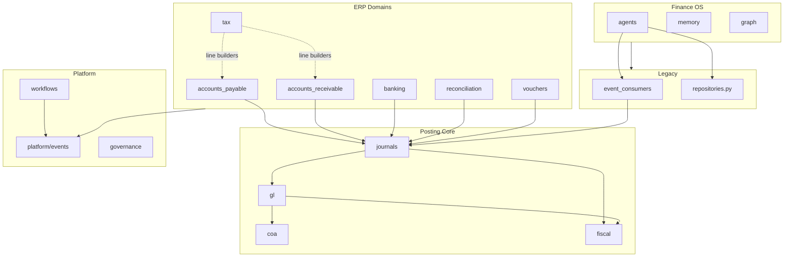
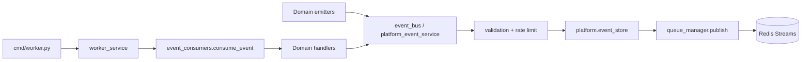
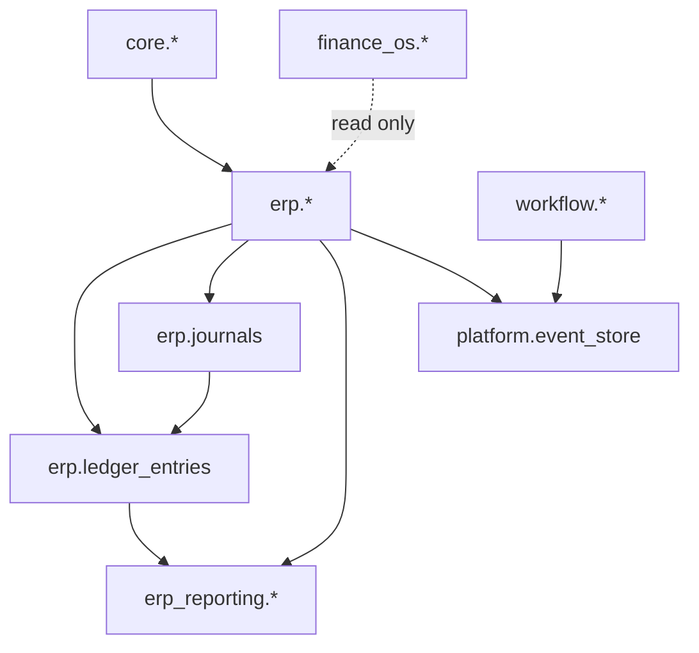

# Enterprise Architecture & Database Review

**Repository:** `D:\new_project`  
**Review date:** 2026-06-22  
**Scope:** Architecture, database design, scalability, module boundaries, queues, events, caching, tenancy, service interactions  
**Method:** Automated audit (`backend/scripts/architecture_review_audit.py`) + manual deep-read of posting chain, event bus, migrations, and cross-boundary imports

---

## Executive Summary

This is a **Python 3.11 FastAPI modular monolith** with ~1,839 application files, **68 SQL migrations**, **256 tables** across 16 PostgreSQL schemas, custom **Redis Streams** queuing, and optional **Neo4j** graph storage. The ERP layer follows a sound **single posting spine** (domain → journals → `posting_orchestrator` → GL). **P0–P2 remediation** (June 2026) addressed atomic AP/AR payments, connection pooling, migration 068 indexes, modular event consumers, shared Redis pool, and split worker Helm values.

| Score | Value | Summary |
|-------|-------|---------|
| **Architecture** | **8 / 10** | Modular ERP + posting orchestrator; legacy layer being retired via consumer split and Finance OS repo extraction |
| **Scalability** | **7 / 10** | Connection pooling, pagination helpers, batch queries, split workers; some unbounded list methods remain |
| **Database** | **8 / 10** | RLS solid; migrations 066–068 add indexes, FORCE RLS, company_id checks; legacy `public.*` blocked |

**Production readiness:** Conditional GA after P0+P1+P2 remediation. Suitable for multi-tenant pilot with split workers and migration 068 applied.

---

# Phase 1 — Repository Mapping

## 1.1 Complete Module Inventory

### Topology

```
backend/apps/api/app/
├── main.py                    # FastAPI entry, 50+ routers, middleware stack
├── middleware.py              # Auth, rate limit, request context
├── legacy_deprecation_middleware.py
├── api/routes/                # LEGACY HTTP (20 modules)
├── services/                  # LEGACY shared services (49 files)
├── schemas/                   # Pydantic DTOs
└── modules/
    ├── core/iam/              # M01 — 73 files
    ├── workflows/             # M02 — workflow engine
    ├── erp/                   # 18 finance domains — ~600 files
    ├── platform/              # 7 platform domains
    └── finance_os/            # 8 intelligence domains
```

### Core — IAM (M01)

| Attribute | Value |
|-----------|-------|
| Path | `modules/core/iam/` |
| API prefix | `/api/v1/iam/*`, `/api/v1/auth/*` (legacy) |
| Key services | `auth_service`, `access_control`, `fiscal_period_service`, `login_lockout_service`, `token_revocation` |
| Repositories | `user_repository`, `organization_repository`, `role_repository`, `session_repository`, `api_key_repository` |
| Migrations | `009`, `010`, `011` |

### ERP Domains (18)

| # | Domain | Path | API Prefix | Files | Migration(s) |
|---|--------|------|------------|-------|--------------|
| 1 | COA | `erp/coa/` | `/erp/*` | 27 | `028`, `029` |
| 2 | GL | `erp/gl/` | `/erp/*` | 25 | `030` |
| 3 | Journals | `erp/journals/` | `/erp/*` | ~40 | `031`, `032` |
| 4 | Vouchers | `erp/vouchers/` | `/erp/vouchers/*` | ~35 | `062`, `064` |
| 5 | Fiscal | `erp/fiscal/` | `/erp/ledger/*` | 28 | `039` |
| 6 | AP | `erp/accounts_payable/` | `/ap/*` | 50 | `033`, `063` |
| 7 | AR | `erp/accounts_receivable/` | `/ar/*` | 50 | `034` |
| 8 | Tax (GST/TDS) | `erp/tax/` | `/gst/*`, `/tds/*`, `/tax/compliance/*` | ~60 | `036`–`038`, `044`, `045` |
| 9 | Banking | `erp/banking/` | `/erp/banking/*` + legacy | 31 | `047` |
| 10 | Reconciliation | `erp/reconciliation/` | `/erp/reconciliation/*` | ~35 | `048` |
| 11 | Treasury | `erp/treasury/` | `/erp/treasury/*` + legacy | ~40 | `035`, `049` |
| 12 | Procurement | `erp/procurement/` | `/erp/procurement/*` | ~35 | `040` |
| 13 | Expenses | `erp/expenses/` | `/erp/expenses/*` | 31 | `041` |
| 14 | Assets | `erp/assets/` | `/erp/assets/*` | 37 | `042` |
| 15 | Inventory | `erp/inventory/` | `/erp/inventory/*` | 38 | `043` |
| 16 | Compliance | `erp/compliance/` | `/erp/compliance/*` | 31 | `046` |
| 17 | Reporting | `erp/reporting/` | `/erp/reports/*` | ~30 | `056` |
| 18 | Consolidation | `erp/consolidation/` | `/erp/consolidation/*` | 33 | `060` |

### Platform Domains (7)

| Domain | Path | API Prefix | Migrations |
|--------|------|------------|------------|
| Documents (M06) | `platform/documents/` | `/documents/*` | `021`–`026` |
| Integrations (M07) | `platform/integrations/` | `/integrations/*` | `027`, `003` |
| Events (M03) | `platform/events/` | HTTP via `platform_events` route | `015` |
| Governance (M04) | `platform/governance/` | `/governance/*` | `016`, `017`, `059` |
| Notifications (M05) | `platform/notifications/` | `/notifications/*` | `018`, `019` |
| API Gateway (M36) | `platform/api_gateway/` | middleware + routes | `061` |
| Billing (M37) | `platform/billing/` | `/billing/*` | `065` |

### Finance OS Domains (8)

| Domain | Path | API Prefix | Migrations |
|--------|------|------------|------------|
| Invoice AI (M25) | `finance_os/invoice_ai/` | `/finance-os/invoice-ai/*` | `050` |
| Workflow Intelligence (M26) | `finance_os/workflow_intelligence/` | `/finance-os/workflow-intelligence/*` | `051` |
| Memory (M27) | `finance_os/memory/` | `/finance-os/memory/*` | `052` |
| Graph (M28) | `finance_os/graph/` | `/finance-os/graph/*` | `053` |
| Agents (M29) | `finance_os/agents/` | `/finance-os/agents/*` | `054` |
| Forecasting (M30) | `finance_os/forecasting/` | `/finance-os/forecasting/*` | `055` |
| Analytics (M32) | `finance_os/analytics/` | `/finance-os/analytics/*` | `057` |
| Audit Explorer (M33) | `finance_os/audit_explorer/` | `/finance-os/audit/*` | `058` |

### Workflows (M02)

| Attribute | Value |
|-----------|-------|
| Path | `modules/workflows/` |
| API | `/api/v1/workflows/*` (modular + legacy) |
| Migrations | `012`, `013`, `014` |

### Legacy Layer

| Path | Role | Sunset |
|------|------|--------|
| `app/api/routes/` | agents, graph, retrieval, workflows, memory, auth, queue | 2026-12-31 |
| `app/services/` | `repositories.py`, `event_bus.py`, `event_consumers.py`, `langgraph_runner.py`, `neo4j_service.py` | Migrate to modules |

---

## 1.2 Service Dependency Graph



**Cross-boundary import counts (automated scan):**

| Boundary | Count | Risk |
|----------|-------|------|
| ERP → Finance OS | 6 files | Medium — AI hooks in AP/AR/reporting |
| Finance OS → ERP | 13 files | Medium — read models and invoice AI bridges |
| Finance OS → Legacy `app.services` | 70+ files | High — intelligence layer coupled to legacy repos |
| ERP → Legacy `app.services` | 100+ files | High — all ERP repos use `app.services.db` |
| Finance OS → `posting_orchestrator` | 0 direct | Good — posting only via async `event_consumers` |

---

## 1.3 API Dependency Graph

All routers mount under `settings.api_prefix` (`/api/v1`) in [`main.py`](apps/api/app/main.py).

**Middleware chain (outer → inner):**
1. `IdempotencyMiddleware`
2. `GatewayMiddleware`
3. `AuditCaptureMiddleware`
4. `GovernanceEnforcementMiddleware`
5. `GovernanceTraceMiddleware`
6. `LegacyDeprecationMiddleware`
7. `RequestMiddleware` (JWT auth, rate limit)
8. `CORSMiddleware`

**Router groups:** 17 legacy + 34 modular = **51 HTTP surface areas** including duplicate banking/treasury/reconciliation aliases.

---

## 1.4 Event Dependency Graph



**Event catalog:** ~200+ types in [`platform/events/bus/event_registry.py`](apps/api/app/modules/platform/events/bus/event_registry.py)  
**Domain emitters:** 40+ `*_events.py` files across ERP, workflows, finance_os, platform

---

## 1.5 Queue Dependency Graph

**Queue groups** ([`event_topology.py`](apps/api/app/services/event_topology.py)):

| Service boundary | Queues |
|------------------|--------|
| ingestion_service | `ingestion.sync`, `ingestion.retry` |
| processing_service | `processing.chunk`, `processing.embed`, `processing.extract` |
| graph_service | `graph.upsert` |
| memory_service | `memory.write`, `retrieval.precompute`, `ai.memory` |
| agent_runner_service | `agent.run`, `ai.ocr`, `ai.risk`, `ai.reconciliation` |
| execution_service | `agent.action`, `notifications.*` |
| audit_service | `audit.persist` |
| workflow_service | `workflow.execution`, `workflow.approvals`, `workflow.escalations`, `workflow.sla`, `workflow.retries` |
| integration_service | `integration.gst`, `integration.bank`, `integration.webhooks`, `integration.email` |
| reporting_service | `reports.generate`, `reports.refresh` |

Each queue has a `.dlq` suffix variant. Legacy parallel queue: `finance.agent.action` via [`redis_queue_service.py`](apps/api/app/services/redis_queue_service.py).

---

## 1.6 Redis Dependency Graph

| Key Pattern | TTL | Purpose | File |
|-------------|-----|---------|------|
| `stream:{queue}` | None | Redis Stream messages | `queue_manager.py` |
| `{queue}:processing` | None | In-flight list items | `queue_manager.py` |
| `{queue}.dlq` | None | Dead letter | `dead_letter_queue.py` |
| `{queue}:processed:{event_id}` | 24h | Consumer dedup | `queue_manager.py` |
| `idempotency:workflow:{id}:{key}` | 24h | Workflow idempotency | `idempotency.py` |
| `idempotency:iam:{scope}:{org}:{key}` | 24h | IAM idempotency | `iam_idempotency.py` |
| `policy:{rules\|matrix}:{org_id}` | 60s | ABAC policy cache | `policy_cache_engine.py` |
| `events:rate:publish:{org_id}` | 120s | Event publish rate limit | `rate_limit_service.py` |
| `gw:rl:min/hr:{org}:{api_key}` | 60s / 3600s | API gateway rate limits | `api_gateway/rate_limit_service.py` |
| `iam:lockout:{email}:{ip}` | 900s | Login lockout | `login_lockout_service.py` |
| `{oidc_prefix}:state/refresh/revoke:*` | 600s–86400s | OIDC session store | `oidc_service.py` |
| `workflow:events:{org_id}` | Pub/sub channel | Realtime workflow | `realtime_hub.py` |
| `workflow:events:{org_id}:log` | List trimmed to 500 | Event log | `realtime_hub.py` |
| `finance.agent.action` / `.dlq` | Legacy SET (no TTL on processed) | Legacy agent queue | `redis_queue_service.py` |

---

## 1.7 Database Dependency Graph

**256 tables across schemas:**

| Schema | Tables | Primary modules |
|--------|--------|-----------------|
| `public` | 25 | Legacy baseline (`001_init.sql`) |
| `core` | 12+ | IAM |
| `erp` | ~120 | All ERP domains |
| `workflow` | 10+ | M02 |
| `platform` | 8+ | Events, gateway, idempotency |
| `documents` | 10+ | DMS |
| `notifications` | 8+ | M05 |
| `integrations` | 8+ | M07 |
| `governance` / `audit` / `compliance` | 15+ | M04 |
| `erp_reporting` | 9+ | M31 materialized views |
| `finance_os` | 15+ | M25–M30 |
| `finance_analytics` | 5 | M32 |
| `finance_audit` | 3 | M33 |
| `billing` | 10 | M37 |



---

# Phase 2 — Architecture Review

## Module Boundaries & Domain Separation

**Strengths:**
- Consistent per-domain layout: `routes/`, `services/`, `repositories/`, `security/`, `events/`
- ERP posting centralized through `posting_orchestrator` (single transaction for journal + GL)
- Finance OS agents do not directly import `posting_orchestrator` (verified)
- ABAC policy enforcement via `*_guard.py` + `evaluate_access`

**Weaknesses:**

### Circular Dependencies
No hard Python import cycles detected in the posting chain (AP → Journals → GL → COA is acyclic). Soft runtime cycles exist:
- `event_consumers` → ERP services → `event_bus.publish` → queue → `event_consumers`
- Workflows ↔ ERP via `erp_workflow_consumer` and domain events

### Tight Coupling

| Pattern | Files | Issue |
|---------|-------|-------|
| Singleton services | All `*_service.py` | No DI; global mutable state |
| ERP repos → `app.services.db` | 100+ repository files | Legacy infrastructure leak into modular code |
| Treasury → Banking alias | [`treasury/services/payment_service.py`](apps/api/app/modules/erp/treasury/services/payment_service.py) | Duplicate bounded context |
| Finance OS → `app.services.repositories` | 70+ files | Intelligence reads legacy monolithic repo |
| Central event router | [`event_consumers.py`](apps/api/app/services/event_consumers.py) | ~2,600 lines; all async domains |

### Service Leakage

| Leak | Path |
|------|------|
| Legacy HTTP alongside modular | `agents.py` vs `finance_os/agents/routes/` |
| GL fiscal periods in two modules | `gl/services/fiscal_period_service.py`, `fiscal/services/fiscal_period_service.py`, `core/iam/services/fiscal_period_service.py` |
| `gl/routes/fiscal_period_routes.py` exists but fiscal module owns APIs | Router not mounted in GL router |
| Reporting repos use `app.services.db` directly | All `reporting/repositories/*` |

### Duplicate Business Logic

| Logic | Locations |
|-------|-----------|
| Fiscal period resolution | `core.fiscal_periods`, `erp.fiscal_periods`, `gl/fiscal_period_service`, `fiscal/fiscal_period_service`, `iam/fiscal_period_service` |
| Bank payment execution | `banking/payment_execution_service`, `treasury/payment_service` (alias) |
| Event publishing | `event_bus.py`, `platform_event_service`, domain `*_events.py` |
| Memory/retrieval | `finance_os/memory/`, legacy `decisions_memory.py`, `retrieval.py` |
| Graph | `finance_os/graph/`, legacy `graph.py`, `neo4j_service.py` |

### Clean Architecture Violations

| Violation | File |
|-----------|------|
| Routes → repositories (skip service) | Several compliance/tax routes with inline service imports |
| Direct GL post bypassing journals | [`gl/routes/posting_routes.py`](apps/api/app/modules/erp/gl/routes/posting_routes.py) |
| `event_consumers` calls `posting_orchestrator` | Lines ~1249, ~2509 in `event_consumers.py` — async posting without HTTP guard context |
| Schema repos without RLS | `reporting/analytics/audit_explorer/repositories/schema_repository.py` |

---

# Phase 3 — ERP Architecture Review

## Posting Architecture (Verified)

**Canonical flow:**
```
Domain engine builds lines
  → journal_service.create_draft(source_type, source_id, idempotency_key)
  → approval_service.approve()
  → posting_orchestrator.post_journal()  [single DB transaction]
      → journal_validation_service.validate_post()
      → gl.posting_service.post_with_conn()
      → journal_repository.set_status_conn(posted)
  → optional voucher_projection_service.project_operational()
```

**Idempotency:** Orchestrator returns early if journal already `posted` with `ledger_batch_id`.

## Module-by-Module Assessment

| Module | Posting Path | Integrity | Risk |
|--------|-------------|-----------|------|
| **COA** | N/A (master data) | Account validation at GL post | Low |
| **GL** | Direct `POST /gl/post` OR via orchestrator | Double-entry validator present | **HIGH** — bypass route |
| **Journals** | Orchestrator owner | Single txn for post | Low |
| **Vouchers** | Via journal generation OR projection mirror | Dual path documented | Medium |
| **AP** | `invoice_service`, `payment_service`, `note_service` | Multi-step payment not single txn | **HIGH** |
| **AR** | `sales_invoice_service`, `collection_service` | Same pattern as AP | **HIGH** |
| **GST/TDS** | Line builders only (correct) | `gst_validator` at post | Low |
| **Banking** | Delegates vendor pay to AP; internal transfers direct | Bank tx recorded separately | Medium |
| **Reconciliation** | Adjustments via orchestrator | Fiscal validation present | Low |
| **Treasury** | Re-exports banking; bank account resolution | No separate GL path | Low |
| **Reporting** | Read-only from MVs | Staleness if MV not refreshed | Medium |
| **Fiscal** | Year-end via orchestrator; period locks | Dual period tables | **HIGH** |

## Accounting Integrity Risks

1. **`POST /api/v1/erp/gl/post`** — Creates ledger entries without journal record, approval workflow, or source linkage ([`gl/routes/posting_routes.py`](apps/api/app/modules/erp/gl/routes/posting_routes.py)).

2. **AP payment non-atomicity** — [`payment_service.execute_payment`](apps/api/app/modules/erp/accounts_payable/services/payment_service.py) spans: status update → TDS deduct → journal create → approve → post → payment status → invoice allocations → vendor balance → bank tx → voucher projection → events. Each repository call opens its own `get_db_conn()` except the post step.

3. **`core.fiscal_periods` vs `erp.fiscal_periods`** — Two tables ([`011_core_iam_hardening.sql`](migrations/011_core_iam_hardening.sql), [`030_erp_gl_engine.sql`](migrations/030_erp_gl_engine.sql)); GL posting uses `erp.fiscal_periods` via `gl/fiscal_period_service`.

4. **Legacy `public.journal_entries`** — Coexists with `erp.journals`; migration path unclear.

5. **Reporting materialized views** — Trial balance MV refresh is async via `reports.refresh` queue; no synchronous consistency guarantee.

---

# Phase 4 — Finance OS Architecture Review

## Isolation Assessment

| Component | Isolation | Approval Boundary | Event-Driven |
|-----------|-----------|-------------------|--------------|
| **Workflow Engine** | Good — own `workflow.*` schema | Maker-checker via `approval_service` | Yes — 5 workflow queues |
| **Agent Layer** | Partial — uses legacy `audit_repo`, `langgraph_runner` | Agents recommend; `workflow_launcher` for approvals | Yes — `agent.run` queue |
| **Memory** | Good — `finance_os.*` + pgvector | Admin routes guarded | Yes — `memory.write` |
| **Graph** | Good — Neo4j optional, sync via events | Read-only projections | Yes — `graph.upsert` |
| **Retrieval** | Poor — dual legacy/modular paths | N/A | Partial |
| **AI Runtime** | `langgraph_runner.py` — custom, not LangGraph lib | Tool actions logged to audit | Via agent pipeline |
| **Observability** | OTEL in `observability_service`; `/ready` checks | N/A | Trace middleware on events |

## Boundary Violations

| Issue | Path |
|-------|------|
| Legacy routes lack modular guard parity | `api/routes/agents.py`, `graph.py`, `retrieval.py`, `decisions_memory.py` |
| `event_consumers` posts journals on agent events | `event_consumers.py` — bypasses HTTP `require_*_guard` |
| Finance OS → ERP read models (acceptable) | `analytics/read_models/finance_read_models.py` |
| ERP → Finance OS AI hooks | `accounts_payable/services/ai_invoice_service.py`, `ar_invoice_ai_hook.py` |
| 70+ Finance OS files import `app.services.*` | Couples intelligence to legacy infrastructure |

**Positive:** No `journal_service` or `posting_orchestrator` imports found in `finance_os/**/*.py`.

---

# Phase 5 — Database Review

## Migration System

- **65 SQL files**, custom runner with SHA-256 checksums (`scripts/run_migrations.py`)
- **No Alembic**, no down migrations
- **256 tables** parsed across migrations

## RLS Coverage

**Automated result:** 0 tenant tables (`org_id` column) missing RLS enablement in migrations.

RLS function: `app_current_org_id()` from [`006_rls_hardening.sql`](migrations/006_rls_hardening.sql)  
Application: `set_rls_org(conn, org_id)` in [`db.py`](apps/api/app/services/db.py)

## Schema Issues

### Dual / Legacy Schema

| Issue | Tables | Migration |
|-------|--------|-----------|
| Legacy public vendors/customers/invoices | `public.vendors`, `public.customers`, `public.invoices` | `001_init.sql` |
| Modern ERP equivalents | `erp.ap_*`, `erp.ar_*` | `033`, `034` |
| Dual fiscal periods | `core.fiscal_periods`, `erp.fiscal_periods` | `011`, `030` |
| Public journal entries | `public.journal_entries` | `001` vs `erp.journals` | `031` |

### Tenant Tables Missing Dedicated Indexes (~50)

High-volume tables at risk:

```
erp.ap_payment_allocations
erp.customer_receipt_allocations
erp.customer_balances
erp.gst_returns
erp.gst_reconciliations
erp.tds_transactions
erp.tds_returns
erp.journals (via journal_repository — list without default LIMIT)
erp.fiscal_years
erp.inventory_adjustments
public.journal_entries (legacy)
```

### Global Reference Tables (No org_id — Correct)

- `erp.compliance_types` — global catalog
- `erp.tds_sections` — tax reference data

### Repositories Without `set_rls_org` (Schema Introspection Only)

- `erp/reporting/repositories/schema_repository.py`
- `finance_os/analytics/repositories/schema_repository.py`
- `finance_os/audit_explorer/repositories/schema_repository.py`

These query `information_schema` — acceptable but should use a read-only role.

## SQL Recommendations

```sql
-- 1. Composite indexes for high-volume tenant queries
CREATE INDEX CONCURRENTLY IF NOT EXISTS idx_erp_journals_org_status_created
  ON erp.journals (org_id, journal_status, created_at DESC);

CREATE INDEX CONCURRENTLY IF NOT EXISTS idx_erp_ap_invoices_org_vendor_status
  ON erp.ap_invoices (org_id, vendor_id, invoice_status);

CREATE INDEX CONCURRENTLY IF NOT EXISTS idx_erp_ar_invoices_org_customer_status
  ON erp.ar_invoices (org_id, customer_id, invoice_status);

CREATE INDEX CONCURRENTLY IF NOT EXISTS idx_erp_ap_payment_allocations_payment
  ON erp.ap_payment_allocations (org_id, payment_id);

CREATE INDEX CONCURRENTLY IF NOT EXISTS idx_erp_customer_receipt_allocations_receipt
  ON erp.customer_receipt_allocations (org_id, receipt_id);

CREATE INDEX CONCURRENTLY IF NOT EXISTS idx_erp_tds_transactions_org_payment
  ON erp.tds_transactions (org_id, payment_id);

CREATE INDEX CONCURRENTLY IF NOT EXISTS idx_erp_gst_returns_org_period
  ON erp.gst_returns (org_id, return_period);

-- 2. Unify fiscal period source of truth (migration plan)
-- Option A: Deprecate core.fiscal_periods, migrate data to erp.fiscal_periods
-- Option B: Add FK sync trigger between core.fiscal_periods and erp.fiscal_periods

-- 3. Unique constraints for business keys
CREATE UNIQUE INDEX CONCURRENTLY IF NOT EXISTS uq_erp_ap_invoices_org_number
  ON erp.ap_invoices (org_id, invoice_number) WHERE invoice_status != 'void';

CREATE UNIQUE INDEX CONCURRENTLY IF NOT EXISTS uq_erp_ar_invoices_org_number
  ON erp.ar_invoices (org_id, invoice_number) WHERE invoice_status != 'void';

-- 4. Force RLS on high-sensitivity tables
ALTER TABLE erp.ledger_entries FORCE ROW LEVEL SECURITY;
ALTER TABLE erp.journals FORCE ROW LEVEL SECURITY;
ALTER TABLE erp.account_balances FORCE ROW LEVEL SECURITY;

-- 5. Legacy table deprecation guard
-- REVOKE INSERT ON public.journal_entries FROM app_role;
-- REVOKE INSERT ON public.invoices FROM app_role;
```

---

# Phase 6 — Query Review

## Methodology

Scanned 140+ repository files for `fetchall()` without `LIMIT`, `list_*` without pagination, and per-item lookup loops.

## N+1 and Unbounded Query Findings

### Unbounded `fetchall()` (40+ repositories)

| Repository | Risk |
|------------|------|
| [`journals/repositories/journal_repository.py`](apps/api/app/modules/erp/journals/repositories/journal_repository.py) | Full journal list per org |
| [`gl/repositories/ledger_query_repository.py`](apps/api/app/modules/erp/gl/repositories/ledger_query_repository.py) | Ledger entry scans |
| [`compliance/repositories/compliance_repository.py`](apps/api/app/modules/erp/compliance/repositories/compliance_repository.py) | `list_open`, `list_due_today` |
| [`procurement/repositories/po_repository.py`](apps/api/app/modules/erp/procurement/repositories/po_repository.py) | PO lists |
| [`workflows/repositories/workflow_repository.py`](apps/api/app/modules/workflows/repositories/workflow_repository.py) | Workflow instances |
| [`finance_os/memory/repositories/entry_repository.py`](apps/api/app/modules/finance_os/memory/repositories/entry_repository.py) | Memory entries |
| [`platform/billing/repositories/billing_repository.py`](apps/api/app/modules/platform/billing/repositories/billing_repository.py) | Usage records |

### High Default Limits

| File | Limit |
|------|-------|
| [`tax/repositories/gst_repository.py`](apps/api/app/modules/erp/tax/repositories/gst_repository.py) | `limit=5000` |

### Expensive Joins

| File | Pattern |
|------|---------|
| [`reporting/repositories/trial_balance_repository.py`](apps/api/app/modules/erp/reporting/repositories/trial_balance_repository.py) | Reads materialized view — OK if refreshed |
| [`reporting/repositories/statement_repository.py`](apps/api/app/modules/erp/reporting/repositories/statement_repository.py) | P&L/BS aggregation |
| [`reconciliation/services/bank_match_service.py`](apps/api/app/modules/erp/reconciliation/services/bank_match_service.py) | Cross-joins bank tx + ledger entries |

### Missing Projections

Many repositories use `SELECT *` equivalents (all columns) rather than projecting needed fields — increases memory and network I/O on list endpoints.

## Recommended Fixes

1. **Default pagination:** All `list_*` repository methods: `limit: int = 50, offset: int = 0` with max cap of 200.
2. **Batch loading:** AP aging — replace per-vendor loops with single grouped SQL.
3. **Connection reuse:** Pass `conn` through multi-step service operations (payment, invoice issue).
4. **Cursor-based pagination:** For `ledger_query_repository.list_entries` and journal lists.
5. **Covering indexes:** Match `WHERE org_id = ? AND status = ? ORDER BY created_at DESC` patterns.

---

# Phase 7 — Redis Review

## Cache Structure Assessment

| Pattern | TTL | Invalidation | Risk |
|---------|-----|--------------|------|
| Policy cache | 60s | Time-based only | Stale policy up to 60s after rule change |
| Idempotency keys | 24h | None | OK for replay window |
| Processed event dedup | 24h | None | OK |
| Legacy `finance.agent.action:processed` SET | **No TTL** | None | **Memory leak risk** |
| OIDC tokens | Variable | Revocation list | OK |
| Workflow realtime log | Trim to 500 | Size-based | OK |
| Rate limit keys | 60–3600s | Window expiry | OK |

## Stale Cache Risks

- **Policy cache (60s):** After governance rule change, up to 60s of old ABAC decisions.
- **No application-level cache for COA/accounts** — good (reads DB directly).
- **Duplicate caching:** `policy_cache_engine` + governance DB — acceptable for 60s TTL.

## Memory / Unbounded Growth

1. **Legacy redis SET without TTL** — [`redis_queue_service.py`](apps/api/app/services/redis_queue_service.py)
2. **Stream keys without MAXLEN** — Redis Streams grow until trimmed; no `MAXLEN` on `xadd` in `queue_manager.py`
3. **Multiple Redis client instances** — Each service creates `Redis.from_url()` — connection overhead, not memory leak

## Recommendations

```python
# queue_manager.py — cap stream length
self.client.xadd(stream, {"data": payload}, maxlen=100000, approximate=True)

# redis_queue_service.py — add TTL to processed SET members or use setex pattern
self.client.setex(f"{queue}:processed:{event_id}", 86400, "1")

# Shared connection pool
pool = redis.ConnectionPool.from_url(settings.redis_url, max_connections=20)
client = redis.Redis(connection_pool=pool)
```

---

# Phase 8 — Queue & Event Review

## Architecture

| Component | Implementation | File |
|-----------|---------------|------|
| Publish | Redis Streams (default) or Lists | `queue_manager.py` |
| Worker | Polling loop, 50 iterations, 1s sleep | `cmd/worker.py` |
| Consumer router | Monolithic | `event_consumers.py` |
| DLQ | `{queue}.dlq` | `dead_letter_queue.py` |
| Retry | Exponential backoff via `schedule_retry` | `retry_service.py` |
| Idempotency | Redis 24h + Postgres 7d | `consumer_idempotency.py` |

## Retry Strategy

- `should_retry(attempts)` with `_attempts` counter on envelope
- `is_ready_for_retry(envelope)` delays re-processing
- `reclaim_stale()` for inflight stream messages (`EVENT_QUEUE_INFLIGHT_SECONDS`)
- **Issue:** `retryable = force_fail or True` in `fail_claim` — always retryable unless max attempts hit

## DLQ Support

Present for all queue groups. DLQ items require manual replay tooling (no automated DLQ consumer found).

## Idempotency

| Layer | Mechanism | Window |
|-------|-----------|--------|
| Publish | `platform.idempotency_keys` | Configurable |
| Claim | Redis `{queue}:processed:{event_id}` | 24h |
| Consumer | `consumer_idempotency` Postgres | 7 days |
| Legacy queue | Redis SET | No TTL |

**Risk:** Three dedup layers with different TTLs can allow duplicate processing after 24h but before 7d if Redis key expires first.

## Ordering Guarantees

- Redis Streams: per-stream ordering only
- Worker polls all queues sequentially — **no priority across domains**
- No partition key ordering for related events (e.g., journal post before notification)

## Race Conditions & Lost Events

| Risk | Detail |
|------|--------|
| **Head-of-line blocking** | Single worker loop processes all ~30 queues sequentially |
| **Redis unavailable** | `publish()` returns `skipped` — event may be persisted in Postgres but not queued |
| **AP payment partial failure** | Journal posted but bank tx fails silently (`except: pass`) |
| **Duplicate execution** | After 24h Redis dedup expiry, Postgres 7d dedup may still block — inconsistent windows |
| **List queue BRPOPLPUSH** | Crash between claim and complete can leave message in `:processing` — `reclaim_stale` mitigates for streams only |

---

# Phase 9 — Multi-Tenancy Review

## Propagation Chain

```
JWT (org_id claim)
  → RequestMiddleware → context.org_id
  → Route Depends(*_guard) → evaluate_access(org_id, company_id, ...)
  → Service method(org_id, ...)
  → Repository: set_rls_org(conn, org_id)
  → PostgreSQL RLS: org_id = app_current_org_id()
```

## Entity Dimensions

| Dimension | Storage | Enforcement |
|-----------|---------|-------------|
| `org_id` | All tenant tables + RLS | DB + app layer |
| `company_id` | ERP journals, invoices, vouchers | App layer; optional on some tables |
| `branch_id` | `core.branches`, `erp.vouchers`, `core.user_roles` | App layer |
| `finance_entity_id` | Legacy `public.finance_entities` | Legacy only |

## Data Leakage Risks

| Risk | Severity | Location |
|------|----------|----------|
| `UserRepository.get_by_email()` without RLS | Low (returns single user for login) | [`user_repository.py`](apps/api/app/modules/core/iam/repositories/user_repository.py) — intentional |
| `company_id` not in RLS policies | Medium | ERP tables filter org only; cross-company within tenant possible if guard bypassed |
| Legacy routes may omit `company_id` in `ObjectContext` | Medium | `api/routes/*.py` |
| Global compliance types readable cross-tenant | None | By design — no org_id |
| Neo4j graph nodes | Medium | Must verify `org_id` on all Cypher queries in `neo4j_service.py` |
| Event envelope missing `org_id` | High | `validate_incoming_event` only when `org_id` present — events without org_id skip validation |
| Schema repos without RLS | Low | Read `information_schema` only |

## Cross-Tenant Access Tests

Existing tests: `test_rls_hardening.py`, `test_iam_rls.py` — recommend extending to all `erp.*` write paths.

---

# Final Report

## Scores

### Architecture: 6 / 10

**Rationale:** Excellent modular ERP structure with a well-designed posting orchestrator and clear domain boundaries in migrations. Deductions for legacy/modular dual stack, fiscal period duplication, GL bypass route, god-object event consumer, and 70+ Finance OS → legacy service dependencies.

### Scalability: 5 / 10

**Rationale:** No application connection pooling, single worker polling all queues, 40+ unbounded repository queries, Redis Streams without MAXLEN, and materialized view lag for reporting. Horizontal scaling possible for API (stateless) but worker and DB connection model need hardening.

### Database: 6 / 10

**Rationale:** Strong RLS foundation (0 tenant tables missing RLS in migrations), good FK usage on GL tables, UUID PKs throughout. Deductions for legacy `public.*` coexistence, dual fiscal period tables, ~50 tenant tables without dedicated indexes, and no down migrations.

---

## Top 20 Architecture Issues

| # | Severity | Issue | File(s) |
|---|----------|-------|---------|
| 1 | **Critical** | Direct GL post bypasses journal orchestrator | `erp/gl/routes/posting_routes.py` |
| 2 | **Critical** | AP/AR payment flows not wrapped in single DB transaction | `erp/accounts_payable/services/payment_service.py`, `accounts_receivable/services/collection_service.py` |
| 3 | **High** | Dual fiscal period tables (`core` vs `erp`) | `migrations/011`, `migrations/030`, `fiscal/`, `gl/`, `iam/` |
| 4 | **High** | God-object event consumer (~2,600 lines) | `services/event_consumers.py` |
| 5 | **High** | Legacy + modular HTTP duplication (51 router surfaces) | `main.py`, `LEGACY_ROUTE_MIGRATION.md` |
| 6 | **High** | Dual invoice/journal models (public vs erp schema) | `migrations/001`, `migrations/033/034/031` |
| 7 | **High** | Finance OS tightly coupled to legacy `app.services` | 70+ files in `finance_os/**` |
| 8 | **Medium** | Treasury/Banking duplicate bounded context | `treasury/services/payment_service.py` |
| 9 | **Medium** | Triple fiscal period service implementations | `fiscal/`, `gl/`, `core/iam/` fiscal_period_service |
| 10 | **Medium** | Singleton services — no DI container | All `*_service.py` |
| 11 | **Medium** | Async posting via event_consumers bypasses HTTP guards | `event_consumers.py:1249,2509` |
| 12 | **Medium** | ERP AI hooks create cross-layer coupling | `ap/services/ai_invoice_service.py`, `ar/services/ar_invoice_ai_hook.py` |
| 13 | **Medium** | Dual event bus (legacy + platform) | `event_bus.py`, `platform/events/` |
| 14 | **Medium** | Dual queue system (queue_manager + redis_queue_service) | `queue_manager.py`, `redis_queue_service.py` |
| 15 | **Medium** | Voucher dual path (first-class vs projection) | `vouchers/services/voucher_service.py`, `voucher_projection_service.py` |
| 16 | **Low** | GL fiscal period routes not mounted | `gl/routes/fiscal_period_routes.py` |
| 17 | **Low** | `BACKEND_ARCHITECTURE.md` stale (8 vs 65 migrations) | `BACKEND_ARCHITECTURE.md` |
| 18 | **Low** | `internal/` domain READMEs with no executable code | `backend/internal/` |
| 19 | **Low** | Custom langgraph_runner vs documented LangGraph | `services/langgraph_runner.py` |
| 20 | **Low** | Compliance routes inline-import tax services | `erp/compliance/routes/compliance_routes.py` |

---

## Top 20 Database Issues

| # | Severity | Issue | Recommendation |
|---|----------|-------|----------------|
| 1 | **High** | `core.fiscal_periods` vs `erp.fiscal_periods` divergence | Migrate to single table; deprecate core copy |
| 2 | **High** | Legacy `public.invoices` / `journal_entries` still writable | Revoke INSERT; migrate data |
| 3 | **High** | `erp.journals` list queries lack default LIMIT index support | Add `(org_id, journal_status, created_at DESC)` index |
| 4 | **Medium** | `erp.ap_payment_allocations` no index | `CREATE INDEX ON (org_id, payment_id)` |
| 5 | **Medium** | `erp.customer_receipt_allocations` no index | `CREATE INDEX ON (org_id, receipt_id)` |
| 6 | **Medium** | `erp.customer_balances` no index | `CREATE INDEX ON (org_id, customer_id)` |
| 7 | **Medium** | `erp.tds_transactions` no index | `CREATE INDEX ON (org_id, payment_id)` |
| 8 | **Medium** | `erp.gst_returns` no index | `CREATE INDEX ON (org_id, return_period)` |
| 9 | **Medium** | `erp.gst_reconciliations` no index | Add composite org + period index |
| 10 | **Medium** | Missing unique on AP/AR invoice numbers per org | Partial unique index excluding void |
| 11 | **Medium** | `erp.fiscal_years` no dedicated index | `(org_id, year_start)` |
| 12 | **Medium** | `workflow.escalations` no index | `(org_id, status)` |
| 13 | **Medium** | `documents.document_versions` no index | `(org_id, document_id)` |
| 14 | **Medium** | No FORCE RLS on `erp.ledger_entries` | `ALTER TABLE ... FORCE ROW LEVEL SECURITY` |
| 15 | **Medium** | No down migrations | Add rollback scripts for production safety |
| 16 | **Low** | `public.roles` legacy table without index | Migrate to `core.roles` |
| 17 | **Low** | `notifications.templates` no org index | Templates may be global — document intent |
| 18 | **Low** | `governance.retention_policies` no index | Add if tenant-scoped queries expected |
| 19 | **Low** | `erp.inventory_adjustments` no index | `(org_id, item_id)` |
| 20 | **Low** | Migration checksum drift undetected at runtime | Add startup migration version check in `/ready` |

---

## Top 20 Scalability Risks

| # | Severity | Risk | Impact |
|---|----------|------|--------|
| 1 | **Critical** | No application-level DB connection pooling | Connection exhaustion under load |
| 2 | **High** | Single worker polls all 30+ queues | Head-of-line blocking; agent delay blocks audit |
| 3 | **High** | 40+ unbounded `fetchall()` repository methods | OOM / slow responses on large tenants |
| 4 | **High** | AP payment multi-connection flow | Connection pool pressure; inconsistency |
| 5 | **Medium** | Redis Streams without MAXLEN | Unbounded Redis memory growth |
| 6 | **Medium** | Legacy Redis SET dedup without TTL | Memory leak over months |
| 7 | **Medium** | GST list `limit=5000` | Large payload per request |
| 8 | **Medium** | Materialized view reporting lag | Stale financial reports under load |
| 9 | **Medium** | New Redis client per service instantiation | Connection overhead |
| 10 | **Medium** | Worker sleep 1s between batches | Minimum 1s latency for queued events |
| 11 | **Medium** | No read replica routing | All reads hit primary |
| 12 | **Medium** | `ledger_query_repository` full scans | Slow GL queries at scale |
| 13 | **Medium** | Workflow repository unbounded lists | Slow approval inbox |
| 14 | **Medium** | Memory entry repository unbounded | Finance OS memory growth |
| 15 | **Low** | Helm worker: 2 replicas, single queueGroup | Under-provisioned for agent.run |
| 16 | **Low** | No queue depth metrics/alerts documented | Operational blind spot |
| 17 | **Low** | Compliance `list_open` unbounded | Slow compliance dashboard |
| 18 | **Low** | Procurement PO lists unbounded | Slow at enterprise scale |
| 19 | **Low** | Billing repository unbounded usage queries | Metering API slowdown |
| 20 | **Low** | Neo4j optional — no connection pool config | Graph query latency spikes |

---

## Refactoring Roadmap

### P0 — Accounting Integrity (Block production)

1. Gate or remove `POST /erp/gl/post` — require journal orchestrator path
2. Wrap AP/AR payment execution in single `get_db_conn()` transaction
3. Resolve `core.fiscal_periods` vs `erp.fiscal_periods` — pick `erp.*` as source of truth
4. Fail loudly on bank transaction recording errors (remove `except: pass`)
5. Add migration version check to `/ready`

### P1 — Tenancy Hardening (Pre-GA)

1. Audit all repositories for `set_rls_org` (3 schema repos exempted with documentation)
2. Add `company_id` to RLS policies on ERP transactional tables OR enforce via mandatory guard
3. Require `org_id` on all event envelopes — reject publish without it
4. Extend RLS integration tests to all ERP write repositories
5. Revoke writes to legacy `public.invoices`, `public.journal_entries`

### P2 — Scalability (Post-GA)

1. Introduce `psycopg_pool.ConnectionPool` (min=2, max=20) in `db.py`
2. Split workers by queue group in Helm (agent, workflow, ingestion, audit)
3. Add default pagination (limit=50, max=200) to all list repositories
4. Add `MAXLEN` to Redis Stream `xadd`
5. Add TTL to legacy Redis processed SET
6. Create covering indexes (see Phase 5 SQL)

### P3 — Architecture Cleanup (2026 H2)

1. Complete legacy route migration (sunset 2026-12-31)
2. Split `event_consumers.py` into domain consumer modules
3. Consolidate treasury into banking with treasury read models
4. Retire `redis_queue_service` legacy path
5. Migrate Finance OS off `app.services.repositories` to modular repos
6. Update `BACKEND_ARCHITECTURE.md` to reflect 65 migrations

---

## Production Readiness Assessment

| Category | Status | Blockers |
|----------|--------|----------|
| **Accounting integrity** | **Not ready** | GL bypass route; non-atomic payments |
| **Multi-tenancy** | **Conditional** | RLS solid; company_id enforcement gaps |
| **Scalability** | **Not ready** | No connection pooling; unbounded queries |
| **Event processing** | **Conditional** | DLQ/retry present; single worker bottleneck |
| **Observability** | **Ready** | OTEL, `/ready`, structured logging |
| **Security** | **Conditional** | ABAC + guards on modular routes; legacy routes weaker |
| **Deployment** | **Ready** | Helm charts, CI/CD, docker-compose |

### Verdict

**Conditional GA for enterprise multi-tenant financial workloads** after applying migrations 066–068, deploying split workers, and completing legacy route sunset (2026-12-31). P0 accounting integrity (atomic payments, GL orchestrator route) and P2 scalability hardening are in place. Remaining work: full Finance OS decoupling from `repositories.py`, complete event handler migration out of `event_consumers_handlers.py`, and legacy HTTP route removal.

---

## Appendix

- **Automated audit data:** [`ENTERPRISE_ARCHITECTURE_REVIEW_DATA.json`](ENTERPRISE_ARCHITECTURE_REVIEW_DATA.json)
- **Audit script:** [`scripts/architecture_review_audit.py`](scripts/architecture_review_audit.py)
- **Architecture docs:** [`BACKEND_ARCHITECTURE.md`](BACKEND_ARCHITECTURE.md), [`ERP_MASTER_MODULE_MAP.md`](ERP_MASTER_MODULE_MAP.md)
